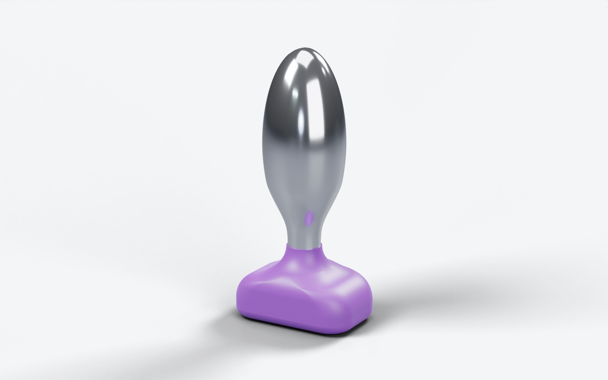

# Buttplug Compass

[Read the illustrated engineering and assembly docs](https://researchanddesire.github.io/buttplug/)

For AJ and other collaborators: start with [the checkpoint handoff](COLLABORATION.md).
It distinguishes the saved threaded-stub CAD from unresolved locking/tooling choices.

Compass is a smart plug and charging dock. The device is a turned stainless
steel body and nose cap with a cast silicone flange. One 52 × 20 mm board in the
flange carries the ESP32-C3, charger, motor driver, temperature sensing and
compass. A protected LiPo and the vibration motor sit in the bulb. The clamshell
dock charges it through four contacts, connects it to a computer over USB, and
has a screen, three buttons and UV-C LEDs.

**Status:** EVT1 design in CAD and KiCad. The current device and dock still
need assembly and bench commissioning. See [Project status](developer-docs/docs/status.md).

| Start here | |
| --- | --- |
| How the device works | [developer-docs/docs/device.md](developer-docs/docs/device.md) |
| Step-by-step assembly | [assembly-docs/assembly-guide.md](assembly-docs/assembly-guide.md) |
| Metal part drawings | [developer-docs/docs/drawings.md](developer-docs/docs/drawings.md) |
| Charging dock | [developer-docs/docs/charging-dock.md](developer-docs/docs/charging-dock.md) |
| Device CAD (FreeCAD scripts, STEP) | [hardware/pcb/evt1/one-board/mech/](https://github.com/researchanddesire/buttplug/blob/backplane/trial/hardware/pcb/evt1/one-board/mech/README.md) |
| Device board (KiCad) | [hardware/pcb/evt1/one-board/](https://github.com/researchanddesire/buttplug/blob/backplane/trial/hardware/pcb/evt1/one-board/README.md) |
| Dock CAD | [hardware/cad/evt1-assembly/evt1-wired/](https://github.com/researchanddesire/buttplug/blob/backplane/trial/hardware/cad/evt1-assembly/evt1-wired/README.md) |
| Firmware | [developer-docs/docs/firmware.md](developer-docs/docs/firmware.md) |
| Requirements | [developer-docs/docs/prd.md](developer-docs/docs/prd.md) |
| Human-owned BOM | [hardware/bom.csv](hardware/bom.csv) |

Use Git history and [archived studies](developer-docs/docs/archive/index.md)
for earlier work.
The docs build automatically when changes land on `main`. See [developer site setup](developer-docs/README.md).

Forked from [researchanddesire/rad-project-template](https://github.com/researchanddesire/rad-project-template).
Repository: `researchanddesire/buttplug`; the local folder keeps its earlier name.
Product release and license selection remain pending. See [LICENSE](LICENSE).
