# Assembly guide

Proposed trial sequence for the compact device and the wired integration dock.
Click an illustration for the full-size CAD view. Part numbers match the
[exploded view](../developer-docs/docs/device.md).

[Device assembly](#device-assembly) · [Dock assembly](#dock-assembly)

!!! danger "Build the first one without a battery"
    Do the first assembly with a dummy battery and no power, to check fits and
    the order of the steps. Connect a real battery only after the board has
    passed its bench checks, and always connect it last.

## Before you start

### Tools

| Tool | Used for |
| --- | --- |
| Two-jaw driver for the 24 AF thin nut | Tightening the rear nut (step 1) |
| Screwdrivers for M1.4 and M2 screws | Board, guide and cover screws |
| Soldering iron, fine tip | Contact targets, wire splices |
| JST SH crimp tool | Motor and tip-sensor plugs |
| Multimeter | Checking every plug before it is connected |
| Ø5.4 mm reamer | Only if a button plunger binds in its bore |
| Thread locker, Loctite 243 (candidate) | Rear nut |
| Potting compound | Tip sensor (not yet chosen) |
| Silicone, primer and the skin mould | Step 9 (not yet chosen) |
| ESD mat and wrist strap | Handling the board |

### Prepare the parts

- **Metal parts:** check both threads with gauges and remove burrs. Keep the
  O-ring groove, the two closure faces and the Ø19.5 mm bond land clean.
- **Printed parts:** remove powder from the tray, cover, plungers, cradle and
  guide. Check that each plunger slides freely in its cover bore.
- **Board:** check the fab fitted every SMT part, then solder the four contact
  targets CT1 to CT4 with their shoulders flat on the board and no flux on
  their faces. Leave JP1 open for now (charging disabled).
- **Pigtails:** crimp the motor pigtail (2 × 28 AWG) and the tip-sensor pigtail
  (2 × 32 AWG) into JST SHR-02V-S housings and splice them to the parts' leads.
  Recipes are in `hardware/cables/evt1/one-board/`.

## Device assembly

### Step 1: Fit the flange tray and the rear nut

[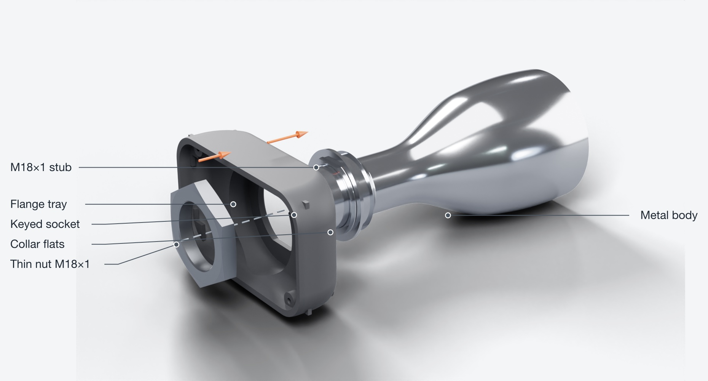](assets/assembly/step01-tray-nut.jpg)

**You need:** metal body (1), flange tray (2), thin nut (3), Loctite 243,
two-jaw driver.

1. Slide the tray onto the body's rear stub, with its open cavity facing away
   from the body. Turn it until the two collar flats drop into the keyed socket.
2. Screw the thin nut onto the stub and trial the two-jaw driver on the flats.
   The nut clamps the tray’s root wall against the steel shoulder.

!!! note "Trial note"
    Check driver access with the flange empty, then check that the module and
    leads can still feed through. If they must go in first, check driver clearance
    with the leads in place. Qualify the torque and candidate Loctite 243 process
    before final fastening.

### Step 2: Build the nose cap

[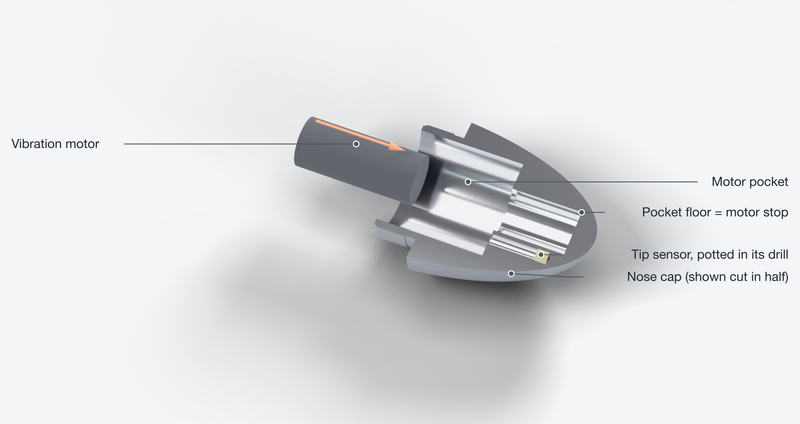](assets/assembly/step02-cap.jpg)

**You need:** nose cap (4), motor (5), tip sensor with its pigtail, potting
compound.

1. Check the actual motor fit in the Ø11.1 mm pocket. Seat it on the metal
   floor, which stops it axially.
2. Pot the tip thermistor into the small offset hole beside the pocket. Keep
   its leads beside the motor, not across the motor's end.
3. Let the potting cure. Check the sensor with the multimeter: about 10 kΩ at
   room temperature.

### Step 3: Build the battery module

[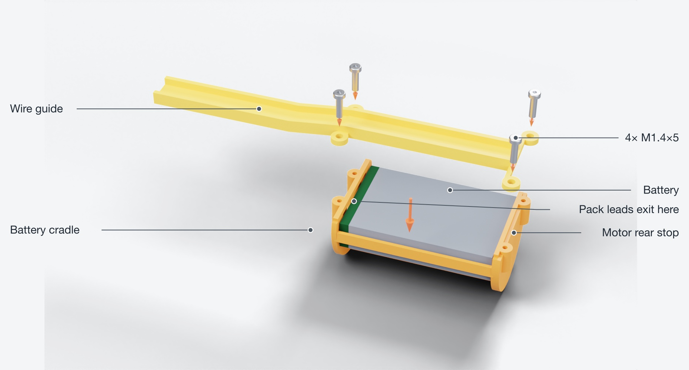](assets/assembly/step03-battery-module.jpg)

**You need:** dummy battery (6), cradle (7), two soft pads, wire guide (8), four
M1.4 × 5 screws (9).

1. Put the two soft pads in the cradle and drop the battery in from the top,
   with its leads at the neck end.
2. Optional: loop soft bands through the slots to hold the battery down.
3. Screw the wire guide on top with the four screws.
4. Run the battery's three leads under the guide, toward the neck.

### Step 4: Put the module in the body and fit the O-ring

[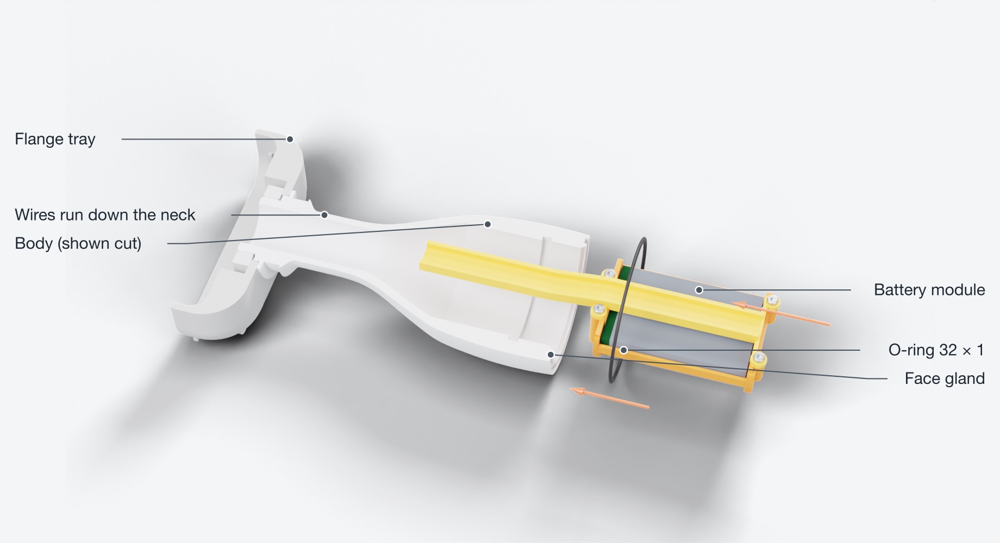](assets/assembly/step04-module-into-body.jpg)

**You need:** the body from step 1, the module from step 3, the O-ring (10).

1. Feed the battery leads down the neck bore so they come out in the flange.
2. Slide the module into the body through the nose, neck end first, until it
   seats in the narrowing bore.
3. Lay the motor and sensor wires from the cap in the guide's trough and feed
   their ends down the neck. Leave them loose.
4. Seat the O-ring dry in the groove on the body's front face.

### Step 5: Close the nose

[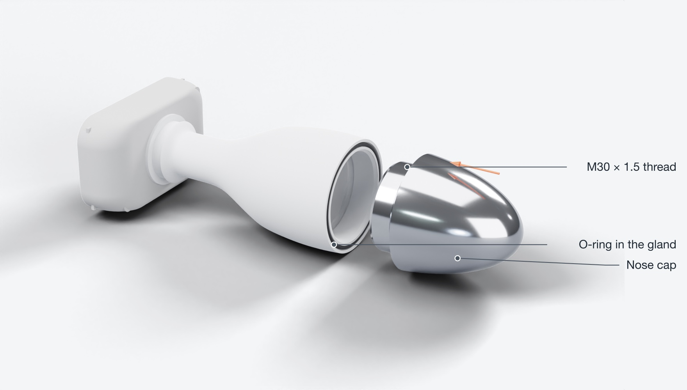](assets/assembly/step05-close-cap.jpg)

**You need:** the cap from step 2.

1. In the inert trial, turn the cap slowly with the wire ends free in the
   flange. Watch the motor and sensor leads at the guide as the cap rotates.
2. Stop if leads pull tight, bind or pinch. Find a routing order that lets the
   shoulders close while keeping slack at both ends.
3. Check for full shoulder contact and inspect the leads before plugging them
   into the board.

The sampled CAD sweep covered rigid parts. It excluded the flexible leads
and cap thermistor. Record the sequence that works with the actual harness.

### Step 6: Build the cover and the board

[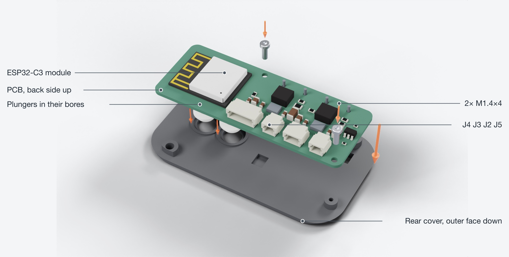](assets/assembly/step06-cover-pcb.jpg)

**You need:** rear cover (12), two button plungers (11), the board (13), two
M1.4 × 4 screws (14).

1. Lay the cover outer face down. Drop a plunger into each bore from the
   inside, flange down into its counterbore.
2. Lower the board onto the cover's two bosses, back side up (ESP32 module
   and plugs facing you). The contact targets go through the four square
   openings, and the switches sit on the plungers.
3. Fit the two M1.4 × 4 screws through the board into the bosses.
4. Press each plunger from outside: you should feel a click from each switch.

### Step 7: Connect the plugs

[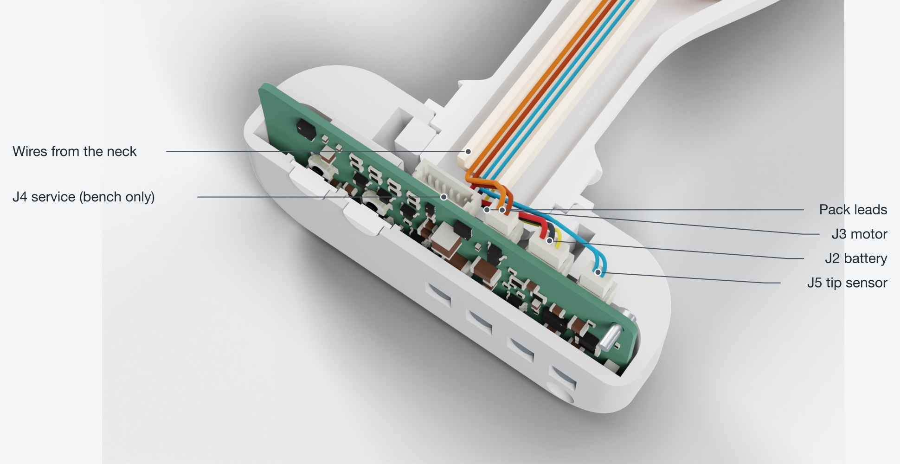](assets/assembly/step07-connect.jpg)

**You need:** the body assembly and the cover assembly, side by side.

1. Dress the leads from the cap without pulling them tight. Plug the motor
   into J3 and the tip sensor into J5.
2. Use a dummy J2 plug for the unpowered trial. The factory battery pinout is
   **1 P+, 2 protected P−, 3 NTC**. Check it before any later live connection.
3. Keep JP1 open for initial bring-up. Use a current-limited supply and pack
   simulator at the open flange. J4 is bench access and carries no power.

### Step 8: Close the flange

[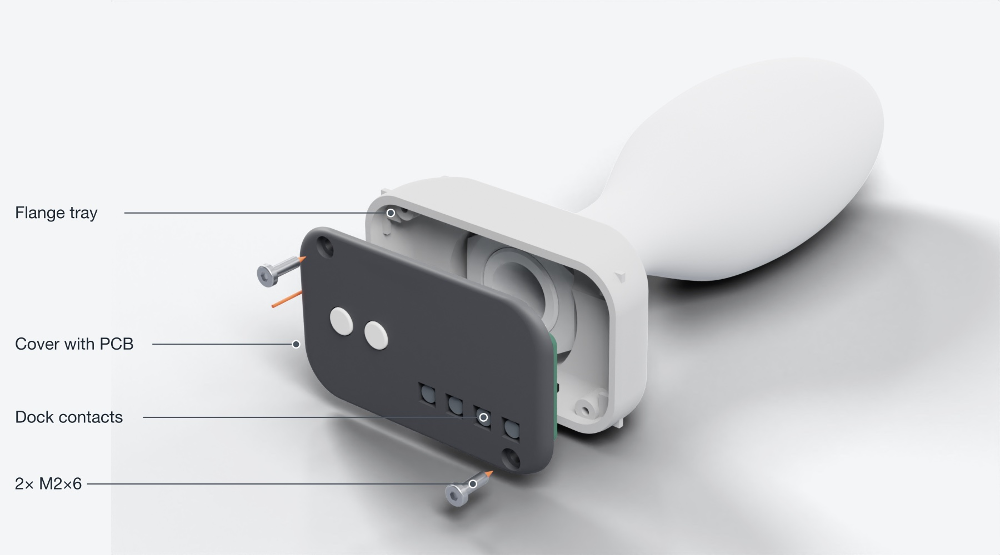](assets/assembly/step08-close-flange.jpg)

**You need:** two M2 × 6 screws (15).

1. Fold the wires into the rounded trough along the tray's long side.
2. Lower the cover onto the tray. Check that no wire is caught at the edge.
3. Trial the two M2 × 6 screws and check engagement. They close the flange halves.
4. Press both buttons and check the four contacts are clean and sit just
   below the cover face.

### Step 9: Cast the skin

[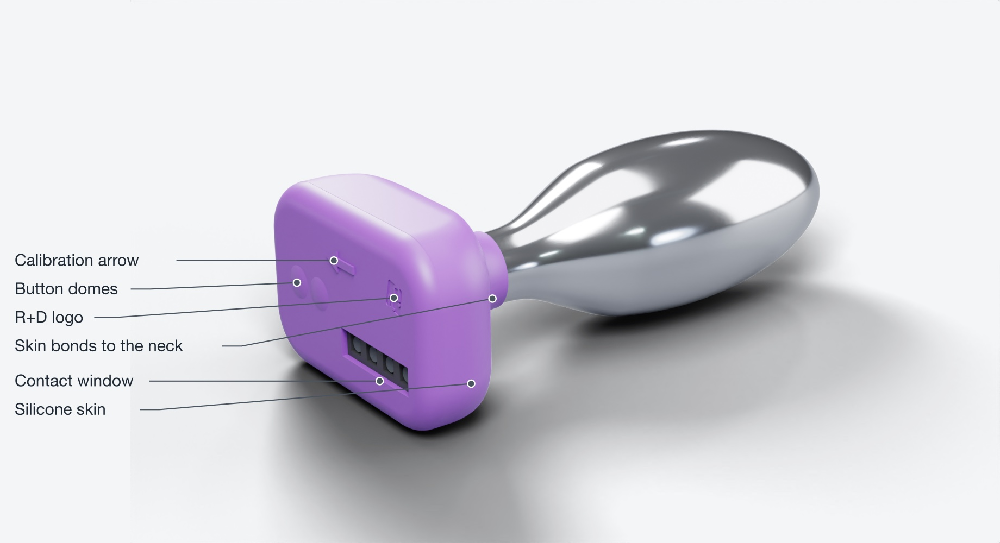](assets/assembly/step09-skin.jpg)

**You need:** silicone, primer, the skin mould, a mask for the contacts.

1. Finish open-flange electrical checks on the separate bench build before
   committing to casting. Check the tip sensor and USB, then verify charge
   permission and TS behavior with a simulator. The shared pack NTC requires
   new firmware before its reading can be used.
2. On an inert assembly, trial neck bond preparation and contact-face masking.
   Keep primer clear of the button bores and inspect for silicone intrusion.
3. Close both halves, then trial one continuous casting over the flange and
   neck root. After demolding, inspect flash, button movement and the bond.

!!! note "Not yet developed"
    The silicone grade, primer, mould and contact mask for this device are not
    chosen. Develop the casting on an inert assembly first. Opening a finished
    device later means cutting the skin off and casting a new one.

### Inspect the trial build

Check both buttons through the skin, then inspect the neck bond and seals.
Use the matching bench or direct-PC fixture for enumeration and recovery.
The wired dock needs a compact seat and contact head before it can be used for
those tests. Use the [firmware and calibration instructions](../developer-docs/docs/firmware.md)
on the powered bench build.

## Dock assembly

These steps illustrate the wired integration dock. Fit the base from the bottom
up because each layer covers the one below it. The compact magnetic dock is a
separate concept. See [Charging dock](../developer-docs/docs/charging-dock.md#compact-fit-studies).

### Step D1: Fit the Main board

[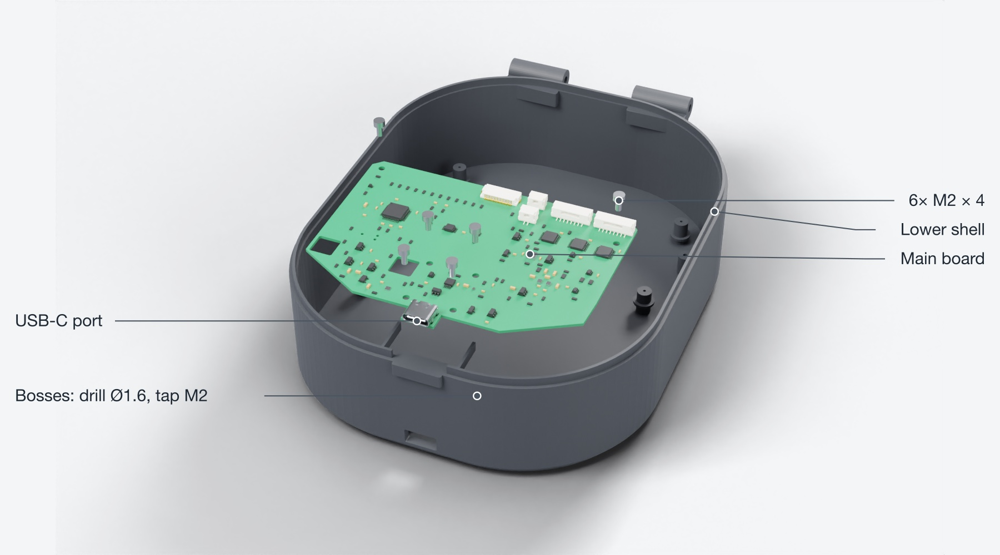](assets/assembly/dock-d1.jpg)

**You need:** lower shell, Main board, six M2 × 4 screws (NBK SNSS-M2-4).

1. Drill the six printed pilot holes in the shell's bosses to Ø1.6 mm and tap
   them M2, using the board as a guide.
2. Set Main on the bosses with its USB-C port in the opening in the front wall.
3. Fit the six screws.

### Step D2: Fit the contact head

[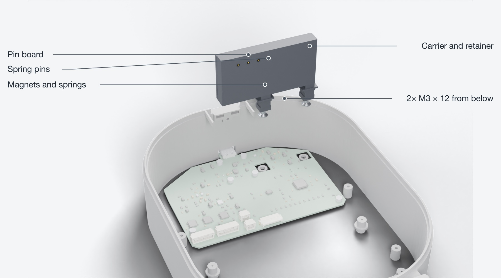](assets/assembly/dock-d2.jpg)

**You need:** contact carrier and retainer, four spring pins (Mill-Max 0906),
two magnets and their springs, the pin board, two M2 × 6 screws, two M3 × 12
countersunk screws.

1. Put the four spring pins, the two magnets and their springs into the carrier.
2. Preterminate the four J94 leads while the pin-board pads are accessible.
   Fit the pin board and retainer, then secure the retainer with two M2 × 6 screws.
3. Stand the carrier at the front of the shell and screw it down from under the
   shell floor with the two M3 × 12 countersunk screws.

### Step D3: Fit the base UV module

[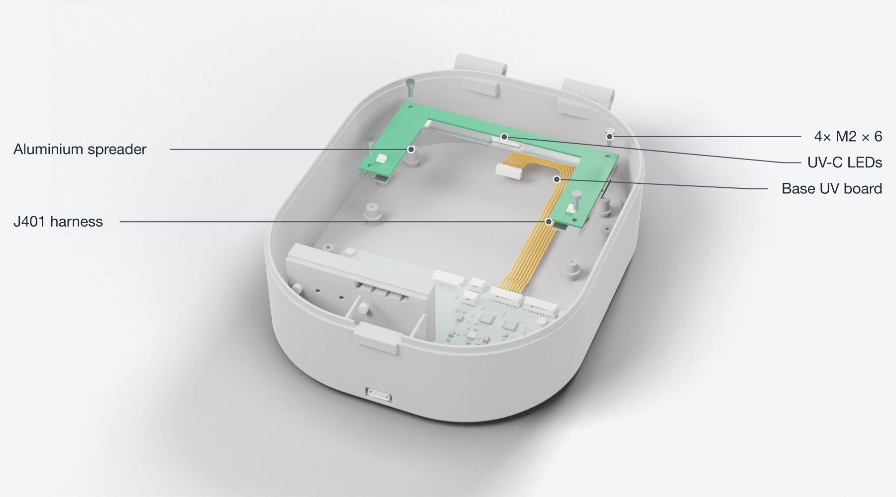](assets/assembly/dock-d3.jpg)

**You need:** base UV board, aluminium spreader with its insulators, thermostat
and pressure bar, NTC and clip, four M2 × 6 screws, the 8-wire UV harness.

1. Build the thermal module: insulator pads on the spreader, thermostat under
   its pressure bar, NTC in its clip.
2. Screw the UV board and spreader onto the four bosses behind Main.
3. Plug the 8-wire harness into J401 on the UV board and J621 on Main.
4. Plug the two Hall looms into J630 and J650 on Main and leave their other
   ends loose. (These two connectors are planned but not yet on the Main board.)

!!! warning "Keep the UV LEDs disconnected"
    Leave the UV harness unplugged at Main whenever the dock is powered open.
    UV-C light is harmful to eyes and skin.

### Step D4: Fit the lower liner

[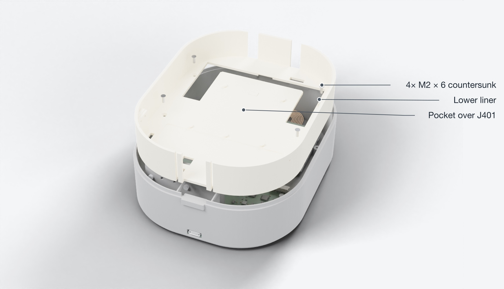](assets/assembly/dock-d4.jpg)

**You need:** lower liner, four M2 × 6 countersunk screws.

1. Thread the three loose Hall wires on each side up through the liner's side
   openings.
2. Lower the liner into the shell. The pocket in its floor clears the J401 plug.
3. Fit the four screws through the liner floor.

### Step D5: Wire the contact head

[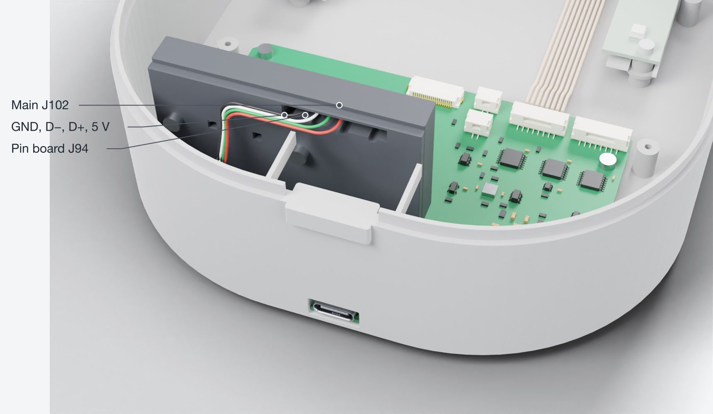](assets/assembly/dock-d5.jpg)

**You need:** four 28 AWG wires, 150 mm (Accu-Glass 100690).

1. Dress the preterminated J94 leads and solder the Main J102 ends: pin 1 GND,
   2 D−, 3 D+, 4 5 V. The illustration hides the liner so you can see the path.
2. Mark each wire at both ends and check continuity and that no two are shorted.

These wires stop the liner lifting, so unsolder them before removing it later.

### Step D6: Fit the lid sensors

[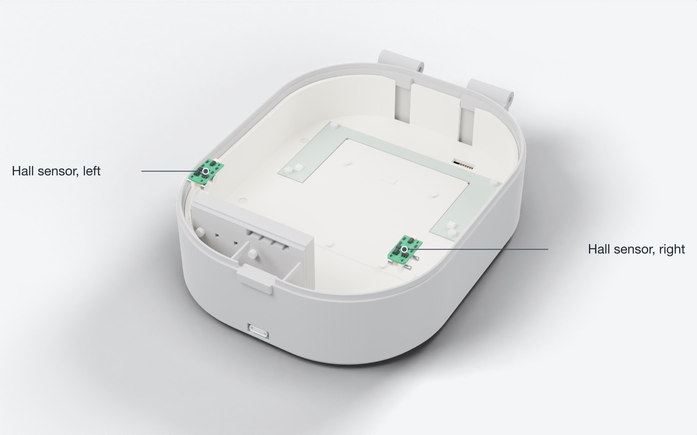](assets/assembly/dock-d6.jpg)

**You need:** two Hall boards, two brackets, four PEEK spacers, four M2 × 8
screws (NBK SPE-M2-8-C).

1. Slide each Hall board, components up, under the lip of its bracket.
2. Screw each bracket into its seat in the liner with two screws and spacers.
3. Solder the three loose wires from Main to each Hall board.
4. Fit the front latch: two magnets in the lower latch plug, held by its
   M2 × 6 screw. Stick the seat pads on the chamber floor.

### Step D7: Fit the bezel and buttons to the lid

[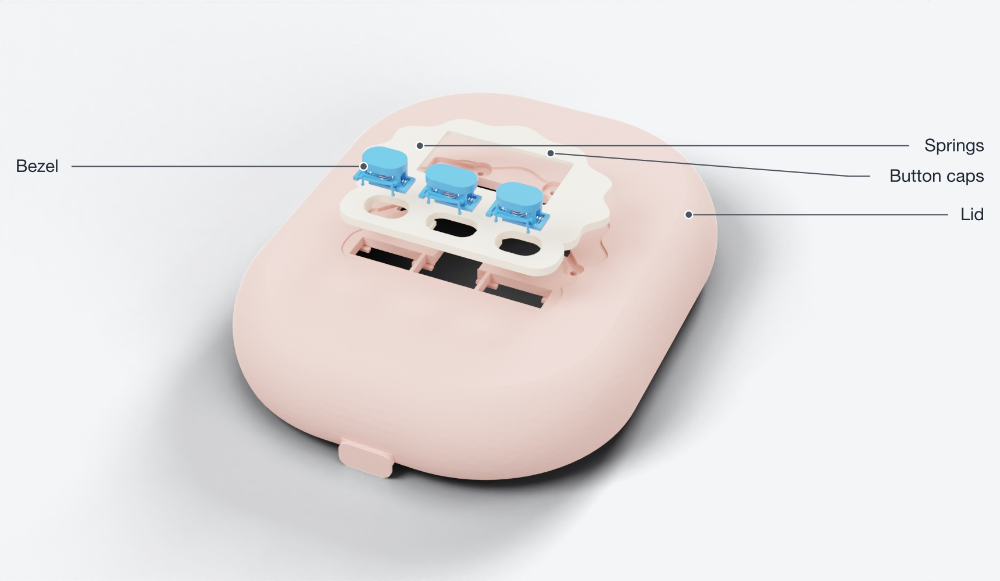](assets/assembly/dock-d7.jpg)

**You need:** upper shell (lid), bezel, three button caps and springs, four
M2 × 6 screws.

1. Put the three button caps and their springs through the bezel.
2. Set the bezel on the lid and screw it on from inside the lid.

### Step D8: Fit the screen, UI board and lid UV module

[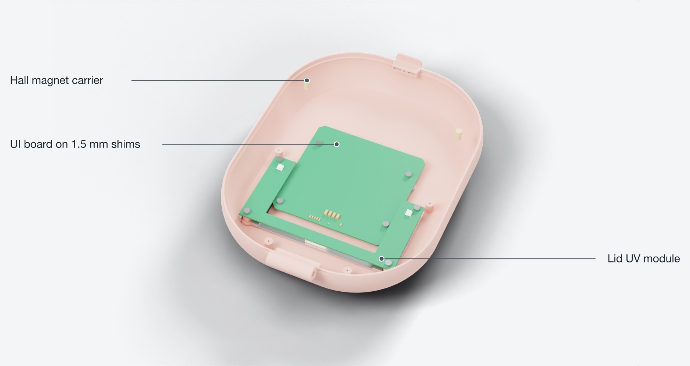](assets/assembly/dock-d8.jpg)

**You need:** LCD with its retention carriers and foam, UI board, four
1.5 mm shims, four M2 × 6 screws, two lid magnets in their carriers, lid UV
board and spreader with four M2 × 6 screws, upper liner with four M2 × 6
countersunk screws.

1. Seat the LCD in the bezel on its foam and retention carriers.
2. Fold the LCD's ribbon into J302 on the UI board, then screw the UI board in
   on the four shims.
3. Fit the two Hall magnets in their carriers at the lid's front corners.
4. Build and fit the lid UV module the same way as the base one.
5. Screw the upper liner into the lid, and fit the upper latch plug with its
   two magnets and M2 × 8 screw.

### Step D9: Join the halves

[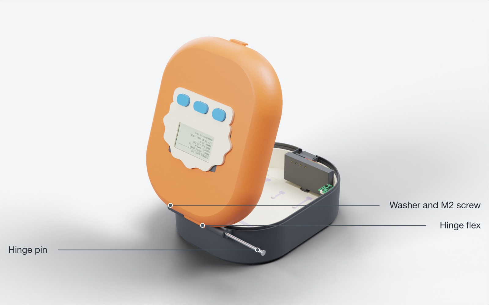](assets/assembly/dock-d9.jpg)

**You need:** the 20-way hinge flex, hinge pin, M2 washer, M2 × 4 screw.

1. Plug the hinge flex into J201 on Main and J301 on the UI board, through the
   liner passages.
2. Dry-fit a dummy J622–J501 lead bundle. The proposed fixed legs hit both
   saved liners and cross the J401 trunk. Resolve the passages and retention
   before installing a live harness.
3. Line up the lid's hinge eyes with the base, push the pin through, and fit
   the washer and screw on the end of the pin. The lid must swing freely.

!!! note "Trial note"
    The route for the lid UV harness through the hinge is not finished in the
    CAD, and the hinge flex has not been bend-tested. Open and close the lid
    slowly and watch both cables on the first build.

### Commission the dock

With the UV harnesses unplugged:

1. Verify stable USB-C power and the startup screen `COMPASS DOCK EVT`.
2. Use a bench USB fixture to check PC enumeration, deliberate local handoff
   and the hardware PC lock. Check tip telemetry clears on disconnect.
3. With dummy loads, verify both lid channels, thermal permits and fault
   shutdown. Keep the emitters isolated until the independent hardware
   cutoffs and power budget pass. Run leakage, heat and optical tests only
   in the qualified closed fixture. See the [dock firmware guide](../developer-docs/docs/firmware.md).
