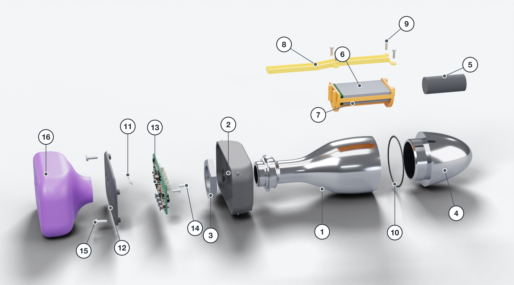

# Assembly documentation

The [assembly guide](assembly-guide.md) builds the compact Compass device and its
wired charging dock step by step, with an image for every step.

- [Assembly guide](assembly-guide.md): tools, part preparation, device steps 1 to 10, dock steps D1 to D9.
- [PCB overview](pcb-overview.md): the boards and their KiCad sources.
- [Cable harnesses](cable-harnesses.md): pin contracts, wire stock and termination.
- [Bill of materials](bom.md): the human-owned product BOM, plus tools and shop supplies.

Device CAD: `hardware/pcb/evt1/one-board/mech/`. Dock CAD:
`hardware/cad/evt1-assembly/evt1-wired/DockAssembly.FCStd`. The developer site
explains how the parts work: `developer-docs/docs/`.
