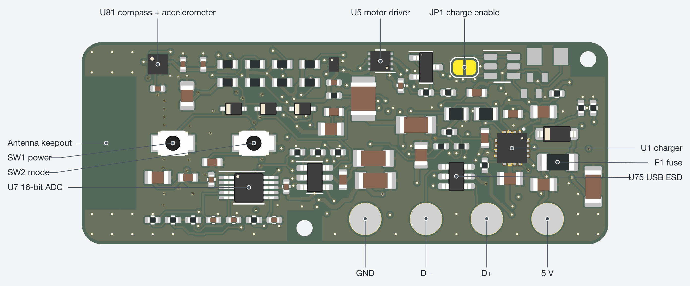
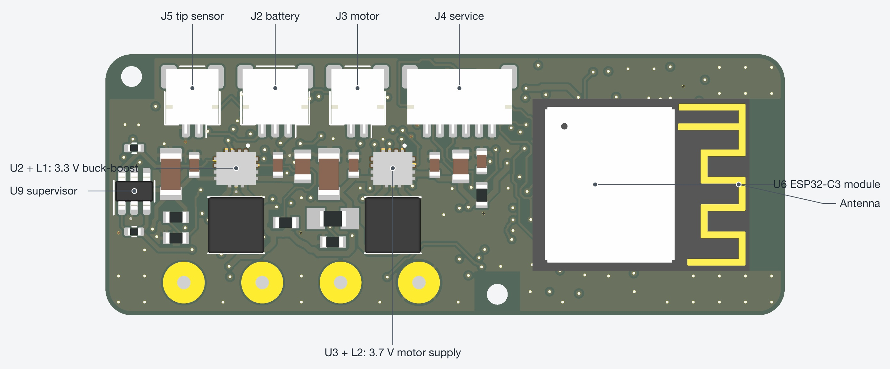

# PCB overview

The [electronics page](../developer-docs/docs/electronics.md) explains the device board, its connectors and pinouts.

| Board | Current source | Assembly role |
| --- | --- | --- |
| Compact device | `hardware/pcb/evt1/one-board/compass-one-board.kicad_pro` | 52×20×1 mm integrated board; mounts to the rear-cover bosses |
| Dock Main | `hardware/pcb/evt1/case-telemetry-study/wired-main/dock-wired-system.kicad_pro` | Source protection, USB host/mux, STM32 UI and UV control; routing remains unfinished |
| Display lid | Linked JST lid source in `hardware/cad/evt1-assembly/evt1-wired/` | LCD/buttons; fixed LCD ribbon plus separate Main-to-lid hinge flex |
| Pin board | Linked contact-board source in the wired dock assembly | Four spring contacts and J94 wire lands |
| Hall heads ×2 | `hardware/pcb/evt1/dock-safety/wired-hall-head/` | Lid closure sensing with independent Main thermal permits |
| UV base/lid | `hardware/pcb/evt1/dock-uv/` | Use the matched wired population and firmware |

Use revision-matched fabrication, assembly and placement files. Older split-board
and larger first-article packages do not describe the compact PCB or its current
pack connection. Detailed file mapping lives in `developer-docs/docs/hardware.md`.

Follow the [assembly guide](assembly-guide.md) for access and installation order,
and [cable harnesses](cable-harnesses.md) for current pin contracts.
