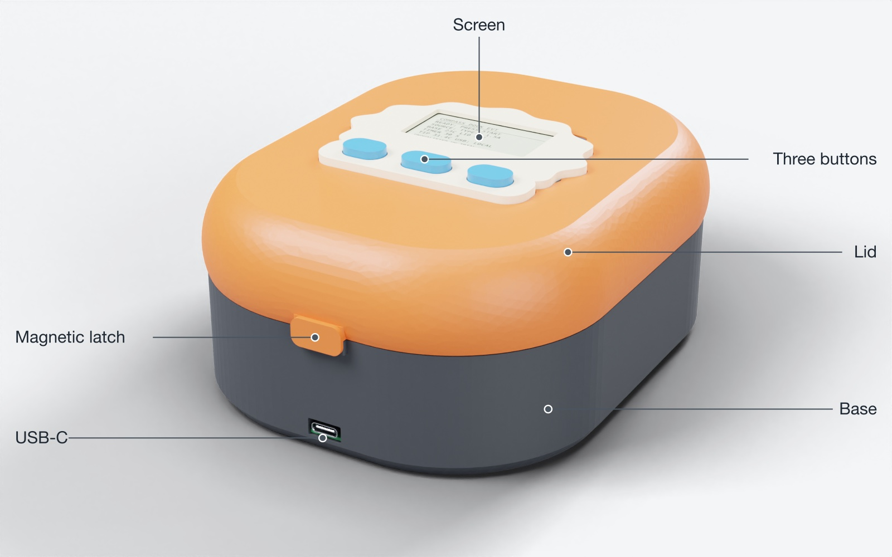
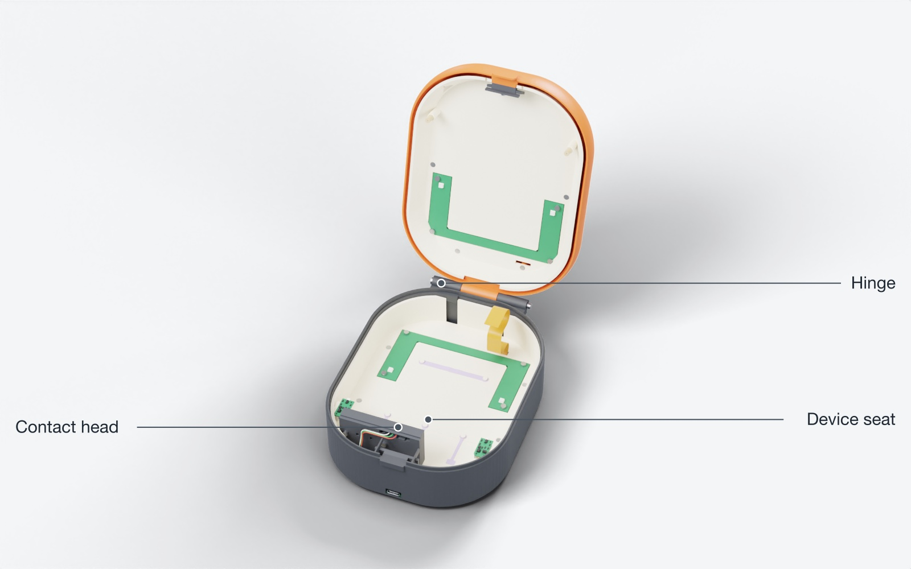
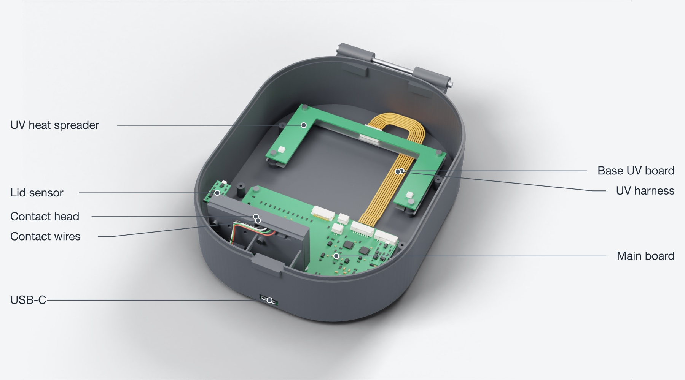
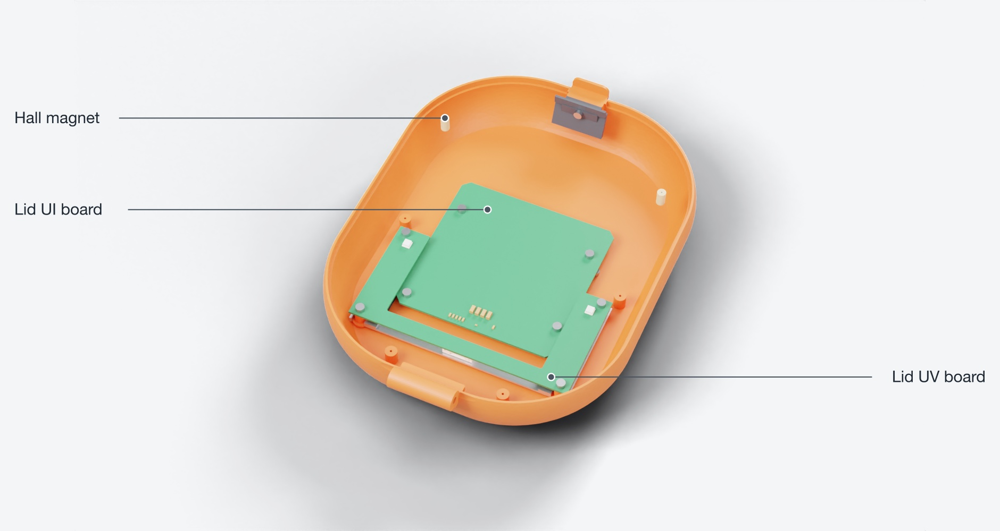
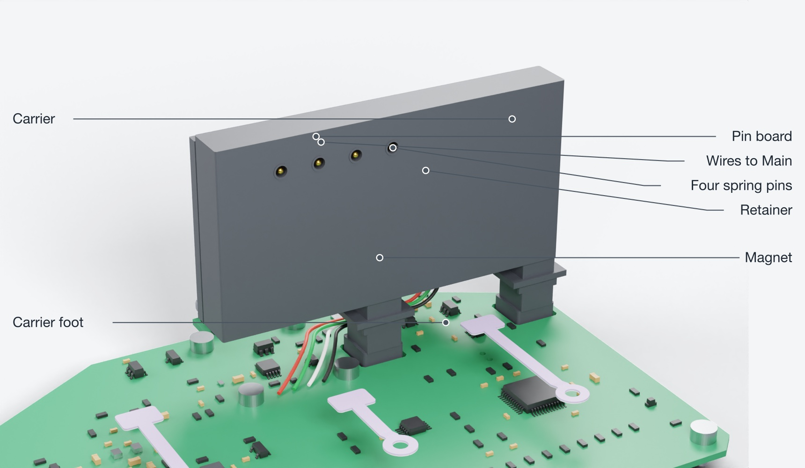
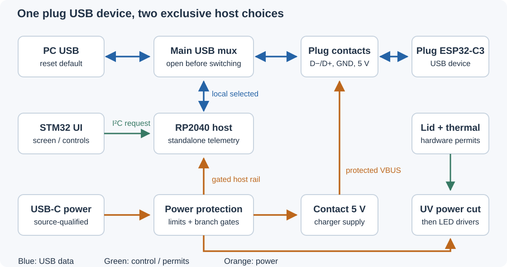
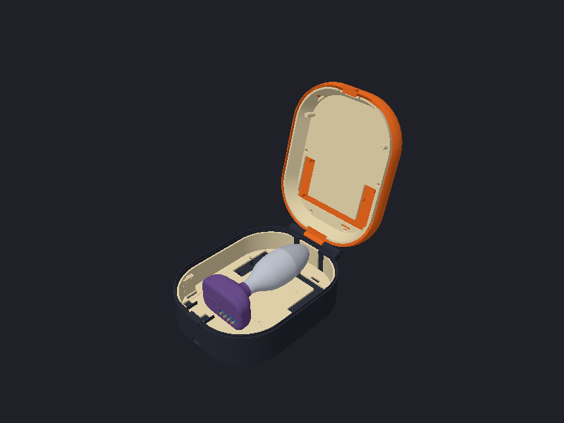
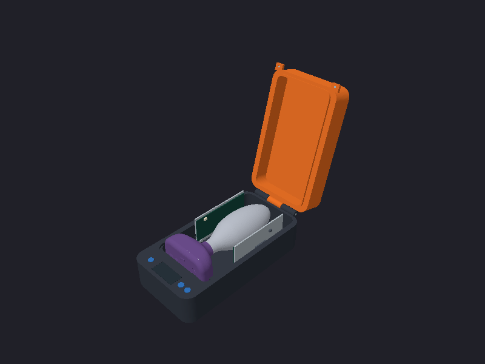
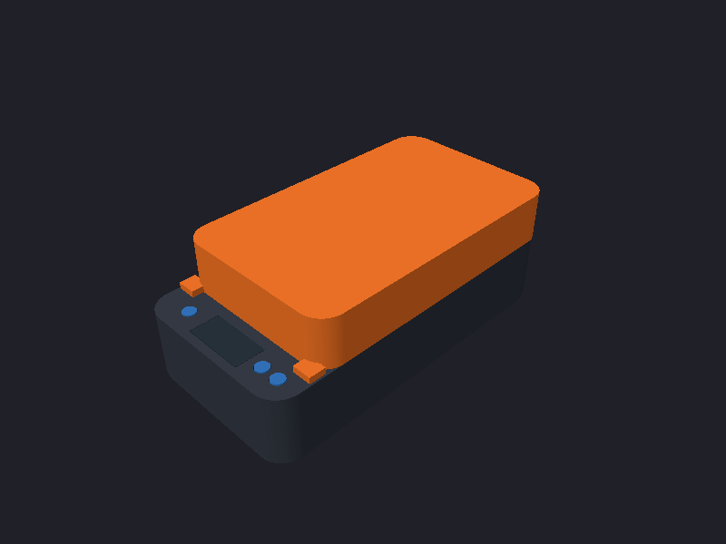

# Charging dock

The dock is a clamshell case that the device lies in. It charges the device,
connects it to a computer over USB, shows temperature and trial-cycle status on a small screen. It is designed for
an enclosed UV-C cycle. Power comes from one USB-C port on the
front. There is no radio in the dock.

*Wired integration dock. The current compact plug needs a different seat and
contact head. See [Compact fit studies](#compact-fit-studies).*

| | |
| --- | --- |
| Size | 137 × 177 × 68 mm closed (73 mm to the button tops) |
| Lid | Rear hinge, opens to 110°, magnetic front latch |
| Shell | MJF PA12: dark lower shell, orange lid, cream liners and bezel, blue buttons |
| Screen | Newhaven NHD-C12864B2Z-RN-FBW, 128 × 64 reflective LCD |
| Controls | Three buttons on the lid: left, centre, right |
| Power | USB-C, 5 V; UV needs a 1.5 A Type-C source |
| Device contacts | Four Mill-Max spring pins: GND, D−, D+, 5 V at 6 mm pitch |
| UV-C | Two LEDs in the floor and two in the lid (Vishay VLMU35CB20-275-120) |

## What is inside

The **base** holds the Main board on six bosses at the front, with the USB-C
port in the front wall. Behind it, the base UV board sits on an aluminium heat
spreader and shines up through an opening in the floor of the cream liner. The
contact head stands at the front of the chamber, and two Hall sensors near the
front corners detect the closed lid.

The **lid** carries the screen and the three buttons on the outside, the lid
UI board under them, and a second UV board on its own heat spreader. Magnets in
the lid trigger the Hall sensors in the base.

| Module | Parts | Job |
| --- | --- | --- |
| Main board | STM32L071, RP2040, FSUSB42 USB switch, TUSB320 Type-C detector, TPS2553 current limits, ADS1115 | Power, USB switching, screen and button control, UV control and monitoring |
| Lid UI board | Three Omron B3FS buttons, LCD socket | Screen and buttons; linked to Main by a 20-way flex through the hinge |
| Contact board | Four Mill-Max 0906 spring pins | Carries the device contacts; wired to Main |
| UV boards (base, lid) | TPS61165 boost driver, two UV-C LEDs, NTC, 45 °C thermostat | UV-C light, each on a 6061 aluminium spreader |
| Hall heads (×2) | DRV5021 Hall switch, TPS3808 supervisor | Lid-closed sensing, one per side |

## Contact head

Four spring pins (Mill-Max 0906-2-15-20-75-14-11-0) stand in a printed carrier
at the front of the chamber, 6 mm apart, in the order GND, D−, D+, 5 V. The wired dock targets 0.6 mm of compression over the pins’ 1.4 mm travel.
Insulating stops on the carrier, not the silicone, set how far the device goes
in. The carrier uses two Ø8 mm magnets and needs matching steel keepers on the device. The pin board is soldered to Main with four wires.

## How it works

### Charging

The USB-C port feeds a Type-C detector and current-limited branches on Main.
One branch supplies protected 5 V to the contact pins; the device's own charger
then charges its battery at about 100 mA. The dock budgets 70 mA for the device
on a default USB port and 630 mA on a qualified Type-C source. The UV cycle
needs a source that advertises 1.5 A.

### USB: PC mode and local mode

The device is always a USB device; its ESP32-C3 talks native USB through the
contacts. A switch on Main connects those two wires to one host at a time:

- **PC mode** (the default at power-up): the computer on the USB-C port talks
  directly to the device, for programming, recovery and logs.
- **Local mode:** the dock's own RP2040 becomes the USB host and reads the
  device's tip temperature for the screen.

To switch, open the lid, make sure no UV cycle is running, and hold **Right**
for 2 seconds. The screen shows `HOLD R: LOCAL USB` or `HOLD R: PC USB`. The
dock opens the data lines before it switches. For recovery, a hardware lock (a
test pad held low while the dock powers up) forces PC mode even if the dock's
firmware is stuck.

### UV-C cycle

Intended controls. Keep emitters isolated until the Hall receivers, hardware
cutoff and bench power checks are complete.

1. Close the lid. Both Hall sensors must see the lid magnets.
2. Choose the time with **Left** or **Right**: 30, 60 or 120 s.
3. Press and release **Centre** to arm. The screen shows `READY: PRESS START`.
4. Press **Centre** again to start. Press it during the cycle to stop.

The cycle stops at the end of the timer, on **Centre**, or on any fault, and it
requires a fresh arm after a stop. The planned hardware enable combines both
Hall lid signals with independent thermal permits. Each UV board has a nominal
45 °C thermostat. The watchdog and latch provide a separate stop path for a
controller fault. The timer is a trial setting: no dose or cleaning result has
been measured, and the screen says `UNQUALIFIED UV TRIAL`.

### Screen and buttons

| Button | Short press | Hold |
| --- | --- | --- |
| Left | Timer down (30 / 60 / 120 s) | Left + Right 2 s: contrast mode |
| Centre | Arm, then start or stop the UV cycle; acknowledge a fault | |
| Right | Timer up | 2 s with the lid open: switch PC / local USB |

The screen shows the cycle state, the USB source (`USB DEFAULT`, `TYPE-C 1.5A`,
`TYPE-C 3A`), the base and lid temperatures, the timer, and in local mode the
device's tip temperature. Faults are shown in words, for example
`NEED 1.5A TYPE-C` or `LID / THERMAL LOOP`. Charge-complete and cooling
states remain future firmware work.

## Wiring between the boards

| From | To | Cable |
| --- | --- | --- |
| Main J102 | Contact board J94 | 4 wires, 28 AWG, soldered (GND, D−, D+, 5 V) |
| Main J201 | Lid UI board J301 | 20-way flex through the hinge |
| Lid UI J302 | LCD | The LCD's own 65 mm ribbon |
| Main J621 | Base UV board J401 | JST GH 8-pin harness |
| Main J622 | Lid UV board J501 | JST GH 8-pin harness |
| Main J630, J650 | Hall heads | JST GH 3-pin looms, one per side |

Harness recipes and wire stock are in `hardware/cables/evt1/dock-main/`. The
step-by-step build is in the [Assembly guide](assembly-guide.md#dock-assembly).

## Compact fit studies

**Retrofit the wired shell.** The compact flange hits the original seat and
liner. Forcing the contacts into alignment also hits the lid and carrier.
A revised pose raises the plug 1.5 mm and shifts the pin row. It clears the
retained closed case at 0.6 mm nominal pin compression after removing the
original carrier, retainer and seat. This gives the replacement hardware a
target location. See `mech/compact-dock-fit.json`.

**Compact magnetic dock concept.** This separate 84 × 171.3 × 58 mm case uses
an integral nest, a base-mounted screen and controls, and two fixed side UV
rails. The modeled plug clears the closed lid by 1.22 mm. The contact head,
rail PCBs, heat paths and cutoff still need integration. See
`mech/compact-magnetic-dock-fit.json` and the [flush contact section](seals.md#6-contact-window).

## Status

The assembly instructions cover the wired integration dock. Its Main board
has 13 opens in the saved routing report. Complete Main and the Hall receiver
integration, resolve the moving UV wiring through the hinge, then verify the
hardware cutoff, leakage and thermal response. See [Project status](status.md#charging-dock).

Sources: `hardware/cad/evt1-assembly/evt1-wired/DockAssembly.FCStd` (CAD),
`hardware/pcb/evt1/case-telemetry-study/wired-main/` (Main board),
`dock-firmware/` (firmware).
