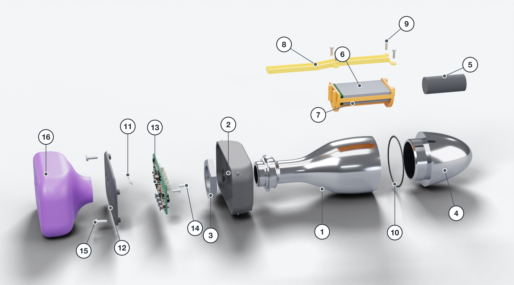
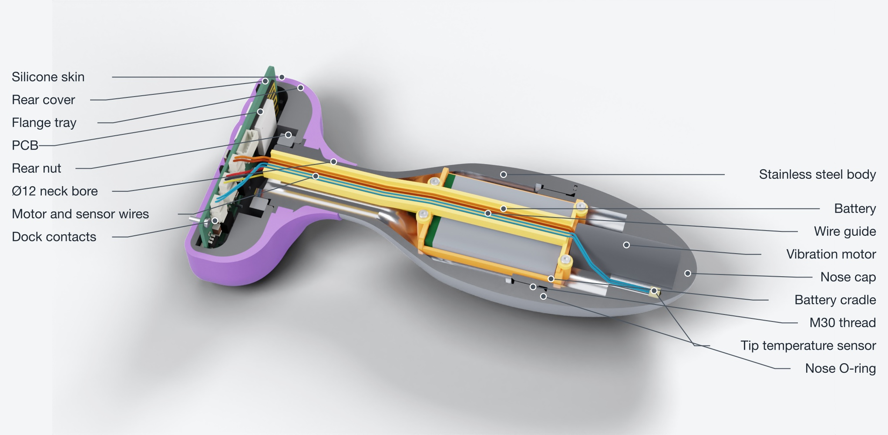
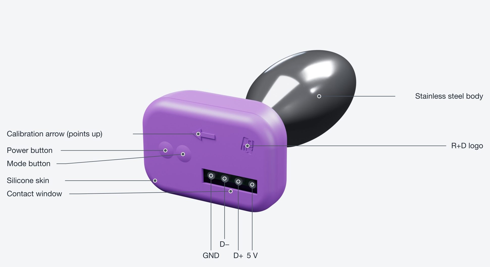

# How the device works

The device has three zones. The **bulb** is turned stainless steel and holds
the battery and the motor. The **neck** is a Ø15 mm steel tube that carries the
wires. The **flange** is a small plastic box that holds the circuit board,
wrapped in one piece of cast silicone.

| # | Part | Made from | Qty |
| --- | --- | --- | --- |
| 1 | Metal body: bulb, neck and threaded rear stub | Stainless steel, CNC turned | 1 |
| 2 | Flange tray | PA12, MJF printed | 1 |
| 3 | Thin nut M18×1, 24 AF × 4 mm (ifm E10028) | Stainless 316Ti | 1 |
| 4 | Nose cap with motor pocket and sensor drill | Stainless steel, CNC turned | 1 |
| 5 | Vibration motor NFP-E1015, Ø11 × 26 mm | Bought | 1 |
| 6 | Battery: protected 1S LiPo with NTC and JST SH plug | Bought (BC-PACK-EVT1-002) | 1 |
| 7 | Battery cradle | PA12, MJF printed | 1 |
| 8 | Wire guide | PA12, MJF printed | 1 |
| 9 | Guide screws M1.4 × 5 | Bought; part number not chosen | 4 |
| 10 | Nose O-ring 32 × 1 mm | Silicone, 70 Shore A (candidate) | 1 |
| 11 | Button plungers | PA12, MJF printed | 2 |
| 12 | Rear cover | PA12, MJF printed | 1 |
| 13 | Circuit board, 52 × 20 mm | 4-layer, 1.0 mm, ENIG | 1 |
| 14 | Board screws M1.4 × 4 | Bought; part number not chosen | 2 |
| 15 | Cover screws M2 × 6 | Bought; part number not chosen | 2 |
| 16 | Skin | Silicone, cast over the closed flange | 1 |

Not numbered: the tip temperature sensor (TDK B57540G1103F000) potted in the
nose cap, the four contact targets on the board, two soft pads under the battery,
and seven wires. The [Bill of materials](https://github.com/researchanddesire/buttplug/blob/main/assembly-docs/bom.md)
lives with the assembly docs.

## Inside

*The enclosure is cut in half to show the parts inside; the board, battery
module and wires are shown whole.*

**The battery sits in the bulb.** A printed cradle holds the battery on two soft
pads and slides into the body through the nose. A removable guide on top of
the cradle keeps the motor and sensor wires away from the battery. The
cradle's front web also stops the motor from moving backwards.

**The motor sits in the nose cap.** It is pushed into a flat-bottomed Ø11.1 mm
pocket and bears directly on steel, so the vibration goes straight into the
shell. The tip temperature sensor is potted into a blind Ø2.5 mm hole beside it.

**Seven wires run through the neck.** Two go to the motor, two to the tip sensor
and three come from the battery (positive, negative and its thermistor). They
end in JST SH plugs on the back of the board.

**All of the electronics are in the flange.** One board carries the charger,
the regulators, the motor driver, the ESP32-C3, the ADC and the compass. Its
front faces the dock: the two buttons and the four contact targets are on that
side. The board is screwed to the rear cover, and the cover closes onto the tray.

## The two joints

**Nose:** the cap threads into the body (M30 × 1.5) until the two steel
shoulders meet. A 32 × 1 mm O-ring sits in a face groove in the body and is
squeezed 22 % when the shoulders touch. The thread carries the load; the O-ring
does the sealing. See [Seals](seals.md).

**Neck to flange:** the body ends in a short M18 × 1 stub with a Ø20 mm collar.
The collar has two flats that key into a matching socket in the flange tray, so
the flange cannot rotate on the body. A thin nut on the stub clamps the tray's
2 mm root wall against the body's Ø24 mm shoulder.

## The dock face

The flange's outer face is what sits against the dock. The four contact targets
(GND, D−, D+, 5 V at 6 mm pitch) mate to spring pins in the proposed compact
dock. The wired integration dock needs a revised seat and contact head.
The two buttons are rigid plungers under the silicone: you press the skin, the
plunger slides in the cover and clicks the switch on the board. The raised
arrow points to the button end and marks "up" for compass calibration.

## Why it is built this way

- **One board, in the flange.** Putting every circuit on one board removes the
  board-to-board connectors and the thick wire loom the earlier two-board design
  needed in the neck. Only seven thin wires go through the neck.
- **Battery in the bulb.** The bulb is the largest volume, so the flange stays
  thin (about 20 mm including the skin) and the battery can be larger.
- **Steel where it touches the body.** The bulb, neck and nose are stainless
  steel; only the flange is plastic, and it is covered by silicone.
- **The shoulder carries the body load.** The motor sits on a steel stop,
  the flange clamps to the body shoulder, and the cover screws close the
  plastic. The proposed flush contacts bear on the cover to carry pin loads.
- **One continuous skin.** Casting over the closed flange covers the plastic
  seam and screw heads. The bond to the steel neck and the four contact
  feedthroughs still need sealing trials.

Detailed part descriptions are in [Mechanical design](mechanical.md); dimensions
of the metal parts are in [Engineering drawings](drawings.md).
