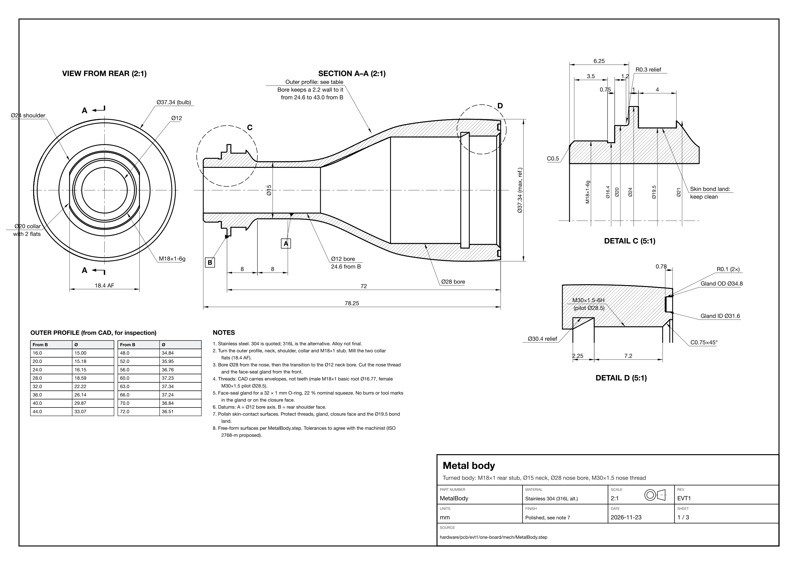
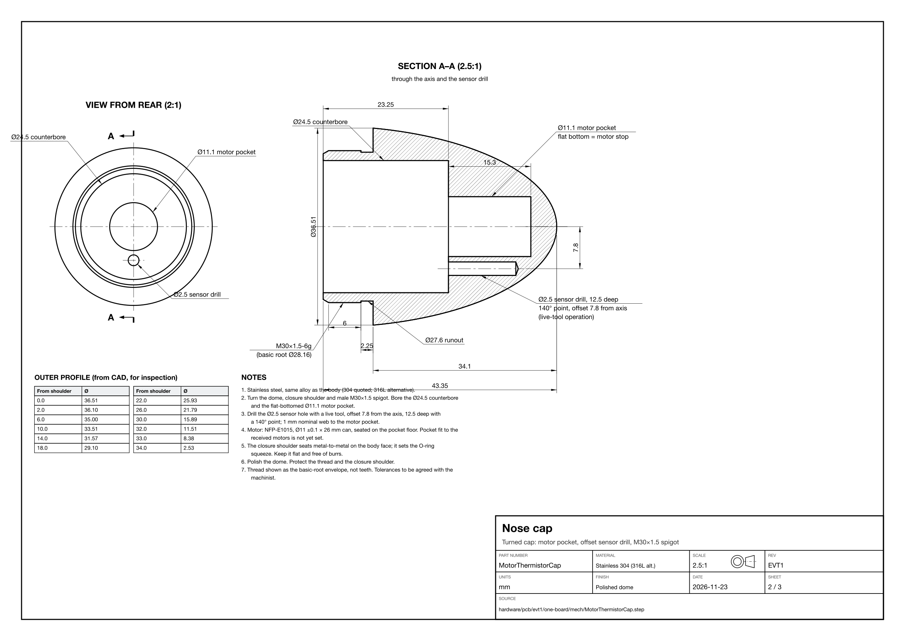
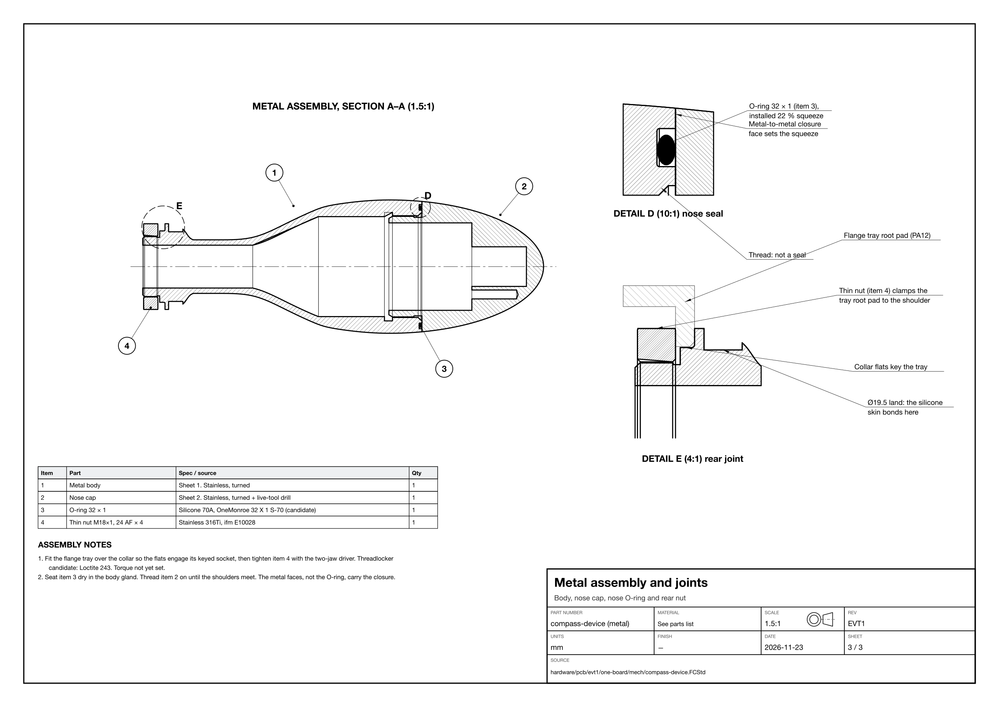

# Engineering drawings

Drawings of the two turned stainless parts and how they go together. Each sheet
is generated from the STEP files in `hardware/pcb/evt1/one-board/mech/`, so the
dimensions are the CAD values. The STEP file is the master for the free-form
outer surfaces; the drawings give the turned features, threads, seal groove and
datums, plus a profile table for inspection.

Third-angle projection. Dimensions in millimetres. Click a sheet for the
full-size image, or download the PDF or SVG.

## Metal body

Sheet 1 of 3: section through the axis, rear view with the collar flats, detail
C (rear stub, collar, shoulder and skin-bond land) and detail D (nose thread and
O-ring groove). Datum A is the Ø12 bore axis and datum B the rear shoulder face.

[PDF](assets/drawings/metal-body.pdf) · [SVG](assets/drawings/metal-body.svg) ·
STEP: `mech/MetalBody.step`

## Nose cap

Sheet 2 of 3: section through the axis and the sensor hole, and a rear view
showing the motor pocket and the hole's 7.8 mm offset.

[PDF](assets/drawings/nose-cap.pdf) · [SVG](assets/drawings/nose-cap.svg) ·
STEP: `mech/MotorThermistorCap.step`

## Metal assembly

Sheet 3 of 3: the body, cap, O-ring and rear nut assembled, with details of the
nose seal and the rear joint, and the parts list.

[PDF](assets/drawings/metal-assembly.pdf) · [SVG](assets/drawings/metal-assembly.svg)

## Notes for the machinist

- **Material:** stainless steel. 304 has been quoted; 316L is the alternative.
  The final alloy is not chosen.
- **Proposed thread fits:** CAD shows the envelope of each thread. Body: M18 × 1-6g
  external at the rear, M30 × 1.5-6H internal at the nose. Cap: M30 × 1.5-6g
  external.
- **Collar flats:** two opposing flats, 18.4 mm across, milled after turning.
- **Sensor hole** in the cap is a live-tool operation: Ø2.5 mm, 12.5 mm cylindrical
  depth plus the 140° point, 7.8 mm off-axis.
- **Finish:** polish the skin-contact surfaces. Protect the threads, the
  O-ring groove, the closure faces and the Ø19.5 mm bond land.
- **Tolerances:** not yet agreed. ISO 2768-m is proposed as the general
  tolerance. The thread fits, groove and closure faces need the machinist's
  review.

## Regenerating the drawings

Run the section extraction and drawing commands in the [figure tools README](https://github.com/researchanddesire/buttplug/blob/main/developer-docs/tools/figures/README.md).
The same section data also draws the diagrams on the [Seals](seals.md) page.
