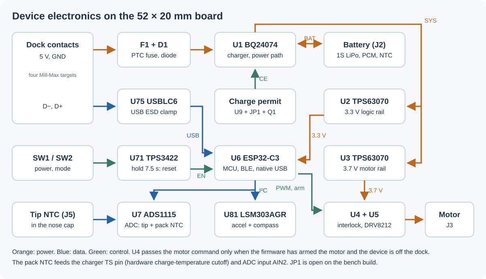

# Electronics

All of the device electronics are on one board: 52 × 20 mm, four layers,
1.0 mm thick, ENIG finish, with parts on both sides. The KiCad project is
`hardware/pcb/evt1/one-board/compass-one-board.kicad_pro`.

*Front (F.Cu). This side faces the dock, behind the rear cover. The buttons and
contact targets come through the cover.*

*Back (B.Cu). This side faces the neck. The plugs from the battery, motor and
tip sensor connect here, along the edge nearest the wire trough.*

## How it works

**Charging.** Dock 5 V comes in through contact CT4, a 500 mA PTC fuse (F1) and
a Schottky diode (D1) to the BQ24074 charger (U1). The charger's power path
feeds the system rail (SYS) from the dock when it is present and from the
battery otherwise. Charge current is set to about 100 mA (R1 = 8.87 kΩ) and
input current to about 500 mA (R2 = 3.24 kΩ).

**Charge permission.** The charger is only enabled when U9 sees a healthy 3.3 V
rail and solder jumper JP1 is closed. JP1 is left open on the first boards, so
the battery cannot charge until you close it on purpose. Independently, the
battery's own thermistor drives the charger's TS pin, which stops charging if
the cell is too hot or too cold.

**Rails.** Two TPS63070 buck-boost converters run from SYS. U2 makes the 3.3 V
logic rail. U3 makes a 3.7 V rail for the motor, and is only switched on when
the firmware arms the motor.

**Motor.** The DRV8212 H-bridge (U5) drives the motor on J3. Its input passes
through a three-input AND gate (U4): PWM from the MCU, the arm signal, and
"not on the dock" from the charger. The motor cannot run on the dock, whatever
the firmware does.

**USB.** The dock contacts carry USB D− and D+ straight to the ESP32-C3's
native USB port, through a USBLC6 ESD clamp (U75). The dock decides whether a
computer or its own USB host is on the other end; see
[Charging dock](charging-dock.md#usb-pc-mode-and-local-mode).

**Sensing.** An ADS1115 16-bit ADC (U7) reads the tip thermistor (on AIN0,
through a 10 kΩ 0.1 % divider) and the battery thermistor (on AIN2). An
LSM303AGR (U81) provides the accelerometer and magnetometer for compass mode.
Both are on I²C.

**Buttons.** SW1 (power) and SW2 (mode) are read by the MCU. Holding SW1 for
7.5 s resets the MCU through U71, in hardware. Holding SW2 while it resets
selects the ESP32-C3 ROM bootloader for USB recovery.

## Connectors

| Ref | Part | Pin 1 | Pin 2 | Pin 3 | Pin 4 | Pin 5 | Pin 6 |
| --- | --- | --- | --- | --- | --- | --- | --- |
| CT1–CT4 | Mill-Max 1946 targets (dock) | GND | D− | D+ | 5 V | | |
| J2 | JST SM03B-SRSS-TB (battery) | P+ | P− (GND) | NTC | | | |
| J3 | JST SM02B-SRSS-TB (motor) | Motor + | Motor − | | | | |
| J5 | JST SM02B-SRSS-TB (tip sensor) | NTC | GND | | | | |
| J4 | JST SM06B-SRSS-TB (bench service) | GND | D− | D+ | EN | BOOT | UART TX |

CT1 to CT4 are listed left to right as seen from the dock, 6 mm apart. J4 is
for bench work with the flange open; it carries no power.

!!! warning "Check every battery plug before you connect it"
    J2 expects pin 1 = P+, pin 2 = P−, pin 3 = NTC. Stock JST SH battery leads
    are not always wired this way. Measure the pack's plug with a meter first.

## Main parts

| Ref | Part | Job |
| --- | --- | --- |
| U6 | ESP32-C3-MINI-1-H4X | MCU, Bluetooth LE, native USB |
| U1 | TI BQ24074 | Single-cell charger with power path |
| U2, U3 | TI TPS63070 + 1.5 µH inductors | 3.3 V logic and 3.7 V motor rails |
| U5 | TI DRV8212 | Motor H-bridge |
| U4 | SN74LVC1G11 | Motor interlock (AND gate) |
| U7 | TI ADS1115 | 16-bit ADC for the two thermistors |
| U81 | ST LSM303AGR | Accelerometer and magnetometer |
| U71 | TI TPS3422 | Long-press hardware reset |
| U9 | TI TPS3808 | Charge-permission supervisor |
| U75 | ST USBLC6-2 | USB ESD protection |
| SW1, SW2 | Omron B3U-1000P | Buttons, under the plungers |
| CT1–CT4 | Mill-Max 1946-0-00-15-00-00-03-0 | Dock contact targets, hand-soldered after SMT |

The ESP32-C3 antenna sits at the end of the board, about 7 mm clear of the nut
in the CAD. Verify the module’s full antenna clearance after resolving the U6
library-footprint mismatch. See [Project status](status.md#device).

## Ordering the board

The fab file is `compass-one-board.fab.json` (4 layers, 1.0 mm, ENIG, green,
1 oz). All SMT parts, J2 included, are fitted by the fab. CT1 to CT4 are
soldered by hand afterwards with their shoulders seated flat. JP1 stays open,
and C12, C22, U8 and R43 to R45 are not fitted.

## Cables

Three short pigtails connect the board to the parts in the bulb. The battery
comes with its own JST SH 3-pin plug. The motor and tip-sensor pigtails are
JST SHR-02V-S housings crimped onto Accu-Glass wire (28 AWG for the motor,
32 AWG for the sensor) and spliced to the part's own leads. WireViz sources,
lengths and stock are in `hardware/cables/evt1/one-board/`.
