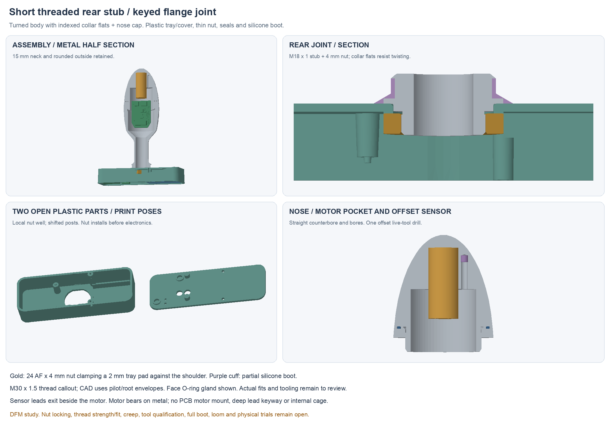

# Hardware

## Open these files

- **Plug CAD.** Open `hardware/cad/manufacturing-layout/ManufacturingLayout.FCStd`
  for the turned body and cap. Open
  `hardware/cad/manufacturing-layout/evt1-integration/contact-module-trial/single-board/SingleFlangeBoardTrial.FCStd`
  for the earlier single-flange and silicone-barrier study. The
  [one-board CAD studies](https://github.com/researchanddesire/buttplug/tree/codex/project-setup/hardware/cad/manufacturing-layout/one-board-evt1)
  cover the bulb pack and the Compact and Master Bench connector fits.
- **Plug PCBs.** Open `hardware/pcb/evt1/one-board/compass-one-board.kicad_pro`
  for the integrated first-article PCB. Open
  `hardware/pcb/evt1/one-board-dev/compass-one-board-dev.kicad_pro` for the
  master bench board with keyed PC/dock selector. The separate body and single-flange projects are source
  references. See [Bulb battery and one-board EVT](one-board.md).
- **Direct PC evaluation.** Use `hardware/cad/evt1-assembly/direct-pc-fixture/`
  and the `hardware/pcb/evt1/direct-pc-contact-adapter/` KiCad project. The
  keyed saddle takes the compact contact row and leaves both buttons open to
  a recovery probe. See the [bench test and ordering guide](https://github.com/researchanddesire/buttplug/blob/codex/project-setup/hardware/design/evt1-bench-ordering/master-bench-eval/README.md).
- **Dock CAD.** Open `hardware/cad/evt1-assembly/evt1-wired/DockAssembly.FCStd`
  in FreeCAD. Keep its `pcb/` and `sources/` folders beside it. This links the
  wired Main StepUp model, recentered contacts and JST display lid.
- **Dock PCBs.** Open
  `hardware/pcb/evt1/case-telemetry-study/wired-main/dock-wired-system.kicad_pro`
  for the wired Main schematic and active PCB. The adjacent
  `dock-wired-transport.kicad_pro` opens the complete interboard circuit. The JST lid source is
  `hardware/pcb/evt1/dock-control/lcd-socket-candidate/dock-lid-jst-candidate.kicad_pro`.
- **Wiring and firmware.** Start with `hardware/cables/evt1/README.md` for the
  WireViz sources. Use `firmware/` for the plug and `dock-firmware/` for the case.

Record design reviews and physical bench results in the Compass doc in R+D
Drive with the Git revision and the specific assembly or board tested.

## Source details

| Area | Source / status |
| --- | --- |
| Active dock assembly | `hardware/cad/evt1-assembly/evt1-wired/DockAssembly.FCStd` integrates the wired Main, recentered carrier, four installed contact wires, JST lid and clamshell. The contact wires clear the closed assembly at nominal dimensions. Trim, strain relief, loading, hinge wiring and physical checks remain open. |
| Product enclosure quote | `hardware/design/evt1-bench-ordering/dock-enclosure/` contains 28 checked STEP files for 33 custom pieces, including the Hall brackets, magnet carriers, backers, screw spacers and machined UV spreaders and thermostat bars. Price the liners separately while the moving UV passages and printable Hall pocket web are being resolved. |
| Integrated flange first article | `hardware/pcb/evt1/one-board/` combines the charger, motor drive, ESP32, controls, compass and contacts. [Native board checks and fabrication notes](one-board.md) apply to this layout. Earlier flange and rigid halves remain reference geometry in `hardware/pcb/evt1/single-flange-routing/` and `hardware/cad/manufacturing-layout/evt1-integration/contact-module-trial/single-board/`. |
| Flange thermal isolation trial | `hardware/pcb/evt1/single-flange-thermal-trial/` is the separate order-review variant with two battery-side 0402s, local no-pour windows on all four layers and dedicated sensor returns to body J2.2S. `hardware/pcb/evt1/thermal-isolation-coupon/` compares intact laminate against a routed sensor neck. Check pad force and PCB temperature bias on an inert surrogate, then qualify both charge paths on the battery simulator before using either sensor for battery protection. |
| Pack restraint and loom closure | `hardware/cad/manufacturing-layout/evt1-integration/contact-module-trial/pack-loom-trial/closed-tray-restraint/` contains the editable shared-screw cover trial. At an 8 mm opening the saved loom needs at least 6.540 mm extra free length at the modeled bend radius and connector exits. The `j6-dry-support/` fixture holds the retained board at its live datum for the unpowered cover and slack trial. Cover geometry and fitted wire lengths are under review. |
| Local case telemetry | `hardware/pcb/evt1/case-telemetry-study/WIRED-USB.md` uses the four contacts for standalone dock USB telemetry and direct PC programming/ROM recovery. The cradle has no radio. `wired-main/dock-wired-system.kicad_pro` opens the active Main schematic and PCB. KiCad reports 13 opens, zero other PCB design-rule findings and zero schematic parity findings. The PC recovery lock is routed. The separate transport view traces the lid and UV boards. `dock-firmware/wired-main/` documents both processor targets, the screen link and USB retry. The two Hall receiver sheets and contact limiter are staged under `hardware/pcb/evt1/dock-safety/wired-hall-head/main-integration/`. |
| Four-contact first article | `hardware/design/evt1-bench-ordering/contact-interface/` has the shop quote ZIP for the revision 051 carrier, retainer and keeper samples, both matching PCB quote links, and exact hardware. The STEP parts are checked against saved native geometry. Measure pogo travel, keeper retention and wired USB through the actual contacts. Enter manual ROM off-dock for the seated recovery trial because the carrier covers both plug buttons. |
| Display connector candidate | `hardware/pcb/evt1/dock-control/lcd-socket-candidate/`: JST 27FLZ-RSM2-TB routed lid candidate passes native DRC/ERC and 109-pad checks. Original lid artwork is preserved. `tools/build_evt1_dock_lcd_socket_replacement.py` authors the native received-fit fixture. Loaded contact height, cable tolerance/numbering and complete-case fit remain open; no invented internal socket cavity or full order release. |
| Lid cutoff | `hardware/pcb/evt1/dock-safety/wired-hall-head/wired-hall-head.kicad_pro` holds the routed Hall head. Both heads, brackets and captive targets are installed in the product CAD and clear 16 sampled lid positions per side. Check received attachment and release, integrate both Main receivers, preserve independent hardware thermal cutoff and measure UV-C leakage on each finished unit. See `hardware/cad/evt1-assembly/lid-jst-integration/hall-lid-study.md` for field and optical measurements. |
| Hall Main routing | `hardware/pcb/evt1/dock-safety/wired-hall-head/main-integration/copper-placement/receiver-routes/window-supply/` has the staged Hall and thermal interlock layout with 178 opens, 12 rule findings and zero schematic parity findings. It includes window comparator links, local 5 V distribution and the U659 ground repair. The routed Hall heads and matched UV modules have independent quote packages. Complete the Main routing before ordering Main. |
| Lid button mechanics | `hardware/cad/evt1-assembly/button-mechanics-trial/` contains the editable three-button coupon and its print quote ZIP. Measure cap travel and shoe force on the coupon while the retained buttons and JST lid fit are being integrated. |
| Dock hinge flex | The `route-join/shared-base-review/` trial under the dock harness keeper study shifts the lid UV wire outlet 9.5 mm left. The eight equal-length moving wires clear the linked assembly at six isolated angles. The shifted keeper needs the old opening closed and the inner nut installed before routing the stationary J401 UV loom. Use an empty dock for tool access. The separate `shifted-motion-refit/` has the editable lower liner and two keeper Bodies with checked STEP exports. The aligned moving wires clear sampled early, middle and late travel through 110°. The repaired upper liner passes a cold native check and STEP readback. The unpowered hinge quote packet contains the checked exchange files and specimen parts list. Between-sample motion, physical restraint, tolerance and UV containment remain open. |
| UV plug clearance | `hardware/cad/evt1-assembly/evt1-wired/README.md` shows the 1.30 mm dry-side pocket at J401 and the eight stationary UV leads. The closed native check found 0.25 mm housing clearance and 0.70 mm nominal liner wall. Seat the liner before final dressing of the J102 contact wires. Installed tolerance, lid wiring and UV containment remain open. |
| Display fit | `hardware/cad/evt1-assembly/evt1-wired/README.md` shows the 1.50 mm lid PCB shim, both liner passages and the editable linked 20-way hinge flex in the closed pose. The fixed flex clears the UV backing by 0.1895 mm. The moving span uses 59.119 mm of stock and clears 25 exact modeled poses. Check supplier end dimensions, actual retention and travel with the UV wires, then measure light leakage at the hinge and rear seam. |
| Bench ordering | `hardware/design/evt1-bench-ordering/` lists samples and incoming checks. The body/cap feasibility ZIP contains the checked metal STEPs and inspection worksheet. The screw-closed inert flange quote includes the drilled cover and matched mold tools. The direct-pass-through Main, matching UV modules and populated JST lid have separate quotes. |
| Single flange PCB quote | `hardware/pcb/evt1/single-flange-routing/assembly-quote/`: four-layer fabrication files, 35 SMT positions on 21 part lines and four separate through-hole targets. |
| Recentered dock interface | `hardware/cad/evt1-assembly/recentered-carrier-trial/RecenteredCarrierTrial.FCStd`: revised native carrier/retainer and pin board clear the supplied case/device context through 49 docking poses and two 12-angle sweeps. The spring C0 diagnostic remains explicit. The isolated full dock rebuild in `hardware/cad/evt1-assembly/review-051/` passed sampled loading; the LCD/lid PCB still overlaps. The dock master is unchanged. |
| Current mechanical study | `hardware/cad/manufacturing-layout/ManufacturingLayout.FCStd` |
| Part exchange | `MetalBody.step`, `MotorThermistorCap.step`, `FlangeTray.step`, `RearCover.step`; additional `ThinRearNut.step` envelope |
| Plastic study prints | `FlangeTray.stl`, `RearCover.stl`; slicer/physical trial pending |
| Detailed DFM / evidence | Adjacent `README.md`, `DFM.md` and `review.json`; prior stock-nut screen preserved under `archive/ring-lock-screen/` |
| Rear nut/tool trial | `hardware/cad/manufacturing-layout/evt1-integration/rear-joint-trial/`: selected ifmE10028 nut reconstruction and editable two-jaw axial-driver proposal;143 tool poses/61 nut orientations pass nominal checks. The adjacent `torque-coupon/` provides a shortened inert stub, the full tray context and a six-pair quote basis. Received fit, torque and material qualification remain open. |
| Overmold / clamshell proposal | `hardware/cad/manufacturing-layout/concepts/overmold-cradle/README.md`; process notes and generated illustration, not full skin/tool/dock CAD |
| Inert overmold trial | `hardware/cad/manufacturing-layout/overmold-trial/README.md`; editable `OvermoldTrial.FCStd`, skin/tool STEP and three print STLs. The original solid dummy supports fill and demolding. The newer `overmold-interface-review/rear-insert-candidate/` has a shop quote packet with the two-half tool, four-face insert, diaphragm tool and shortened metal root. The rear insert candidate includes a dry rear-stop measurement procedure, an editable probe-access review and a worksheet for the four received target faces. |
| Dock / contact prototype | `hardware/cad/manufacturing-layout/charging-dock/README.md`; editable `ChargingDock.FCStd`, STEP and print kit. Clamshell/nest/pin carrier, fixed target posts/rear half/skin and removable face mask. Two routed cradle PCBs now drive the case/mount datums; no physical result. |
| Actual device-board integration | `hardware/cad/manufacturing-layout/evt1-integration/README.md`; editable `EVT1Product.FCStd`, four STEP parts and two dry-fit plastic STLs. Actual board outlines/component envelopes, integral sensor bosses and nominal loading checks; full package remains unfinished. |
| Rebuild / verify | `tools/build_manufacturing_layout.py`, `tools/verify_manufacturing_layout.py` |
| Earlier five-board baseline | `hardware/pcb/evt1/system-evt1.kicad_pro` and `pcb-ordering.csv` cover the retained body plus the earlier flange, separate compass sensor, USB and pin boards. Saved native DRC and pad/netlist checks cover those five boards. Use the single-flange and dock sources above for the revised integration. |
| Protected-pack request | `hardware/pcb/evt1/pack-lead-feasibility/`: 1.5 A factory-protected pack, 33×21×6.3 mm maximum, with two ~42 mm factory leads for the horizontal disconnect. The two dry NTC pairs are device-side. The factory exit shares growth space and needs supplier review. `PACK-RFQ.md` records the prior short-lead baseline. |
| Prior electrical reference | `hardware/pcb/pack-pigtail-r35/candidate-f/system-r35.kicad_pro`; NTC/tabs not revised |
| Required compass sensing | LSM303AGR circuit/code is retained. The accepted single flange board replaces the earlier routed12×10mm daughterboard/two-boss mount; new rigid registration, package-axis transform, factory calibration, C83 effective capacitance and magnetic survey remain to qualify. |
| Required cradle interface | Four external contacts: 5V/GND/USB D+/D-; separate prototype CAD exists. Device circuit, routed cradle PCBs and wake/recovery code exist. Product PCB layouts, feedthrough sealing and physical USB qualification pending. |
| Firmware | `firmware/`, `evt1` for NTC/LSM303AGR and per-boot thermal history; `prototype-r0` for former TMP117/MC3635 hardware. Separate `dock-firmware/` STM32 target for the required LCD, controls and UV trial behavior. `firmware/thermal-history-validation/` binds the new history/USB checks. |
| Product BOM | `hardware/bom.csv`, human-owned and header-only |

## Current interfaces

Two main custom metal parts: turned body with indexed collar flats, and cap.
Body features include Ø15 neck, Ø12 passage, straight Ø28 front bore and a
short M18×1 rear stub behind the shoulder.
Cap has rear-access bores, a metal motor stop and one offset sensor drill.
Motor pocket Ø11.1 is a nominal reference, with actual fit/force still open.

Nose joint: provisional M30×1.5 and a candidate 32×1 face O-ring. Thread teeth
are represented by pilot/root envelopes; supplier-reviewed callouts and
seal/closure tolerances must control machining.

Rear: Ø24 shoulder, Ø20/18.4 AF keyed collar and 6.25 mm shoulder-to-tip stub.
A 24 AF ×4 mm thin-nut envelope clamps the 2 mm tray pad. Retention uses a
qualified tightening torque and Loctite on the metal threads; qualification
and final-angle clearance to both pack thermistors remain open.
Threads are pilot/root envelopes, with 3.5 mm nominal full male length.
Boot cuff bonds to the unchanged Ø19.5 land and finishes at the Ø21 shoulder.
Separate skin/split-tool CAD now exists for an inert casting trial; final
contact/button tooling and process remain unfinished. Both plastic halves close before molding;
their screws close plastic only and lie beneath the continuous skin.
Nut well, shifted posts and revised PCB tabs are CAD-only proposals; local
wall is about 1.25 mm. The narrow axial driver is an unqualified reservation.

Cap-last wiring is unresolved with the flange closed: current tails connect
after threading while that flange is open. EVT workshop battery service consumes
and remakes the continuous skin before opening both rigid halves; practice on
an inert assembly first. No neck-extraction path or rear service opening is added.

Body PCB uses a sleeve/two foam pads, with no rigid cage. The actual-board
native uses the requested33×21×6.3mm protected-pack maximum, two dry NTC head
envelopes and reserved growth space; supplier acceptance and retention remain open.
The main manufacturing native still has the former two-contact targets.
The separate dock study replaces these with four Ø4 fixed spool-head posts,
GND/D−/D+/5V at X−38/−32/−26/−20, Z11.5 on6mm pitch; faces Y−26.8 are0.3mm proud.
M2 nuts retain them against the rear half. Silicone wraps their grooves;
an additional inner face-seal gland now holds a trial2×0.5mm NBR70 ring against
the flat rigid half. `charging-dock/contact-seal-trial/` has two fixture prints,
editable CAD, actual-post STEP/inert RFQ and a gravity water-column test. Gland
fit/space checks pass; compatibility, liquid-tight bonds, finish and retention
remain to qualify. A removable contact
mask pulls−Y before lateral tool opening. Permanent magnets are dock-only;
buried steel keepers still require compass-interference tests.

The earlier dock prototype shell is155×115×65mm,166mm long including hinge/latch.
Rigid annular stops touch the metal target faces to set0.6mm nominal pin
compression. Lower at+3mm axial offset, then slide to mate. The two EVT1 cradle PCBs are routed. The USB-C PCB has a narrow nose, four M2
mounts and a socket face flush with the case. The pin-board wire lands are on
the rear face beside the revised retainer opening. Their source hashes bind
the old CAD; its component bodies remain conservative envelopes. No powered result exists.

The current `evt1-assembly/` revision uses the rounded pocket-toy exterior,
cream chamber and scalloped bezel, three blue caps and the selected reflective
LCD with a native folded FFC. The case, chamber, carrier and retainer are editable
PartDesign bodies. Both existing cradle boards are real StepUp imports with
package geometry, linked as separate native documents. The physical pin-board
frame puts its rear wire lands at Z45.3; the carrier/retainer follow that frame.
The earlier Z41.7 envelope drawing was mirrored. MJF/SLA plastics and multiaxis
CNC/cast metal are the targets. The lower chamber has four screw mounts and
full-depth hinge-web slots;119 sampled loading/driver positions pass alongside
1,435 nominal assembled pairs. Received fit, tap/torque and strength remain
unqualified. Full switch travel/retention, latch/pin hardware, UV
metal/thermal/optical containment and installed wiring remain open.

The new full dock schematic is
`hardware/pcb/evt1/dock-system/dock-system.kicad_pro`. Its six source-bound
leaves cover direct computer USB/source qualification, STM32 controller,
actual LCD/buttons, independent lid/thermal/watchdog/latch/cuts and two UV
drivers. Native combined ERC passes with zero errors/warnings and812 conserved
terminals. The routed shared Main board combines source, controller and safety.
The UV module boards are under `hardware/pcb/evt1/dock-uv/`. The 051 CAD rebuild
uses the Main board placement snapshot and the earlier Molex lid. The isolated
JST trial links the revised lid board and passes the nominal board clearance
screen. Confirm loaded socket fit with the received parts. Dock firmware has ARM
build and host-test evidence. Integrated case fit, supplier acceptance, powered
operation and optical/cleaning validation remain open.

## Compatibility

EVT1 replaces the old split dock/service interface with protected external USB
and a hardware wake/reset circuit. Full-system and body ERC pass. Both cradle
boards pass native ERC/DRC and independent pad/netlist parity; fabrication quote
ZIPs are saved beside their sources, with supplier acceptance still pending.
R35F layout seeds are preserved and are not EVT1 fabrication files.

The ADS1115/two-wire thermistor and flange-fixed LSM303AGR have matching firmware.
The body/flange/sensor boards now pass native DRC and fit the separate
`evt1-integration/` assembly. The tray's sensor bosses use two NBK RENY M1.4×2.5
screw candidates; tap/torque and actual bit access need a trial. Saved-native
static and finite loading checks pass, including the shortened insulating sleeve.
Selected parts have native/order parity checks; effective capacitance, supplier pack,
actual retention/loom and factory axes still need qualification. Magnetic
calibration must be qualified with the assembled metal/motor and dock away.
The full EVT product is not ready to order. See [electrical details](evt1-electrical.md).

Current loom sources live in `hardware/cables/evt1/`. They replace the old
P1/R35F recipes for the current boards. J6/J7 remains numeric1:1 with
TIP_EXC_EN on pin10. Native wire-form work lives in `evt1-integration/loom/`;
the colliding prior study is archived. The working flange PCB and product
native now turn J7 toward the neck, move D71/U75/D73 and expand the west PCB
body inside its existing overall bounds. Native DRC/pad parity and saved
product geometry/loading checks pass. `loom/neck-facing-j7-trial/` preserves
the pre-route screen and acceptance evidence. The current ten-wire native's
`loom/review.json` passes native solid/closed-mesh, sampled bend and static
clearance checks. Wire STEP conversion is withdrawn with the failed comparison
archived. Other installed routes, first-article crimps/egress and restraint remain unfinished. Logical
recipes retain starting stock.

The current source-backed DFM review covers Protolabs/Fictiv/HLH guidance,
Sandvik tooling, source-access limits, setup candidates and tolerance budgets.
Body/cap metal volume is about32.9cm³, excluding the nut; material and total weight remain open.

The [thermal study](thermal-presence-study.md) compares316L, Grade2 titanium and
copper against the current cap geometry. Grade2 is the strongest thermal/mass
candidate to test; neither modeled warming nor a material name qualifies rectal
presence, cleaning or tissue-contact safety. Product material selection remains open.

