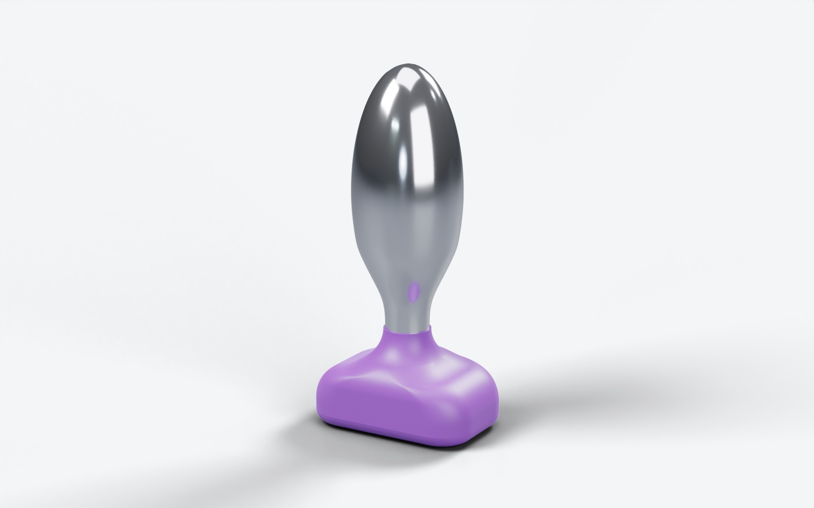
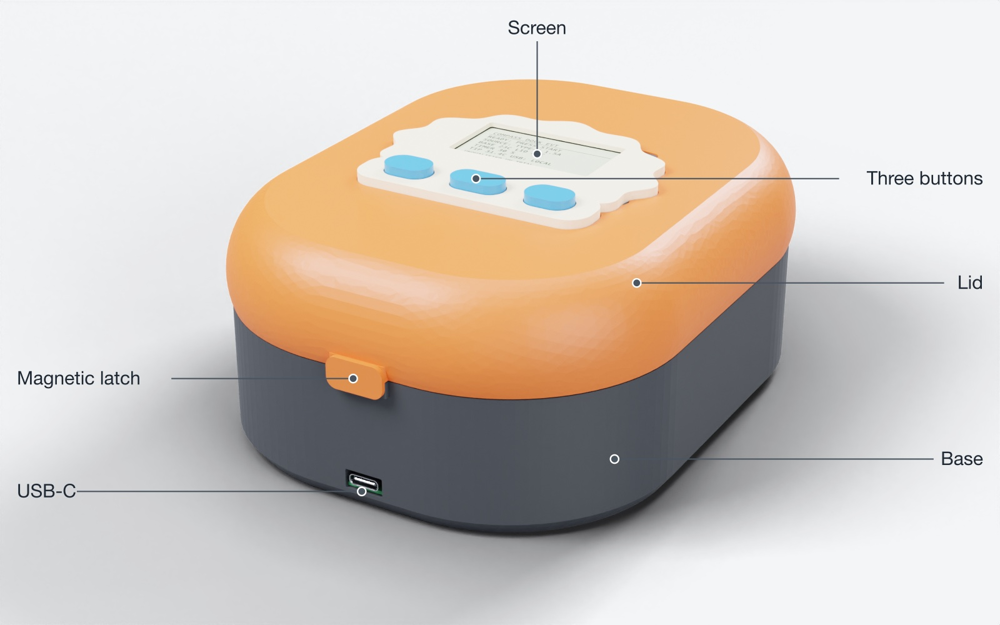

# Buttplug Compass

Compass is a smart plug and a charging dock. The plug is turned stainless
steel with a soft silicone flange. Inside are a vibration motor, a tip
temperature sensor, a compass and a small battery. It charges, and talks USB,
through four contacts on its base when it sits in the dock. The dock is a
clamshell case with a screen, three buttons and UV-C LEDs in the lid and the floor.

This site is the engineering documentation for the **EVT1 prototype**: how it
is built, how it works, and how to assemble one. The parts are designed but not
yet made or tested together. See [Project status](status.md) for what is done
and what is open.

## At a glance

| | Device | Charging dock |
| --- | --- | --- |
| Size | 124 mm long, Ø37 mm bulb, Ø15 mm neck, 59 × 40 mm flange | 137 × 177 × 68 mm closed |
| Shell | Turned stainless steel body and nose cap; printed PA12 flange under cast silicone | Printed PA12 clamshell, 110° hinged lid |
| Electronics | One 52 × 20 mm four-layer board: ESP32-C3, charger, motor driver, ADC, compass | Main board, lid UI board, contact board, two UV boards, two lid sensors |
| Power | 3.7 V protected LiPo, about 230 mAh, charged from the dock | USB-C in |
| Interface | Two buttons under the silicone, four dock contacts | 128 × 64 LCD, three buttons, USB-C to a computer |
| Sensors | Tip and battery temperature, accelerometer, magnetometer | Lid closed (Hall), UV board temperature |

## Where to start

- **[How the device works](device.md)**

    Exploded view, cutaway, and what each part does.

- **[Assembly guide](assembly-guide.md)**

    Step-by-step build of the device and the dock, with images.

- **[Engineering drawings](drawings.md)**

    Dimensioned drawings of the turned metal parts.

- **[Seals](seals.md)**

    How water is kept out: O-ring, bonded silicone skin, domes.

- **[Electronics](electronics.md)**

    Board layout, block diagram, connectors and pinouts.

- **[Charging dock](charging-dock.md)**

    What is inside, how charging, USB and UV-C work, and the controls.

## Repository map

| Folder | Contents |
| --- | --- |
| `hardware/pcb/evt1/one-board/` | Device KiCad project; `mech/` holds every device CAD part as a FreeCAD script, native file and STEP |
| `hardware/cad/evt1-assembly/evt1-wired/` | Dock FreeCAD assembly |
| `hardware/pcb/evt1/case-telemetry-study/wired-main/` | Dock Main board KiCad project |
| `hardware/cables/evt1/` | Harness definitions (WireViz) |
| `firmware/`, `dock-firmware/` | Device and dock firmware |
| `developer-docs/tools/figures/` | Scripts that regenerate every image and drawing on this site from the CAD |

All images on this site are renders of the CAD, not photographs.
