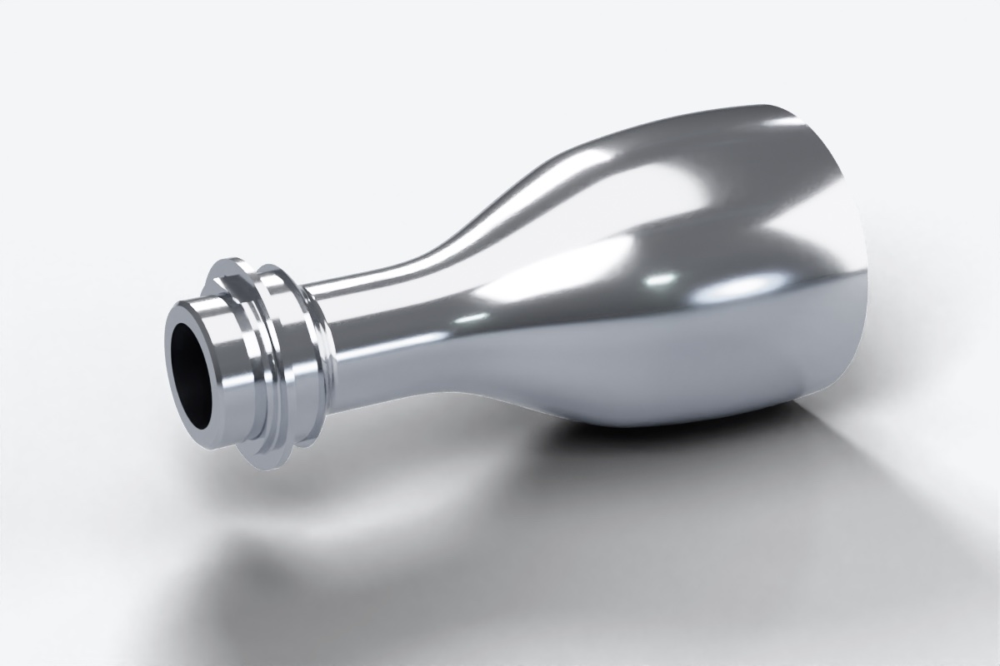
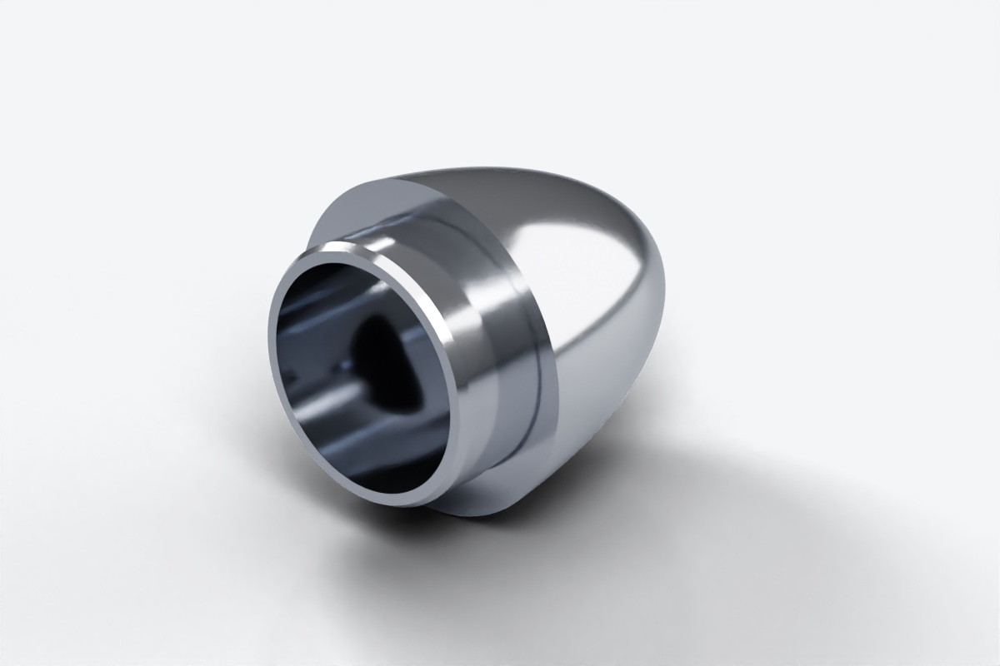
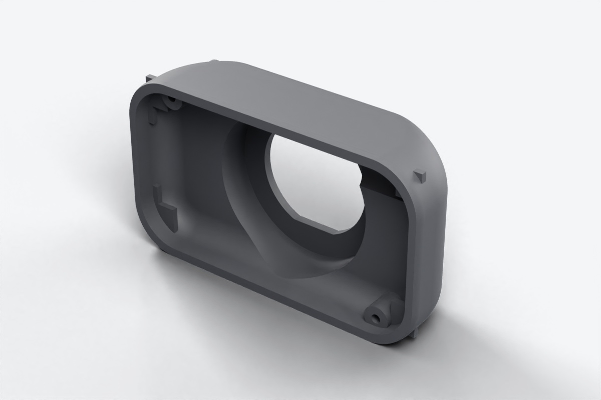
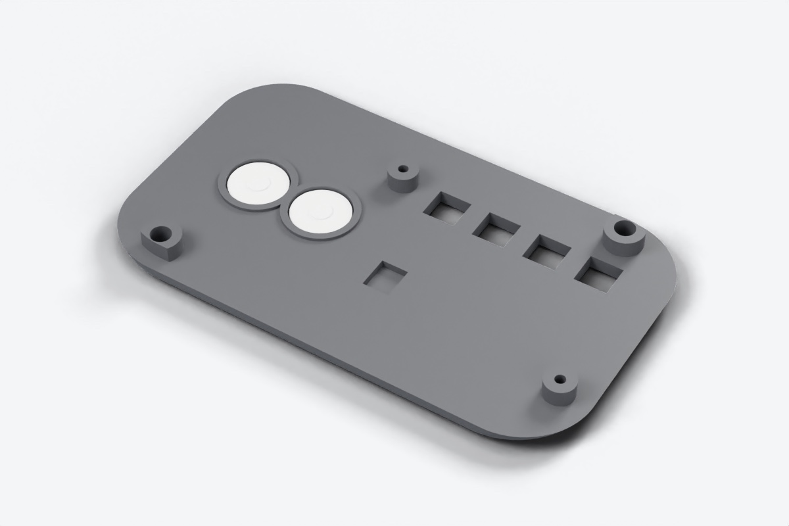
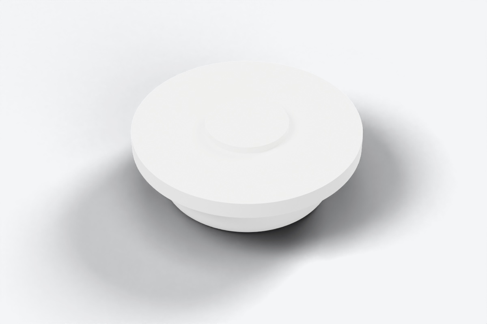
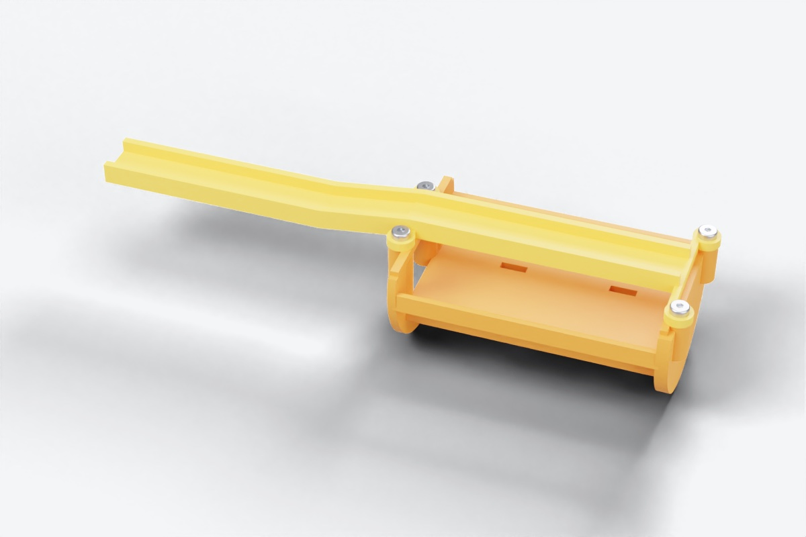
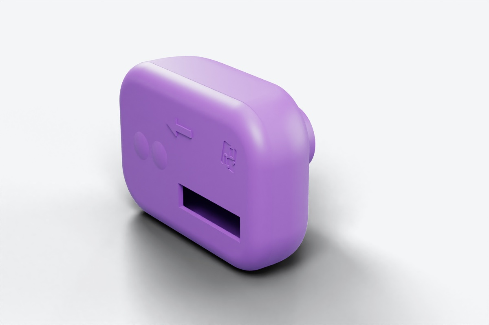

# Mechanical design

Every device part is a FreeCAD script with its dimensions as named parameters,
in `hardware/pcb/evt1/one-board/mech/`. Shared numbers (flange size, board
position, joint datums) are in `compass_datums.py`. Each part has a native
`.FCStd`, a `.STEP` export and, where it is to be ordered, a `.fab.json`.

| Part | Process | Material | Source |
| --- | --- | --- | --- |
| Metal body | CNC turning, milled collar flats | Stainless steel (304 quoted, 316L option) | `metal_body.py` |
| Nose cap | CNC turning, live-tool drill | Stainless steel | `MotorThermistorCap.step` |
| Flange tray | MJF printing | PA12, black | `flange_tray.py` |
| Rear cover | MJF printing | PA12, black | `rear_cover.py` |
| Button plunger (×2) | MJF printing | PA12, grey | `button_plunger.py` |
| Battery cradle | MJF printing | PA12 | `internal_cradle.py` |
| Wire guide | MJF printing | PA12 | `cradle_wire_guide.py` |
| Nose O-ring | Bought, 32 × 1 mm | Silicone 70A candidate | `cap_face_seal.py` |
| Skin | Cast over the closed flange | Silicone (grade not chosen) | `flange_skin.py` |

`device_assembly.py` places every part, checks for overlaps, connector
withdrawal and button travel, and writes `device-fit.json`.

## Metal body

The body is one turned stainless part, 78.25 mm long. From the back:

- **M18 × 1 stub** with 3.5 mm of full thread, for the flange nut.
- **Ø20 mm collar with two flats 18.4 mm apart.** The flats key into the tray
  so the flange cannot turn. They are milled after turning.
- **Ø24 mm shoulder.** The tray is clamped against this face. It is datum B on
  the drawing.
- **Ø19.5 mm land and Ø21 mm ring.** The silicone skin bonds here. Keep this
  surface clean and unpolished.
- **Ø15 mm neck,** with a Ø12 mm wire bore.
- **Bulb,** Ø37.3 mm at its widest. The bore opens from Ø12 to Ø28 mm inside
  it, with a 2.2 mm radial wall through the blend. The Ø12 bore leaves 1.5 mm at
  the neck.
- **Nose:** an M30 × 1.5 internal thread and a face groove for the O-ring.

See the section, dimensions and profile table on [drawing sheet 1](drawings.md#metal-body).

## Nose cap

The cap is the dome of the bulb. It threads into the body with a 6 mm M30 × 1.5
spigot and stops on a flat shoulder. Inside it has a Ø24.5 mm counterbore, a
flat-bottomed Ø11.1 mm pocket for the motor, and one Ø2.5 mm blind hole 7.8 mm
off-axis for the tip temperature sensor. The hole is drilled from the inside
and does not break through the dome. [Drawing sheet 2](drawings.md#nose-cap).

## Flange tray and rear cover

The **tray** is the body-side half of the flange, 56 × 32 mm. Its front has a
keyed socket for the collar and a well for the nut. The board sits in a shallow
cavity on four corner ledges. A rounded trough along one long side gives the
motor and sensor wires room to loop from their plugs to the neck. Its body-side
edge is rounded R10 on the ends for comfort.

The **rear cover** is the dock-side half. It carries the board on two bosses
(M1.4 screws), has four square openings for the contact targets, two bores for
the button plungers and a shallow recess over the tallest capacitor (C30). Two
M2 × 6 screws pull it onto the tray.

## Buttons

Each button is a rigid PA12 plunger. It goes into the cover from the inside:
a Ø6.6 mm flange seats in a counterbore, and the Ø5.0 mm head slides in a
Ø5.4 mm bore. The head stands 0.4 mm proud of the cover, under 0.9 mm of
silicone and a 0.5 mm dome. Pressing the dome moves the plunger 0.1 mm to the
switch and 0.15 mm more to the click. The dome covers the plunger opening. Check free travel and return before and
after casting.

## Battery cradle and wire guide

The **cradle** is an open frame that holds the 33 × 21 × 6.3 mm battery on two
soft pads, with slots for optional soft bands. Its front web sits 0.25 mm
behind the motor. The model allows about 0.49 mm total axial motion with the
cap closed. The **wire guide** screws on top
with four M1.4 × 5 screws after the battery is in, and carries the four motor
and sensor wires in a 4.8 mm trough. The three battery wires run under it in
the lower half of the neck bore.

## Silicone skin

The skin is cast in one piece over the closed flange and bonds to the steel
from the Ø19.5 mm land up the neck. It is 1.3 mm thick over the dock face,
1.6 mm over the ends and 4 mm on the long sides, where it ramps smoothly into
the neck. On the dock face it has two button domes, a raised arrow pointing to
the button end (the compass "up"), a recessed R+D logo, and a window over the
four contacts. See [Seals](seals.md).

## Rear joint parts

| Part | Spec |
| --- | --- |
| Thin nut | M18 × 1, 24 AF × 4 mm, stainless 316Ti (ifm E10028) |
| Thread locker | Loctite 243 (candidate) on the M18 thread |
| Tool | Two-jaw driver on the nut flats, through the open flange |

## Rebuilding the CAD

Run each script with FreeCAD (offscreen GUI, for coloured STEP files) in this
order: body, seal, tray, cover, plunger, skin, cradle, guide, internals,
assembly. The commands are in `mech/README.md`. Re-export the board STEP after
any layout change.
