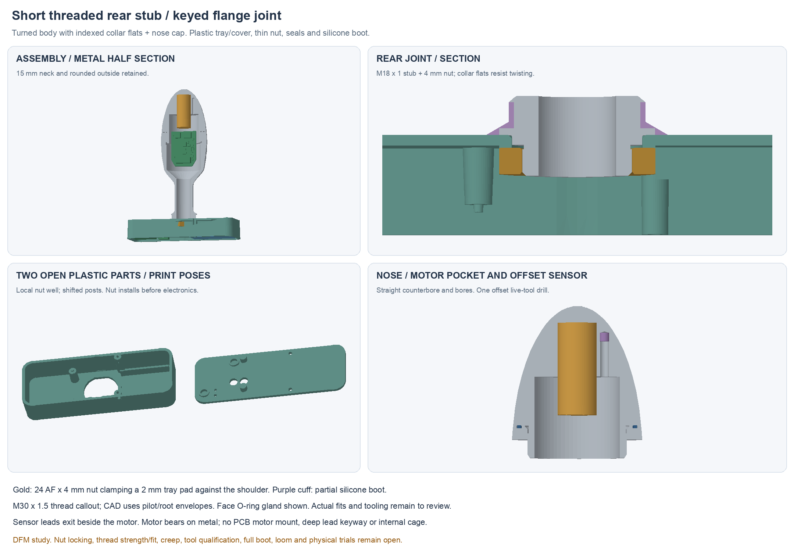
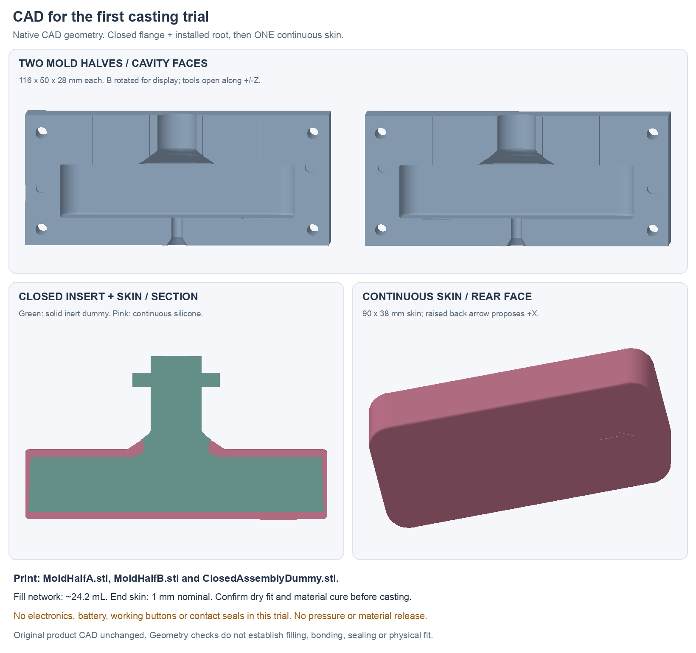
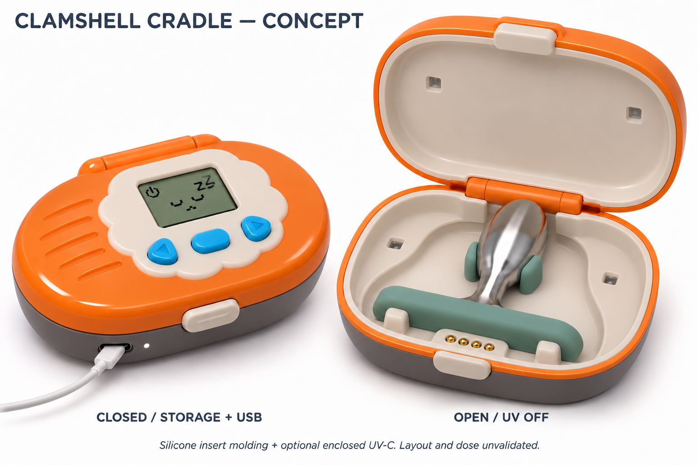
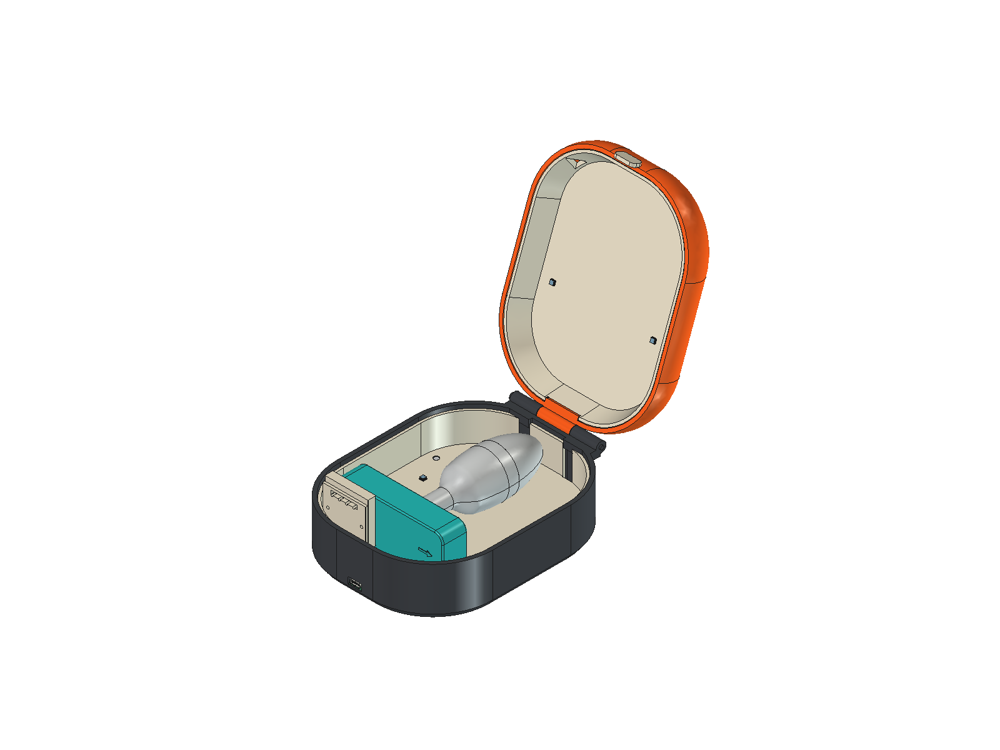

# Manufacturing design proposal

**Two main custom metal parts:** turned hollow body with indexed collar flats,
and a screw-on nose cap.
They join two plastic flange halves, closed before a continuous silicone overmold.
The 15 mm neck and rounded outside remain. This is a DFM study, **not a
manufacturing release**.

## Rear joint

The saved CAD now uses the selected **short threaded stub and thin nut**
direction. A provisional M18×1 stub extends 6.25 mm behind the Ø24 shoulder.
A generic 24 mm across-flats, 4 mm thick nut clamps the tray's 2 mm root pad.
The Ø20 collar has two opposing 18.4 mm flats fitting a matching tray socket,
so torque does not depend on socket adhesive. The collar ends 0.5 mm short
of the nut bearing face. No separate compression limiter is selected.

The flange stays 88×32 mm. A local drafted nut well leaves about 1.25 mm wall;
internal screw/board posts move. The separate EVT integration now fits actual
boards and a requested protected-pack/NTC envelope. Tighten the nut before boards/pack/loom using a narrow axial driver.
The nut and driver are engineering envelopes, not qualified purchased hardware.
The separate `evt1-integration/rear-joint-trial/` now supplies an ifmE10028
stock-nut reconstruction and a two-jaw service-tool proposal. Its native loading
checks pass; the main product still has the prior nut representation. Actual
thread/driver fit and usable torque require the inert trial.

**Rear nut retention:** specify tightening torque and apply Loctite to the
metal threads. Validate both on the actual joint; no locking washer is used.
The nut is torqued before the thermistors go in. Check clearance at the final
nut angle before installing them. Preload, creep, continued key engagement
and pull-through need separate checks. See the [hardware source](hardware.md).
The recessed Ø19.5 boot land and flush Ø21 upper shoulder remain; full boot
and full overmold tooling are unfinished. Cover screws close plastic only and
will lie beneath the continuous skin.

## Single flange board

Keep the existing body PCB. One flange PCB carries the retained flange
electronics, two Power/Mode switches, LSM303AGR and four Mill-Max1946 fixed
charge/data targets. The battery sits beneath it; the actual MINI-1 integrated
antenna overhangs a board-edge notch rather than sitting under the battery.
The original selected-part placement/native study is preserved in
`hardware/pcb/evt1/single-flange-study/`. Its separate39-part routed successor,
`hardware/pcb/evt1/single-flange-routing/`, passes native DRC0/0, full ERC and
163-pad parity with no ignored checks. U75 and U71 move to clear the actual J7
plug;59 connector/tool poses pass. Original body artwork remains unchanged.
The separate `single-flange-routing/assembly-quote/` package has bare-board
Gerbers, exact SMT part/position files and four separately installed targets
for this revision.

The matching mechanical candidate is
`hardware/cad/manufacturing-layout/evt1-integration/contact-module-trial/single-board/`.
It preserves88×32mm outside dimensions and adds3.2mm at the rear rigid extent.
The populated board loads into the rear half as one assembly; four nonmetal
screws retain it, and integral tray posts support docking force beneath the
target bases. A single pre-cured silicone web covers the two switch openings
and four contact necks before the closed flange receives its continuous skin.
All39 selected package models clear the proposed rigid halves, skin, barrier
and requested pack envelope. Saved-file/model-pose readback and33 populated-board
insertion plus33 cover-closing poses pass. These are nominal digital checks;
the flexible wire/service route, molding trials, received parts and RF/sealing
qualification remain open before replacing the existing product native/tooling.
The target row, buried keepers and dock carrier are being moved together.

## Silicone mold and clamshell cradle concept

Secure the lower metal body to the flange, close both plastic halves, then mold
one continuous silicone skin over that assembly and the root. The skin covers
the plastic seam and fasteners. Mask the four contact faces and metal
functional surfaces; design gates, vents, button barriers and the molded back
arrow into a two-part tool. Start with dummy closed assemblies to qualify
cure, pressure, fill, bonding and thermal exposure before molding electronics.

**Next physical build:** the [inert overmold trial](hardware.md)
has native skin/tool CAD, three print STLs, hardware and assembly instructions.
Two 116×50×28 mm tool halves open sideways around a solid closed-assembly
gauge; the continuous skin is 90×38 mm with 1 mm nominal end coverage and about
24.2 mL connected fill volume. Geometry/STEP/mesh checks and 22 opening poses
pass. No slicing, printing or casting has occurred. This first trial checks
external filling/demolding; it has no real cavity, buttons, contacts or internals.

The current single-board flange needs its own cavity and mask exit. The
editable FreeCAD candidate in
`hardware/cad/manufacturing-layout/overmold-interface-review/rear-insert-candidate/`
adds a removable rear mask insert and a split-open window for the contact
heads. The saved model passes sampled removal and STEP readback. Received
contact height, insert load, flash, fill and cavity sealing need inert trials.

EVT workshop battery service consumes/remakes the continuous skin before opening
both rigid halves; trial removal on an inert assembly first. No battery path
through the Ø12 neck or rear service lid is introduced.
Cap installation after molding also needs a wiring solution; the current cap
module connects its flange tails while the flange is still open.

The dock is a rounded Pocket Neopet-style clamshell for dry storage and computer
USB charging/programming. The orange upper, dark lower, cream scalloped bezel
and chamber, working screen, three blue controls and UV-C LEDs are required
for this EVT. Plastics target MJF/SLA. UV source budget, independent hardware
lid/thermal interruption, optical leakage, dose, coverage and material aging
require qualification; no sterilization claim is made.

**Current dock authoring:** `hardware/cad/evt1-assembly/DockAssembly.FCStd`
contains editable component bodies, a native revolute assembly, selected
LCD/FFC/contact/LED geometry and external StepUp PCB links. The cream lower
chamber now has full-depth hinge-web slots and four screw mounts; its sampled
installation path clears the fixed shell/contact module. Install it before
the UV modules and device. Lower the device at+3mm axial offset, then slide to
mate against the metal target-face stops at0.6mm nominal pin compression.
The native remains an integration candidate: switch mechanics, working latch,
pin retention, UV backing/thermal joints and final installed wiring are open.
The linked USB/interface boards precede the new controller/safety circuitry.
New source, controller, lid UI and UV circuit candidates plus separate dock
firmware are being integrated; the earlier five-board quote kit does not
include them. See [hardware](hardware.md) for exact sources and evidence.

The contact CAD now includes a separate trial face-seal gland under each post.
A nominal2×0.5mm ring seals against a flat rigid counterface in the proposed
design; finish, compatibility and real sealing remain unqualified. A separate
two-print single-contact fixture and inert316L machining RFQ support a gravity
water-column trial before molding a complete cavity. The outer silicone groove
still serves mechanical capture; permanent button/cavity barriers remain open.

## Turning and cap

The body has a straight Ø28 front bore tapering to the Ø12 neck bore, with no
hidden bulb-shaped internal undercut. The rear collar needs two indexed flats
in addition to turning the shoulder/stub and rear thread.
The cap is shorter: the seam moves to Y64, without changing the rounded outside.
A rear counterbore exposes the motor pocket and separate sensor drill.

The motor still seats directly on metal. Its nominal Ø11.1 pocket is not an
approved press fit. The thermistor moves beside it into one straight Ø2.5 blind
hole near the nose flank. This needs **one offset live-tool drilling operation**;
there is no deep internal lead keyway. Motor load does not pass through the PCB
or sensor potting. Thermal response and motor bias need measurement.

Provisional nose joint: M30×1.5 thread and 32×1 face O-ring. CAD uses thread
pilot/root envelopes with a drawing callout, not helical teeth. Thread fit,
runouts, gland tolerances, tool access and closing torque need machinist review.
The modeled joint reserves6 mm of full male thread and explicit lead/runout spaces.
See the current [hardware source](hardware.md) for the detailed DFM notes.

## Assembly and next gates

1. Secure the lower body to the first flange half with the keyed collar/nut.
   Qualify the torque and threadlocker process, and check the torqued nut's
   clearance to the pack sensors before loading them.
2. Complete internal wiring, contacts, board and pack while the flange is open.
   The current cap module must be threaded with free tails, then connected;
   cap-last after molding requires a revised, demonstrated connection process.
3. Close the two rigid flange halves and overmold their continuous skin/root.
   Mold fill/masking and component thermal/pressure limits remain to qualify.
4. Demold, finish and inspect contact faces, skin, root bond and electrical paths.
   Prove sealing, root loads and actual tool/loom access before a build release.

The EVT1 NTC/compass circuit and firmware are implemented candidates. All five
PCB layouts pass native DRC and pad/netlist parity. The separate
`evt1-integration/EVT1Product.FCStd` fits actual device-board outlines, connector
allowances and an integral two-boss compass mount; nominal static/loading checks
pass. Exact PCB parts and assembly quote ZIPs are prepared. The protected-pack
RFQ requests1.5A continuous/2A100ms in33×21×6.3mm; requested maximum/two dry
NTC/growth envelopes fit, with supplier acceptance/retention still pending.
Actual loom, final button/cavity seals, nut locking and manufacturing
callouts remain unfinished. The selected four-contact power/USB interface and included smart
cradle replace the former two-contact charging target; see
[cradle architecture](architecture.md#smart-cradle-and-four-contact-interface).
Contact/feedthrough prototype CAD is now separate from the main metal study;
powered product USB and sealing qualification remain open; dock wake/recovery has circuit
and code, with hardware qualification pending.
The inert skin trial includes a raised +X back-arrow proposal. Compass sensing/readout and heading math exist; the sensor now has fixed mechanical
registration, while the factory package-axis/calibration workflow and compass-driven haptics remain unfinished; see
[compass architecture](architecture.md#compass-mode). The simpler straight bore
also changes metal mass; material/weight must be reviewed for wear comfort.
Battery/BOM remain open.
No machining, physical assembly, sealing or wear result is claimed.
