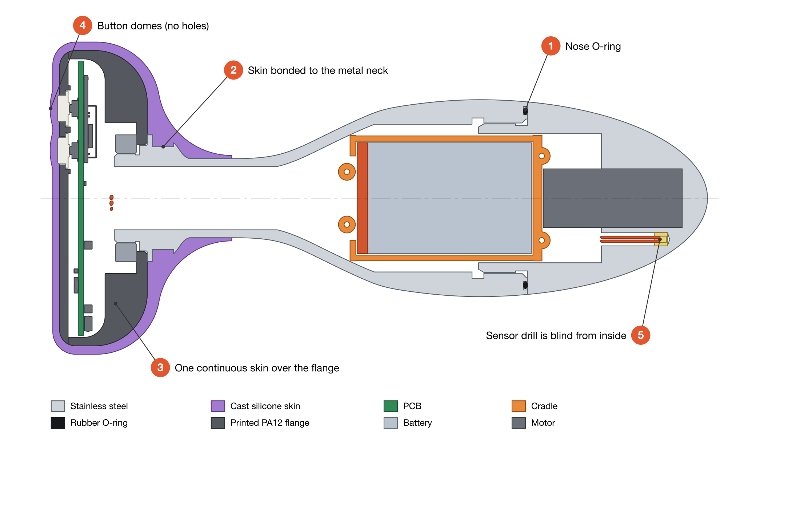
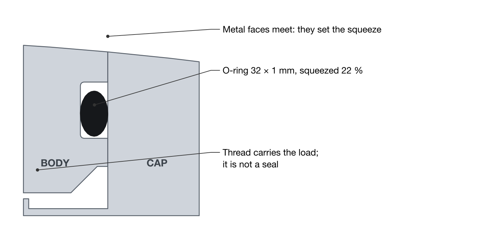
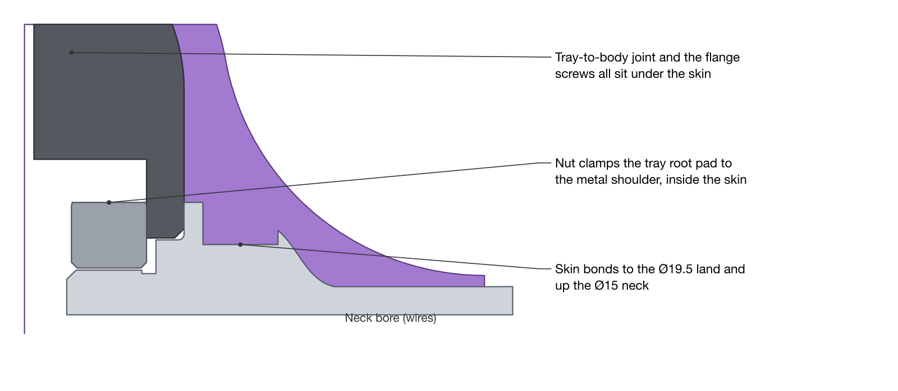
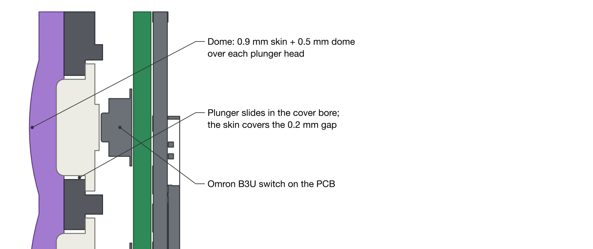
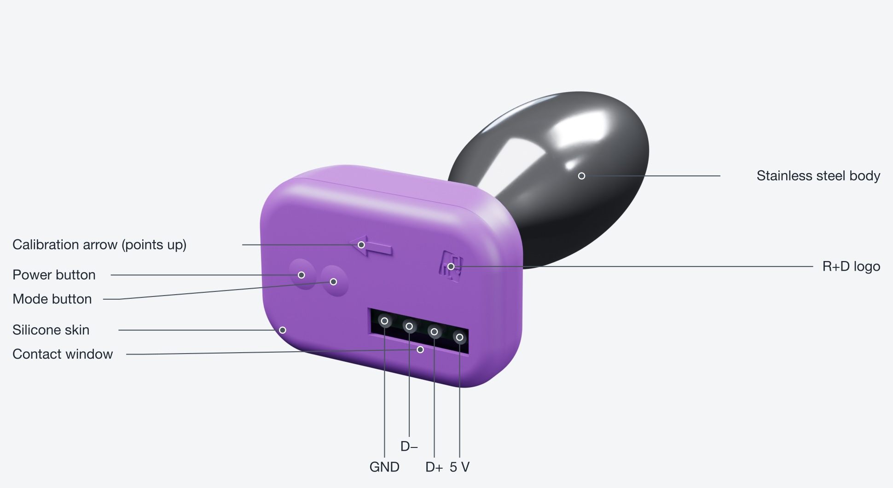
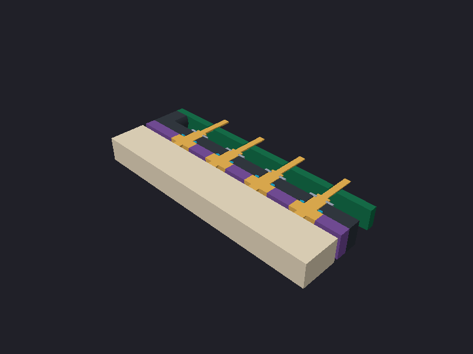

# Seals

The device has to keep water and body fluids out of the battery and the
electronics, and it has to be easy to clean. The design uses two barriers:

- **Steel and one O-ring** for the bulb. The only joint in the metal shell is
  where the nose cap meets the body. An O-ring forms the proposed face seal.
- **One continuous silicone skin** for everything else. It is cast over the
  closed flange and bonded to the steel neck, so the plastic flange, its screws
  and the neck-to-flange joint all sit inside it.

*Section through the axis. Numbers match the list below.*

| # | Seal | How it works | Status |
| --- | --- | --- | --- |
| 1 | Nose O-ring | 32 × 1 mm O-ring in a face groove, squeezed 22 % when the cap's shoulder meets the body | Designed; ring grade and leak test open |
| 2 | Skin-to-neck bond | Silicone bonds to the Ø19.5 mm land and the Ø15 mm neck, covering the joint between the steel and the flange | Designed; primer and bond process open |
| 3 | Continuous skin | Cast in one shot over the closed flange; no parting line through the shell | Designed; casting tool not yet made |
| 4 | Button domes | The plungers stay under 0.9 mm of silicone; nothing of the button opens to the outside | Designed |
| 5 | Blind sensor hole | The tip sensor sits in a hole drilled from inside the cap, so there is no hole through the metal | Designed |
| 6 | Contact window | The four contact targets face the dock through a window in the skin | **Open:** the openings around the targets need a seal |

## 1. Nose O-ring

The O-ring sits in a face groove cut into the front of the body: ID 31.6 mm,
OD 34.8 mm, 0.78 mm deep. The ring is 32 mm ID × 1 mm section. When the cap is
screwed in, its flat shoulder lands on the body's front face and squeezes the
ring to 0.78 mm, a nominal 22 % axial squeeze. The contacting steel faces set the gap at full
closure. Check ring and groove tolerances and verify leakage on the build.

The candidate ring is OneMonroe 32 X 1 S-70 (silicone, 70 Shore A). Fit the ring
dry and keep the groove and both faces free of burrs and polishing compound.

## 2 and 3. The skin

The skin wraps the whole flange: 1.3 mm over the dock face, 1.6 mm over the ends
and 4 mm on the long sides, where it ramps into the neck. Under it are the
tray-to-cover joint, the cover screws, the nut and the flange's keyed joint to
the body. Water has to get past the silicone-to-steel bond on the neck, or in
through the contact window (seal 6), to reach any of them.

The bond runs from the Ø19.5 mm land behind the Ø21 mm ring up the neck to the
top of the ramp. That steel must be clean and unpolished. On the flange the
skin wraps all the way round; it only bonds to the PA12 where a primer is
applied.

The skin is cast after both flange halves are screwed shut. It is not a
separate boot. Opening the flange for service means cutting the skin off and
casting a new one.

## 4. Buttons

Each button is a rigid plunger that slides in a bore in the cover. Its head
stands 0.4 mm above the cover, under 0.9 mm of skin and a 0.5 mm dome. The
skin is the membrane: you press through it. During casting the silicone can
wick into the 0.2 mm radial gap around the head. The trial keeps primer clear
within 2 mm of the bores. Check plunger return and sealing after casting.

## 5. Tip sensor

The tip temperature sensor is a glass-bead thermistor potted into a Ø2.5 mm
hole drilled from inside the nose cap, beside the motor pocket with a 1 mm wall
between them. The hole stops inside the dome and never reaches the outer
surface, so the cap's steel is unbroken.

## 6. Contact window

The four Mill-Max targets stand on the board and reach up through 3.8 mm
square openings in the cover. The skin has a window around them so the dock's
spring pins can touch them. In the current CAD there is a 0.3 mm gap around
each target where it passes through the cover, and nothing fills it. This is
an open path into the flange.

**Flush-contact concept.** Each contact face moves 1.77 mm outward to the skin
surface, keeping the 6 mm pitch. The head bears on the cover and an individual
1.8 × 0.4 mm ring sits in a 0.30 mm deep face gland for 25% nominal squeeze.
An inside clip locates the stem. Check mold flash, clip retention, unmated wash
sealing, wet bridging and USB before adopting it. See
`mech/compact-flush-contact-fit.json`.
