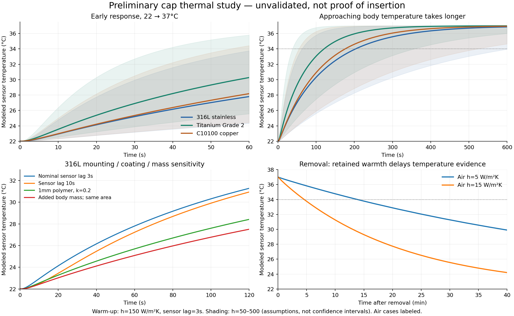

# Temperature response and metal selection

**Preliminary engineering study, 2026-11-12. No physical thermal, biological or
wear-detection validation. Material selection remains open.**

For fast temperature response in the modeled metal geometry, **commercially pure
Grade 2 titanium is the strongest candidate to test**, with 316L stainless as
the comparison baseline. Copper spreads heat much faster, but produces little
improvement in the modeled early sensor response. Its antimicrobial properties
do not establish suitability for repeated rectal contact.

Temperature can provide evidence of warming. **It cannot uniquely establish
rectal presence.** Warm water, hands, heated storage and internal motor heat
can produce similar evidence; a prewarmed plug may show almost no insertion
transient. This study does not qualify the existing wear detector or enable
confirmed wear time.

## Study geometry and sensor

This study is bound to the manufacturing-layout STEP exports and native review
used for the comparison. It has not been regenerated for the compact assembly's
revised body shoulder, internal cradle and skin. Its body is **17.99 cm³**, cap
**14.93 cm³**, and exposed cap dome **31.95 cm²**. The mass comparison uses those
two study parts only; it is not the current product's weight. See
[Hardware](hardware.md) for the active device geometry.

The TDK B57540G1103F000 sits in the cap's Ø2.5 blind drill beside the motor.
The modeled head is centred at radius 7.8 mm / Y89.7 mm, with potting around it.
The drill's minimum metal wall to the dome is 1.289 mm; that is **not** the bead's
distance to the surface. The motor-side web is 1 mm. Do not thin either wall
based on this thermal screen.

The [TDK datasheet](https://www.tdk-electronics.tdk.com/inf/50/db/ntc_09/Glass_enc_Sensors__B57540__G540__G1540.pdf)
gives approximately 3 s cooling time constant **in air** and 1.3 mJ/K heat capacity.
Those values do not specify a potted assembly's response. Current EVT firmware
samples approximately once per second; mounting lag, calibration and motor
bias remain unmeasured.

## Material comparison

| Material | Conductivity W/(m·K) | Heat capacity J/(kg·K) | Study body + cap mass | Cap heat capacity J/K |
| --- | ---: | ---: | ---: | ---: |
| 316L stainless | 15 | 500 | 263 g | 59.7 |
| Titanium Grade 2 | 20 | 520 | 148 g | 35.0 |
| C10100 copper | 391 | 385 | 294 g | 51.4 |

Typical properties come from [Outokumpu, table 7](https://www.outokumpu.com/en/products/product-ranges/-/media/files/products/supra/outokumpu-supra-range-datasheet.pdf?modified=20251117111951&revision=7a909396-d1f3-4d36-9c1c-99606be41fd2),
[Metalcor Grade 2](https://www.metalcor.de/en/datenblatt/122/) and
[Kanthal C10100](https://prodshop.kanthal.com/en/products/datasheets/material-datasheets/wire/conductive-wire/cda-10100-copper/).
Constant properties are used across the small temperature range. Kanthal
tabulates conductivity at 100°C; [CDA's 20°C value](https://alloys.copper.org/alloy/C10100)
is also approximately 391 W/(m·K). Supplier Grade 2 conductivity varies:
[TIMET](https://www.timet.com/assets/local/documents/datasheets/cpgrades/50a.pdf)
lists 21.79 W/(m·K). These are engineering inputs, not finished-part acceptance.
Do not substitute a different titanium alloy without rerunning the comparison.

Conductivity describes heat flow through the metal; thermal diffusivity is
`alpha = k / (rho * cp)`. The modeled diffusivities are 3.75, 8.53 and 113.6 mm²/s
respectively. However, heat arriving through tissue/contact must also warm
the cap's mass. Grade 2's volumetric heat capacity is about 41% lower than
316L's; copper's is only 14% lower. High conductivity alone does not give
proportionally faster sensing.

## Modeled response

Assumptions: initially 22°C; the entire bare dome exposed to a fixed 37°C
reservoir; effective heat-transfer coefficient `h=150W/(m²·K)`; installed sensor
time constant 3 s. The ranges independently sweep `h=50–500` with the same 3 s lag.
**These coefficients are illustrative, not measured rectal values or confidence
limits. Actual response and installed lag can fall outside these sweeps.**

| Material | First 1°C rise, nominal (range) | First 2°C rise, nominal (range) | Reach 34°C, nominal |
| --- | ---: | ---: | ---: |
| 316L stainless | 10 s (5–26 s) | 19 s (8–52 s) | 3.4 min |
| Titanium Grade 2 | 7 s (3–16 s) | 12 s (5–32 s) | 2.0 min |
| C10100 copper | 10 s (4–25 s) | 18 s (7–49 s) | 2.9 min |

A small rise can be observed well before reaching body temperature. An
illustrative 5 s dwell plus sampling would add roughly 5–6 s to a threshold time;
no such threshold is validated or implemented here. Copper saves only about
0.6 s over 316L for the nominal 2°C rise, versus about 6.5 s for Grade 2 titanium.



For 316L at nominal contact conditions:

| Change | Modeled consequence |
| --- | --- |
| Installed sensor lag 1 s / 3 s / 10 s | 2°C rise in 17 s / 19 s / 25 s |
| Optional 1 mm polymer, assumed k=0.2 W/(m·K) | 2°C rise in 31 s; this is an illustrative resistance, not a selected silicone |
| Start 32°C instead of 22°C | 2°C rise takes 63 s |
| Start 36°C, reservoir 37°C | A 2°C rise is physically unavailable |
| Artificially add the body's heat capacity without extra heated area | 2°C rise takes 38 s; a mass stress case, not an assembly prediction |
| Remove from 37°C into 22°C air, assumed h=5–15 | Falling below 34°C takes approximately 4.6–13.9 min |

The cooldown case excludes radiation, evaporative cooling and the rest of the
assembly. It illustrates retained warmth, not an actual removal timeout.
Insertion and removal therefore need separate detection tests. A fast warming
cue does not provide fast evidence of removal.

## Charging-case baseline and cooldown

Record the plug's temperature throughout docking/charging and retain its
temperature at removal. Charging and UV can both change the starting condition:
the modeled 316L 2°C rise takes 19 s from 22°C but 63 s from 32°C. A baseline
improves interpretation; it cannot create temperature contrast when the device
is already close to the temperature of its surroundings after insertion.

| Event / measurement | Required record |
| --- | --- |
| While docked | Approximately 1 Hz plug-tip temperature with timestamps, validity, charging/source state and UV state; retain a short history to estimate the trend. Buffer or batch storage rather than writing flash every sample. |
| Removal candidate | Last fresh docked temperature, sample age and trend, event timestamp, boot/session identity and charging/UV state. Capture this even if removed before charging finishes. |
| After removal | First fresh undocked sample and subsequent temperatures, with their actual timestamps. Evaluate changes against the removal baseline and elapsed time. Do not describe an older sample as an instantaneous removal measurement. |
| Case / pack temperatures | Separate chamber/room reference and relevant pack/hot-spot measurements where needed. Existing UV-module thermistors and the tip NTC do not establish all these temperatures. |

Dock power loss is not by itself proof of physical removal. Preserve that
ambiguity in the event record. Stale/invalid samples, reboot and missing history
must make the baseline unavailable or uncertain, rather than defaulting to a
room-temperature value.

Keep **battery charge state** separate from **thermal readiness**. The proposed
case display flow is:

| Display | Meaning / transition |
| --- | --- |
| Charging | Valid evidence that charging is occurring; a dock connection alone is insufficient. |
| Charged — cooling | Charge completion is confirmed, but the thermal readiness criteria are not met. The charger terminates normally; this state does not prolong charging. |
| Ready | Charge completion plus fresh, qualified thermal measurements: acceptable contact-region temperatures, a sufficiently settled baseline and enough expected warming contrast for the intended sensing mode. Numerical limits and dwell require bench qualification. |
| Temperature detection limited / status unavailable | Ambient conditions leave insufficient contrast, or required measurements/status are missing. Do not promise an endless cooling countdown or display Ready from a timer alone. |

UV heat and interrupted/repeated cycles reset the relevant readiness evaluation.
Cooling must never automatically restart a stopped UV cycle or bypass the
independent pack/lid/thermal protections. Readiness is not cleaning validation.

### Required data paths and present gaps

The wired dock uses the four contacts for standalone RP2040-host telemetry and
preserves a direct PC programming/ROM-recovery path. Only one host owns the USB
pair at a time. The STM32 remains responsible for the screen and UV control.
The native paths and matching firmware targets are listed in [Hardware](hardware.md).

The plug retains 64 tip-NTC attempts and 16 source-loss candidates in RAM, with
actual acquisition times, validity and boot identity. USB telemetry and
same-boot source-loss replay candidates exist. Source loss is not confirmed
removal, and reset/deep sleep discards the history. Installed USB switching,
measurement timing and display behavior remain to verify.

Charge completion and an ambient reference remain gaps. The available charge
payload does not establish CHG/CE/TS/ISET state. A charger-status level or battery
voltage alone must not become proof of full charge. UV-module thermistors are
not plug or room measurements. Qualify charge interpretation, missing/stale
history and the Charging / Charged — cooling / Ready transitions on the
assembled unit; these states are not established by the current code.

### Fan feasibility

A small fan is a candidate to test. It can improve heat transfer from the plug
to case air, but the heat must then leave through a heat-rejecting case surface
or a designed inlet/exhaust path. Recirculation can help if it improves that
whole path; it does not remove heat from a closed case by itself and adds its
own electrical heat. Ordinary airflow cannot cool below the incoming room-air
temperature. [Oriental Motor's cooling guide](https://www.orientalmotor.com/products/pdfs/2009-2010/E/usa_fan_overview.pdf)
distinguishes enclosure heat rejection and ventilation from air circulation.

The relevant heat balances are `C_plug*dT_plug/dt = P_plug - Q_plug_to_case`
and `C_case*dT_case/dt = P_case + P_fan + Q_plug_to_case - Q_case_to_room`.
The earlier fixed-temperature air cooldown is not a closed-case prediction.
Measure case thermal resistance, installed airflow, charging/UV heat and sensor
lag before predicting a cooling wait or selecting the fan. Include fan start,
stall and blocked-vent cases. Any vents must preserve opaque UV containment;
no direct light path or defeated lid cutoff is acceptable.

Use the matching revision of
`hardware/pcb/evt1/dock-safety/power-budget.json` for the source allocation.
A fan has no qualified allowance. Charging-only/cooldown scheduling may free
UV allocation, but source, startup and transient limits need separate budgets.
No fan part, airflow route or cooldown time is selected. Compare passive
cooling against a fan after charging and UV stop, using actual assembled
temperatures rather than a fixed delay.

## Copper, corrosion and cleaning

Copper's antimicrobial activity is a reason to investigate it, not to accept it
for this surface. An [EPA copper-alloy label](https://www3.epa.gov/pesticides/chem_search/ppls/082012-00005-20100209.pdf)
describes reductions of specified bacteria over two hours with regular cleaning.
It explicitly retains routine hygiene requirements. Those tests do not establish
efficacy in fecal soil, under lubricant, against all pathogens or on rectal tissue.

[Bastidas et al.](https://doi.org/10.1080/13625180500131642) measured copper
dissolution in simulated uterine fluid at 37°C and found that protein, pH and
oxygen conditions affected release; the corrosion layer was poorly protective.
This is evidence that wet biological chemistry matters, **not a rectal exposure
limit or a direct prediction for this product**. Corrosion products, ion release,
irritation, surface deterioration and cleaning compatibility remain unresolved.
Visual tarnish alone cannot establish safety or cleanliness.

I would **not select exposed copper** from the available evidence. A complete
barrier would change both tissue exposure and direct copper/microbe contact, so
an encapsulated copper core cannot simply inherit exposed copper's antimicrobial
claim. Plating or coatings introduce their own wear, defect and qualification
requirements; the small modeled speed benefit does not justify adding them here.

Polished, passivated 316L and finished Grade 2 titanium are candidates, not blanket
assurances of safety. The [FDA biocompatibility framework](https://www.fda.gov/medical-devices/biocompatibility-assessment-resource-center/glossary-biocompatibility-terms)
considers tissue location, repeated exposure, final surface, processing and
residues. Use that framework for evaluating the finished mucosal-contact assembly;
this study makes no determination about the product's regulatory classification.
Cleaning validation must include the cap joint, silicone transitions, contact
seals and repeated-use surface condition. No self-cleaning or sterilization
claim follows from a metal choice or the proposed UV cradle.

## Model and numerical checks

`tools/study_thermal_presence.py` solves an axisymmetric finite-volume cap model:

```text
C_i dT_i/dt = sum_j G_ij (T_j - T_i) + G_external,i (T_reservoir - T_i)
G_metal = k * area / distance
G_external = area / (1/h + wall_distance/k + coating_thickness/coating_k)
dT_sensor/dt = (mean_sampled_bore_wall_temperature - T_sensor) / sensor_tau
```

The cap profile follows the study's turned blank, spigot, counterbore and motor
bore. The offset sensor hole is omitted from the axisymmetric metal; equally
weighted samples at its inner/outer radial walls at Y89.7 drive a passive sensor
filter. Real potting conductances, voids and lead conduction are unknown.
Internal faces are adiabatic. The model excludes motor/electronics heat, motor
mass, cap/body joint conductance, body/neck/flange heat loss, finite tissue heat
capacity/perfusion and nonuniform contact. The fixed warm reservoir and complete
contact are optimistic simplifications; this is not anatomical simulation or
full-product FEA. Optional coating heat capacity is omitted.

The 0.25 mm mesh has 3,639 cells, 14.956 cm³ metal versus 14.927 cm³ saved cap, and
31.945 cm² heated area. Refining to 0.125 mm changes nominal 316L threshold times
by less than 0.5%; this checks discretization, not the physical assumptions.
Source hashes, passive temperature bounds, energy balance and a high-conductivity
comparison against `tau_bulk=rho*cp*V/(h*A)` pass. The latter's maximum mean
temperature error is 0.00021°C. Sensor lag is separate from that bulk time constant.

Inputs, source hashes, full curves and threshold CSV live in
`hardware/design/thermal-presence/`. Regenerate from the repository root with a
Python environment containing NumPy, SciPy and Matplotlib:

```sh
python tools/study_thermal_presence.py
```

`--extract-geometry` additionally requires the FreeCAD/Part/pythonocc runtime.
It reads the saved STEP exports and refreshes the study snapshot without saving
any product native. Geometry-source changes fail the normal run until reviewed.

## Physical study needed for a decision

1. Build inert 316L and Grade 2 caps at the geometry being evaluated, with the same NTC,
   recorded bond thickness/fill and separate surface/reference thermometers.
   Measure installed sensor response before adding electronics or a live pack.
2. Record repeat warm-up/removal trials from 12/22/32/36°C into controlled baths
   and a compliant, lubricated contact fixture. Sweep contact area, lubricant
   thickness and reservoir temperature. Fit contact and mounting parameters
   separately; a stirred bath does not reproduce tissue contact.
3. Challenge candidate rules with handling, warm water, warm storage, partial
   contact, immediate reinsertion, cool-down, stale data and sensor faults.
   Record latency distributions, misses, false positives and false removal
   decisions using an independent insertion/removal reference. Do not use the
   temperature threshold itself as ground truth.
4. Once powered hardware is qualified, measure motor/electronics heat bias and
   all contact-region temperatures separately. Prefer sensor coupling to the
   outside wall and reduced coupling to the motor, subject to existing wall,
   strength and sealing constraints.
   Log complete docked charge/UV/cooldown cycles, early removal, source loss and
   removal/reinsertion. Verify the baseline record and each readiness state;
   compare passive/fan cooling with the lid closed and at warm room temperatures.
5. Establish cleaning, corrosion/extractables and repeated mucosal-contact
   suitability before human-use validation. If dependable presence is required,
   investigate an independent contact/deformation channel; motion alone cannot
   resolve the thermal ambiguity. Keep uncertain evidence unconfirmed.

The next useful decision is a matched 316L / Grade 2 bench comparison. No CAD,
firmware, BOM, supplier order or human-use release is changed by this study.
