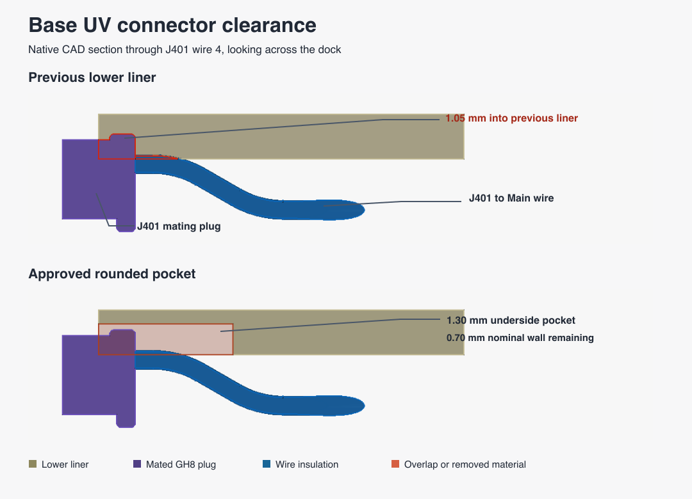
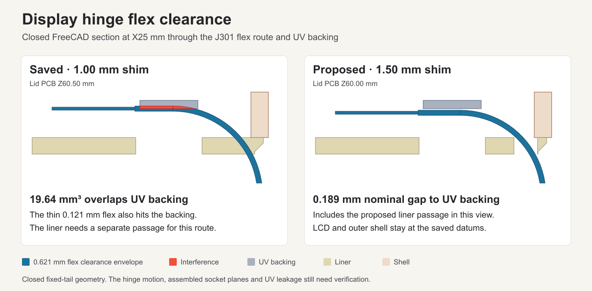
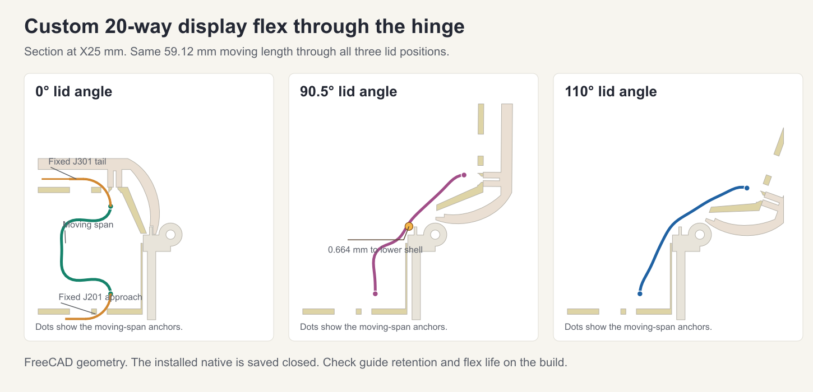

# EVT1 wired dock assembly

Open [DockAssembly.FCStd](DockAssembly.FCStd) in the FreeCAD 1.1 VM with the adjacent `pcb/` and `sources/` folders. The base assembly’s Main board uses a real external StepUp link to [MainPCB-Wired.FCStd](pcb/MainPCB-Wired.FCStd). Use the [wired Main KiCad project](../../../pcb/evt1/case-telemetry-study/wired-main/dock-wired-system.kicad_pro) for electrical changes.

The Main board seats at Z5.4 to Z6.4 mm on the existing bosses. The same six mount sites and front USB opening carry through from the direct USB source. The dock keeps its saved clamshell, hinge, catch and contact geometry. The JST lid, four-contact carrier, UV board geometry and product exterior stay linked from their saved sources. The wired Main supplies a dock USB host for the four-contact telemetry path alongside direct PC servicing.

The [Main integration readback](integration.json) records the wired board installation before adding the harness. The [cold readback](contact-harness-check.json) covers the current native. The linked wired board has 297 populated-model solids. The [source parity report](geometry.json) shows that the current PCB and the StepUp source have the same 225 footprint placements and sides, 200 package geometries and transforms, 29 outline objects and 11 mechanical drill entries. The remaining board routing, received fit and powered USB remain open. The two Hall stations are installed in CAD. UV operation needs qualified installed hardware cutoffs and measured leakage, optical response and thermal results.

The pre-harness [Main rigid check](installed-rigid-check.json) screened all 297 solids in the linked Main at the saved closed position against 14 dock obstacles, including both shells and liners, both latch baffles, six Main screws, and the contact carrier and retainer. It found no overlaps exceeding 0.00001 mm³ in 4,158 possible pairs and 328 exact intersections. Run `Clash.FCMacro` in the FreeCAD 1.1 VM with `COMPASS_WIRED_DOCK_WORK` pointing to a scratch folder containing `dock/` (the assembly and its relative dependencies) and a copy of `integration.json`. The check does not cover flexible routing, loading or motion, tolerances, powered behavior or UV containment.

## Main to spring-pin harness

The current assembly includes `BaseModule/DockContactHarness`. The four wire bodies follow the existing carrier hood and liner opening, then fan out below the liner to Main. No board, shell, carrier or guide placement needed to move. The [native route view](DockContactHarness.png) shows the wire exits and lands.

| J102 to J94 pin | Signal | Insulation path | Nominal pad to pad |
| --- | --- | --- | --- |
| 1 | GND | 90.52 mm | 91.12 mm |
| 2 | USB D− | 93.73 mm | 94.33 mm |
| 3 | USB D+ | 97.70 mm | 98.30 mm |
| 4 | 5 V | 101.11 mm | 101.71 mm |

The [harness check](contact-harness-check.json) reopened the saved native and verified all four Ø0.60 mm insulation solids. At the closed lid pose it screened 82 assembled obstacle objects and ran 239 exact BRep tests, with no rigid intersections above 0.000001 mm³. The minimum sampled centerline bend radius is 4.00 mm. The exact minimum gap between wire surfaces is 0.142 mm. The nominal pad-to-pad lengths add a 0.30 mm centerline extension per end to the insulation paths. The [WireViz recipe](../../../cables/evt1/dock-main/README.md) retains 150 mm starting blanks for actual stripping, dressing and trimming. Received wire, solder fillets, strain relief, assembly/loading motion and powered USB remain to check.

Run `BuildContactHarness.FCMacro` in the FreeCAD 1.1 VM with `COMPASS_WIRED_DOCK_WORK` pointing to a scratch copy of the pre-harness assembly and dependencies in `dock/`. The exact pre-harness assembly hash is recorded in [integration.json](integration.json). The macro writes the routed native next to its source and the fit report in scratch.

## Stationary base UV harness

The lower liner contains the approved editable J401 pocket, 12.10 × 6.10 mm
with R0.40 corners and 1.30 mm nominal depth. The pocket leaves a 0.70 mm
nominal web. The seated GHR-08V-S housing clears the liner by 0.25 mm and the
aluminum backing by 0.95 mm. The base board and connector datums stay at their
saved positions. The [pocket and installed fit record](base-uv-check.json)
identifies the exact assembly and source revisions.

`BaseModule/InstalledBaseUVHarness` contains the seated J401 housing and
the relative [native harness link](sources/BaseUVHarness.FCStd). Eight
editable Ø0.8382 mm insulation sweeps follow the saved J401–J621 paths.
Their centerline lengths are 105.589–133.078 mm, with R4.00 mm minimum
bend radius. The 175 mm wire length remains the starting blank for
terminations and final dressing. [Harness source and length record](../dock-harness-trial/uv-liner-assembly-review/base-uv-route/native/README.md)

Fit the base UV branch and seat the liner before dressing and terminating
the J102–J94 contact harness. The J401 housing and eight UV wires cleared
15 sampled liner lifts from 0 to 60 mm. The dressed J102 wires meet
the rising liner at sampled offsets between 3 and 30 mm. Release those
wires before lifting the liner during service. Check access for the final
J102 termination on the assembled prototype. The native cold check covers
the closed, seated paths and the modeled J401 housing. Received contact
retention, strain relief, moving lid wires, and UV tests remain open.

## Display stack and hinge flex

The 1.50 mm lid shim puts the lid PCB top at Z60.00 mm. The glass stays
at Z68.80 mm. The native J302 fold uses the existing 65 mm LCD ribbon,
a 3.25 mm nominal bend radius and a 3.607 mm lead-in. The model uses a
loaded copper height of 1.20 mm above the PCB and a tip at Y112.575 mm.
Measure the received socket before freezing either fold dimension.
[OEM ribbon and J302 fit ranges](../lid-jst-integration/coupled-lid-fit.md)

The two editable liner passages clear the modeled fixed ends of the separate
20-way J201–J301 hinge flex. Its sockets remain 25 mm apart sideways.
The supplier drawing uses 20 opposite-face, pin-for-pin contacts, a 10.50 mm
tail width and 0.30 mm stiffened-tail thickness. The lower shim gives a
nominal 178.16 mm developed free length between the socket mouths. The
supplier’s tip-to-tip length adds the measured insertion depths. Use the
straight Molex 0151660220 bench cable with the boards exposed.
[Custom hinge flex drawing and pin map](../dock-harness-trial/shared-hinge-review/display-flex-feasibility/README.md)

The closed dock links the [native J201–J301 flex](sources/DisplayHingeFlex.FCStd)
with nominal 0.30 mm stiffened ends, the fixed tails and a 59.11878 mm
moving span. The saved geometry ends at the two socket mouths. Total
production length adds the measured insertion depth at each FH12 socket.
The current socket CAD confirms mouth locations and external approach
but represents the internal contacts at simplified detail. Inspect the
contact faces and loaded stops before releasing supplier artwork.

The [hinge readback](hinge-flex-check.json) records ten closed solids and the
previously installed 12 wires. The [moving span control data](sources/DisplayHingeFlexMotion.json)
give 221 modeled half-degree stations from 0° to 110°, with fixed arc
length and a 5 mm minimum centerline radius. The expanded envelope
cleared the rigid components at 25 exact sampled angles. The tightest
clearance was 0.664 mm to the lower shell at 90.5°. The archived moving
UV wire candidates leave at least 11.58 mm of lateral clearance at their
sampled poses. The native flex link represents the closed position.

The next build still needs flex guidance and retention, verified with the
moving UV wires, received cable and bend-cycle testing. Keep the UV emitters
isolated during dry fit. The [display-stack readback](display-stack-check.json)
records 18 of 60 sampled rays reaching the enclosed dry side through the
liner passages. Every sampled ray met a barrier before reaching the exterior.
Measure UV leakage on finished cases for reflections, material transmission
and assembly variation.

## Enclosure quote

The [product enclosure packet](../../../design/evt1-bench-ordering/dock-enclosure/Compass-EVT1-Dock-Enclosure-Quote.zip)
contains one STEP per custom shell, liner, control, hardware support and hinge
pin listed in its parts table, plus the two 6061-T6 UV spreaders and two
thermostat pressure bars. It includes the J401 relief, both display-flex
passages and the two blind Hall recesses. Quote the two liners separately
while the moving UV wire passages and retainers are being resolved. Run
`export_enclosure.py DockAssembly.FCStd <empty-dir>`
with FreeCAD's Python and then `build_quote.py --exports <empty-dir>` in the
quote directory to refresh it after geometry changes. The packer's `--check`
compares the STEP hashes and the exported body hashes to the current source.

## Hall board fit

The 8.8 × 16 mm Hall boards reuse the two front switch stations.
`HallHeadLinerRelief` is an editable pocket in the lower liner Body. The
two approved blind recesses give 0.312 mm minimum nominal clearance at each
board, up from 0.050 mm. The checked web beneath the 0.50 mm shoulder cuts is
0.48 mm. The [cold readback](hall-liner-check.json) verifies both recesses
and the existing J401 clearance. Confirm the achievable web thickness with
the print shop.

The lower module now includes two Hall PCB brackets, the linked
[current routed head](pcb/WiredHallHead.FCStd), and stock-screw and spacer
fit shapes. The upper module carries both captured magnets and backers.
The old switch objects remain available in the source tree as reference.
The [installed-station report](hall-station-check.json) covers 16 sampled lid
angles per side from 0° to 110°. Both magnets have about 0.605 mm nominal
closed clearance to the populated head. The PCB link uses the source KiCad
outline, 0.80 mm finished laminate and selected KiCad packages. Q1 uses
the Diodes maximum package dimensions.
Use four NBK SPE-M2-8-C screws with the machined PEEK bracket spacers.
Both Hall brackets use the approved editable integral capture lip. It overlaps
the 0.80 mm PCB by 0.75 mm and leaves a 0.90 mm nominal slot at the existing
sensor datum. With the bracket off the dock, slide the PCB toward the hinge
(+Y) under the lip. Offer the pair from inside the dock toward its side wall.
The installed-station report records ten board-slide samples across 1.50 mm
and twelve module-approach samples across 12 mm per side with zero modeled
rigid interference. Confirm the finished slot and withdrawal restraint with
received parts. Stud and shim fit, lead
restraint, magnetic release, Main receivers and finished-unit UV-C
leakage remain open. Use the [product Hall and optical worksheet](../lid-jst-integration/hall-lid-bench-worksheet.md)
to record both independent cutoff checks and the finished-unit scan.
[Hall harness pin maps, parts and incoming checks](../../../cables/evt1/dock-main/README.md#hall-heads-to-main)

### Main-side connector access

The approved [GH3 positions](hall-main-connector-fit.json) put J630 at dock
X−44.50/Y39.00 mm (KiCad 270°) and J650 at X40.50/Y19.00 mm (KiCad 90°).
The cable exits face the adjacent walls. Both seated plugs clear the lower
liner by 0.30 mm nominal. The modeled 5 mm insertion envelope and first
4 mm of wire exit clear the saved parts with the liner off. The liner blocks
straight latch-tool access when seated. Check actual latch travel, full wire
routing and the liner seating sequence before releasing the placement. Use
these positions in the Hall Main integration layout.

Each existing liner opening passes three Ø0.838 mm wire sections in a
longitudinal row, at X±50.50 mm and Y25.20, 26.60 and 28.00 mm. The minimum
nominal gap to the liner is 1.08 mm and the minimum gap between adjacent
wires is 0.56 mm within that straight passage check.

[HallLeadRoutes.FCStd](HallLeadRoutes.FCStd) contains the six formed leads in
dock coordinates. Add it to the dock at an identity placement to inspect the
fit. The [static route check](hall-lead-route-check.json) found no interference
with the saved dock and donor Main. The minimum modeled gaps are 0.179 mm to
the liner and 0.117 mm between wires. The tightest centerline bend radius is
4.448 mm. The paths use the existing openings and both approved GH3
locations. Left feed, signal and return enter at Y26.60, 28.00 and 25.20 mm,
respectively. The right bundle enters at Y25.20, 26.60 and 28.00 mm in pin
order. Both keep the same pin numbers at the other end.

The [formed-wire check](hall-formed-lead-loading-check.json) found liner
interference at six sampled lifts between 7 and 22 mm. Mate both GH3 plugs
with the liner off. Form the lower bends
and feed the three loose head ends through each liner opening before
seating it. The [loose-end loading check](hall-liner-loading-check.json)
models straight extensions to dock Z85 mm and checks 18 liner heights from
seated to +60 mm. The minimum nominal gap is 0.352 mm across 108 lead and
liner pairs. The four Hall bracket screws thread into the liner seats.
After seating the liner, park the loose ends toward the front at Y22.70 mm
while installing the Hall modules. The [bracket loading check](hall-bracket-loading-check.json)
sampled 12 positions per side and found 0.931 mm minimum clearance between
the parked leads and the moving bracket, head and spacers. Form and terminate
the head leads after installing the modules. A
[soldering tool envelope](hall-solder-access-check.json) with a
Ø4.30 mm barrel clears every pad at a 75° approach from the front by
at least 0.695 mm. Keep the chamber empty and verify the actual iron,
neighbor wires and holding access on the first unpowered build.

The updated Main component models, handling and workholding, strain
relief, assembly tolerances and physical installation still need checks.
Keep the cable starting-stock lengths for the first fit.

## Lid UV harness fit

The [fixed-leg readback](uv-lid-fixed-leg-check.json) uses the active dock and
the existing eight-wire CAD for each end of the J622–J501 harness. Both liners
interfere with all eight proposed wires. The base leg crosses the installed
J401 route at all 64 wire pairs. A 10.20 × 1.70 mm lower passage 9.50 mm left of
center gives 0.306 mm minimum nominal clearance. Lowering the central J401
trunk from Z5.50 to Z3.80 mm separates the two branches by 0.418 mm nominal.
On the lid side, a 10.20 × 2.20 mm hinge passage and a separate blind J501
exit relief clear the fixed wire bend by 0.185 mm nominal. Confirm the
assembled tolerance there and the keeper and fastener access before updating
the enclosure quote. The current enclosure files precede these proposed cuts.
In the closed empty dock, none of 100 sampled straight rays from the emitter
centers through the two proposed hinge passages reached the dry side. Screen
the rear seam during opening and measure leakage on the assembled unit.

The existing routing controls estimate 184.84 mm for the longest installed
wire including terminal allowances. Use the [UV wire stock and pin map](../../../cables/evt1/dock-main/uv-harnesses/README.md)
for 225 mm starting blanks. The installed length and resistance acceptance
still depend on the moving route, received crimps, restraint and qualified
source. Check the complete hinge motion with the display flex installed.
