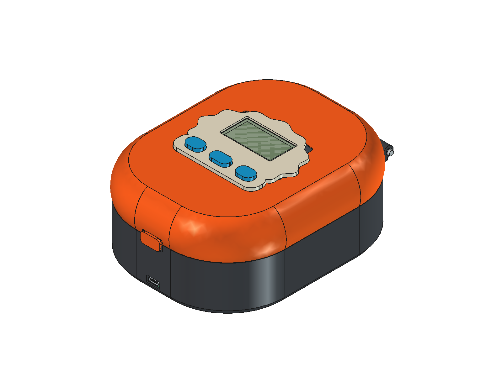
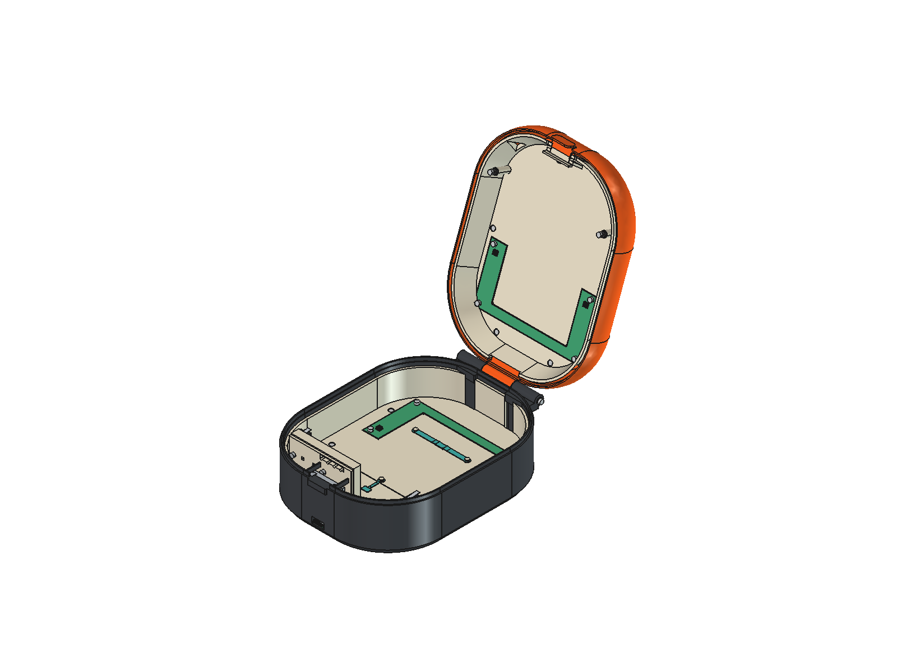

# FreeCAD dock revision 051 review

These views come from the isolated FreeCAD 1.1.4 VM rebuild with the recentered
four-contact carrier and current single-flange-board exterior. The [result](result.json)
identifies the saved native and exact input packet. The editable linked candidate
is available in the [FreeCAD review ZIP](DockAssembly-051-review.zip). Extract
the whole folder and open `DockAssembly.FCStd` beside its `pcb/` and
`sources/` folders. The archive binds the model, all six external documents,
the native geometry and loading reports, and both views. A relocated reopen
in FreeCAD 1.1.4 resolved all 14 external component links.

The sampled loading check passed. The static check found a single colliding
part pair, the installed LCD and lid UI assembly, at the saved closed position
and three modeled stack offsets. The [connector section and received-fit fixture](../vendor/lcd-socket-replacement/README.md)
show where the flex enters the socket. Bench measurements will establish the
actual contact plane, fit and powered display behavior.
