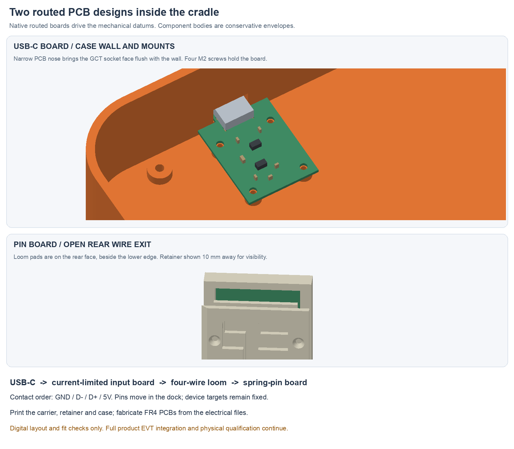
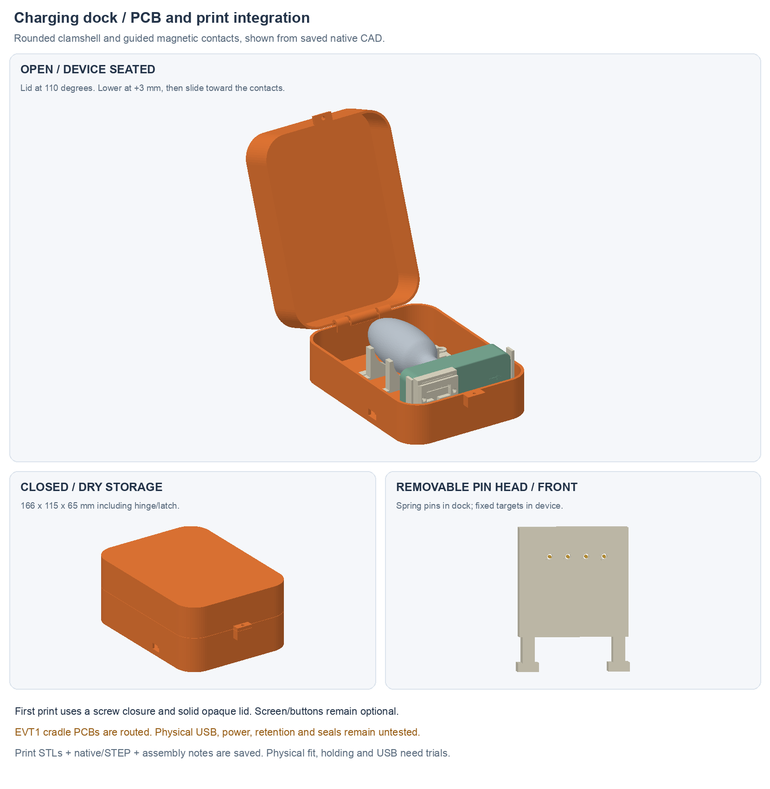
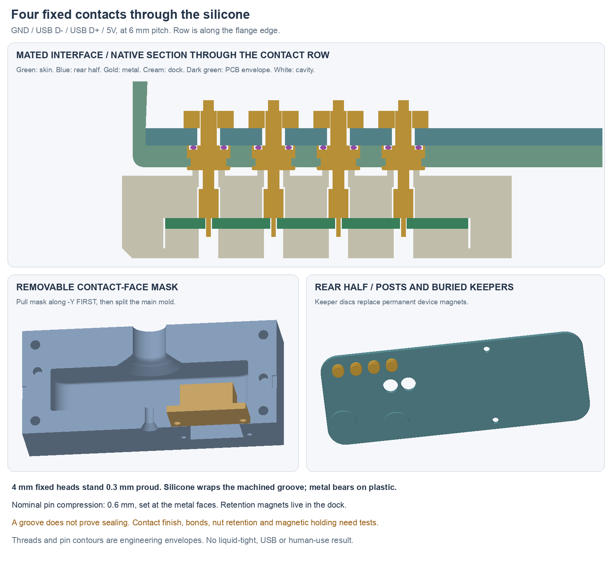

# Four-contact flange and clamshell dock

Editable dock/contact design with print STLs and two routed EVT1 cradle PCBs.
There is no physical powered charging/programming result; the complete product
now has five routed PCBs and a separate actual-board assembly checkpoint, but
still needs supplier pack approval, non-PCB parts, loom and final seals. The study combines the current metal outside, revised rear
plastic half, continuous silicone skin, fixed contact posts and a rounded
clamshell dock. The four main rigid product pieces remain unchanged in count.
The earlier manufacturing native and inert mold checkpoint are preserved.
Electrical sources, native ERC/DRC results and fabrication quote files live in
[`hardware/pcb/evt1`](../../../pcb/evt1/README.md). Do not substitute the old
R35F layout seeds for EVT1 fabrication sources.





## First dock print

Print one each of `DockBase.stl`, `DockLid.stl`, `DockNest.stl`,
`PogoCarrier.stl`, `PogoRetainer.stl`, `DockDeviceGauge.stl`, `PinPCBBlank.stl`,
`MagnetBackSpacer0.stl` and `MagnetBackSpacer1.stl`. These nine pieces make an
**unpowered fit kit**. The gauge is an expendable, solid representation of the
device outside; its printed contacts cannot conduct or qualify the metal posts.
`PinPCBBlank.stl` is a flat plastic spacer/drill template for dry pin fitting,
not a solderable or electrically functional board.

`ChargingDock.FCStd` contains editable construction, booleans and design-intent
notes. Matching `.step` files retain model coordinates: device interface parts
use the original product frame; dock parts/gauge use the translated dock frame.
STLs have deliberate
bed orientations and closed meshes; no slicer profile or physical print has
been produced. Inspect supports around hinge eyes, the nest's front guides,
the carrier's interior,
and beneath the gauge's rear flange/raised contact faces. Do not print the
silicone or metal STEP references as functional parts.
Copied profiles and design-intent notes are not all driving expressions;
change the geometric builder and regenerate, or revalidate any edited native.

The body shell is 155 × 115 × 65 mm; hinge and prototype latch extend its
overall length to **166 mm**. Base walls/floor are 2.5 mm nominal; lid walls
2 mm with a 2.5 mm roof. The lid is solid and opaque. The first prototype uses
a screw closure; a tactile latch and optional exterior screen/buttons remain
to develop. No UV hardware, optical window, lid interlock or UV qualification
is included.

| Trial hardware | Quantity / use |
| --- | --- |
| M3 × 60 bolt and M3 locknut | One each, hinge; inspect bore fit, axial play and full travel before tightening. |
| M3 × 10 screw | One, temporary front closure. |
| M3 × 8 screws | Six: four nest mounts and two carrier feet. Proposed plastic pilots need thread/torque trials. |
| M2 × 6 countersunk screws | Two, carrier rear retainer; verify actual head size against the counterbores. |
| Mill-Max 0906-2-15-20-75-14-11-0 | Four candidate spring pins, not purchased or received. |
| Pin PCB | One routed EVT1 28 × 10 × 1mm FR4 board; Ø0.6 pin holes. J94 lands are on its rear face at the lower edge. |
| USB-C PCB | One routed EVT1 board with a narrow nose, GCT USB4105 and protected power/data. Socket face flush at X−57.5; board bottom/top Z5.4/6.4. |
| M2 × 4 pan screws | Four USB-board mounts; pre-tap the Ø1.6 plastic pilots and qualify tightening/retention. |
| Ø8 × 3 mm dock magnets | Two, supermagnete S-08-03-N dimensional candidate. |
| Printed magnet spacers | Two initial 3.2 mm shims; measure actual magnets/pocket stack, trim or shim to seat them without crushing or leaving float. |

This is a trial list, not a product BOM change or an order. Screws, pilot holes,
shim fit, materials and loaded deflection are not qualified. Keep magnets
captured beneath the retainer during a trial; do not use catalog direct-contact
pull as installed holding force.

For a dry fit use the plastic spacer; for electrical assembly use the actual
1mm FR4 pin board. Solder/inspect the four rear J94 wires before closing its
retainer. The carrier/retainer window now clears those lands and the complete
raised pressure pad. Fit the USB-C board on its four bosses, then fit the nest.
Its PCB nose and socket pass through the enlarged wall window; do not replace
the PCB outline with a plain rectangle or recess the socket behind the wall.
Spring-pin load passes through the PCB and its support into the carrier/base.
Retainer reliefs clear the solder tails and provide a downward wire opening;
a 5 mm channel runs between the two magnet pockets. The left nest rail is
interrupted over the USB-board bay, while crossbars/right rail keep the nest
connected. Actual conductor size, bend/strain relief and flexible routing still
need a hands-on trial.
Fit the nest and hinge, then check the lid through its full travel with the
gauge seated. Use the flange rests to establish height; body saddles have a
conservative Ø38.8 clearance and need soft liners fitted to the measured gap.
No liner material/thickness or UV compatibility is selected.

**Loading:** open the lid, lower the device 3 mm away from its seated axial
position, then slide it 3 mm toward the contact head. The side guides engage
before the free pins. Slide away before lifting out. Do not scrape the spring
pins sideways. Finite CAD checks cover this specified path only; arbitrary
drop-in, tilt, deformation or damaged guides are not qualified.

## Device contact assembly



Moving spring pins stay in the dock. Four **fixed, rounded spool-head posts**
pass through the silicone and bear directly on the rear plastic half. Each
post is retained by an internal M2 nut before that half is closed and molded.
Silicone fills the post's circumferential groove; it is not credited as the
spring-force support or as a demonstrated liquid seal. A separate miniature
face-seal gland is now modeled under the metal bearing shoulder. It is a trial
barrier against the flat rigid rear half, with no physical sealing result.

Viewed toward the device rear face along +Y, the row follows increasing X
on 6 mm pitch, leaving space for a small retaining-nut driver:

| Net | Device X | Device Y face | Device Z | Connection requirement |
| --- | ---: | ---: | ---: | --- |
| GND | −38 | −26.8 | 11.5 | Charger/USB/device ground |
| USB D− | −32 | −26.8 | 11.5 | ESP32-C3 GPIO18 via reviewed protection/routing |
| USB D+ | −26 | −26.8 | 11.5 | ESP32-C3 GPIO19 via reviewed protection/routing |
| Protected 5V | −20 | −26.8 | 11.5 | Charger input / dock detection path |

Coordinates are mm in the product frame. The dock uses the **same physical
net coordinates**, translated +40Y/+32Z; do not mirror a connector diagram
by eye. D− and D+ are adjacent. All four pins have equal nominal heights;
no guaranteed ground-first sequence is claimed.

Post proposal: Ø4 head, 2.3 mm overall head height, R0.15 exposed edge,
0.3 mm proud of the flat silicone; Ø3.3 groove from 0.4 to 1.1 mm behind the
face; M2×0.4 shank for 3.2 mm behind the bearing face, then a Ø1 × 1 mm
termination tail. The 4 AF × 1.6 mm nut clamps the 1.6 mm cover. **STEP uses
a basic thread-root envelope, not helical teeth. Never machine that envelope
as a finished M2 thread.** Effective engagement, lead-ins/relief, fit, actual
nut dimensions, torque/locking, wire termination and pullout need qualification.
Install nuts with the rear half removed. A Ø6 mm /4.2AF axial-driver envelope
is checked against the cover and adjacent nuts' all-angle envelopes at24
poses; it is not a selected or torque-qualified purchased tool.
Contact stock, finish/plating and finished-contact suitability are unselected.
Catalog electronics-contact plating is not a finished body-contact approval.

The inner trial gland is ID2.10/OD3.60/depth0.38mm in the metal bearing face,
with an inspection candidate HANSA-FLEX OR2-0.5 NBR70 ring. The rear-half bore
is nowØ2.10, leaving0.05mm nominal radial clearance to an M2 major envelope.
Requested machining finish/flatness and incoming-ring budgets are in
`contact-seal-spec.json`. The installed elliptical ring is only a
volume-preserving space model. It does not establish sealing force, strain,
preload or compatibility. In particular, do not assume NBR is compatible with
any proposed platinum-cure casting system.

The [single-contact trial](contact-seal-trial/README.md) adds two printable
fixture pieces, an actual-post STEP and an unplated316L inert machining RFQ.
An open water column tests the feedthrough while the nut/tail remain visible
on the dry side. Printed faces only establish fit; representative counterface
finish, cure-inhibition coupons, leak/aging and complete-cavity trials follow.
This is separate from the external face mask and does not resolve button seals.

The reference PCB, tray, hold-downs and pack clear the nominal new assembly.
Actual routed boards, conductor keepouts, thread major diameters and flexible
loom still need integration. Fixture the four faces to the mask coordinates
while tightening the nuts; fit the contacts and keeper discs while the rear
half is accessible. Keep the current prewired-cap sequence, connect tails
before closing both flange halves, then mold together. EVT workshop battery
service consumes/remakes the skin before opening both rigid halves; trial the
removal process on an inert assembly. External Power/Mode recovery circuitry
exists, while physical button/seal/recovery qualification remains open.

## Stroke and magnetic retention

Four insulating **annular stop lands bear on the metal target faces**, setting
0.6 mm nominal compression. The surrounding silicone is recessed from this
axial datum. The candidate pin's free height is 5.0038 mm and stated maximum
travel 1.397 mm. Main body/tail shapes are conservative drawing envelopes,
not OEM CAD. The inspected manufacturer-authored May 2025
[pin data sheet](https://static6.arrow.com/aropdfconversion/adfa1bc04697174a4358693f99b5c90949307da3/0906-2-15-20-75-14-11-0.pdf)
has differing drawing/generic length tolerances; the arithmetic uses the larger
±0.1524 mm note. Its 60 gf spring entry is not a guaranteed maximum force or
an installed magnetic-holding result. Measure all four received pins.

Unqualified budgets of ±0.1524 pin length, ±0.15 carrier/PCB stack and ±0.05
target coplanarity give **0.2476–0.9524 mm** compression, below a conservatively
reduced 1.2446 mm travel. Assumed ±0.15 mm X/Z location and ±0.5° bank rotation
leave the full pin tip and stop lands on the proposed flat faces. These are
inspection targets, not printer capability or accepted received tolerances.

Permanent magnets are in the **dock only**. The device carries Ø8 × 1 steel
keepers under 0.4 mm plastic webs and about 1 mm silicone at X/Z−38.5/−8 and
−21/−10.5. Nominal magnet-to-keeper gap is **2.7 mm**. The
[magnet source](https://www.supermagnete.de/eng/data_sheet_S-08-03-N.pdf)
supplies dimensions/tolerances; its ideal pull does not establish attraction
through this stack. Test installed retention, rocking, all-pin contact,
removal and cable loads against measured spring forces. Steel keepers can
still distort heading; assembled magnetic/compass tests remain required.

## Contact-face mold mask

Additional print files: `FourContactRearHalf.stl`, `ContactMoldHalfA.stl`,
`ContactMoldHalfB.stl` and `ContactFaceMask.stl`. The mask accepts two proposed
M3×10 screws into tool pilots. Reuse the first inert mold's four M4×65
clamp bolts/eight washers/four nuts and two Ø4×10 alignment dowels.
The rear half's outward keeper bosses leave its plate above the bed in the
exported pose; support the plate and preserve the contact-bearing faces during
cleanup. Inspect the slicer before printing these secondary tool/interface parts.

The four face pockets have nominal zero axial shutoff at Y−26.8 and 0.05 mm
radial clearance to the Ø4 post envelope. The body of the removable mask has
0.05 mm nominal sliding clearance. These do not prove pressure sealing;
finish and dry-fit the actual faces before a material coupon or casting.

After cure, remove the mask screws and **withdraw the face mask along −Y
before opening the main tools**. Its slot runs to the Z=0 parting edge.
A blind rectangular window would leave a wall that catches the proud heads
as tool B moves +Z. Then remove main clamp bolts and separate A along −Z / B
along +Z, sliding off the dowels. The exposed-face shutoff is therefore a
third removable tool piece, not separately overmolded product halves.

Start with inert material/contact coupons. The revised rear half still has
open button holes: permanent button barriers and real closed-cavity seals
remain to design. Do not cast real electronics/battery with these parts.
Qualify metal/silicone bonds, capillary paths, backside encapsulation, contact
retention, cure/pressure/exotherm and repeated cleaning before a functional build.

## Electrical work before power

The two routed EVT1 cradle boards include a GCT USB4105 receptacle, independent
CC pull-downs, USBLC6 protection and TPS2553 current-limited 5V. Their actual
PCB outlines drive the case opening, mounts and rear wire reliefs. Establish
the computer's actual USB power budget and qualify contact shorts, dry/seated
handling and exposed-pin power behavior before connecting a finished device.
The data path connects to the device's native
[ESP32-C3 USB serial/JTAG](https://docs.espressif.com/projects/esp-idf/en/v5.5.3/esp32c3/api-guides/usb-serial-jtag-console.html),
with protection and pair routing reviewed across both boards and contacts.
Keep any dock controller off the data pair unless a proper hub topology is added.

Bench-test contact resistance/dropout, enumeration, transfer and flashing,
interrupted update, sleep/wake/recovery and hardware motor inhibition. The
four contacts do not expose reset/boot pins. EVT1's independent long-press Power
reset and Mode/BOOT chord provide a recovery circuit and firmware candidate;
the molded buttons and actual recovery sequence still require qualification.
Schematics, PCB routes and firmware builds are digital results; there is no
powered contact, charge or programming result.

## Checks and rebuild

`review.json` binds the source checkpoints, builder, native, exports and
independent verifier: 39 valid single solids/STEP readbacks and 13 closed print
STLs; 27 lid, 11 lowering, 9 sliding, 10 mask and 24 split-tool poses.
Checks also cover source-interface clearances, board keepouts, retaining-nut
driver access, nominal dock fit, specified lid/load/slide
paths, contact hard stops, mask withdrawal and split-tool opening. All motion
screens are finite rigid samples, not a continuous swept proof or physical fit.

```sh
/Applications/FreeCAD.app/Contents/Resources/bin/python tools/build_charging_dock.py hardware/cad/manufacturing-layout /private/tmp/compass-charging-dock
/Applications/FreeCAD.app/Contents/Resources/bin/python tools/verify_charging_dock.py /private/tmp/compass-charging-dock
python tools/render_charging_dock.py /private/tmp/compass-charging-dock /private/tmp/compass-dock-figures
```

The renderer needs NumPy/Pillow, matching existing project renderers. The
verifier uses PythonOCC in FreeCAD's runtime. `*-view.stl` are regenerable
render caches; section views are intentionally open planar profiles, not print
meshes. The editable main files remain separate from the source
manufacturing and first inert-trial natives. The human-owned product BOM is unchanged.
