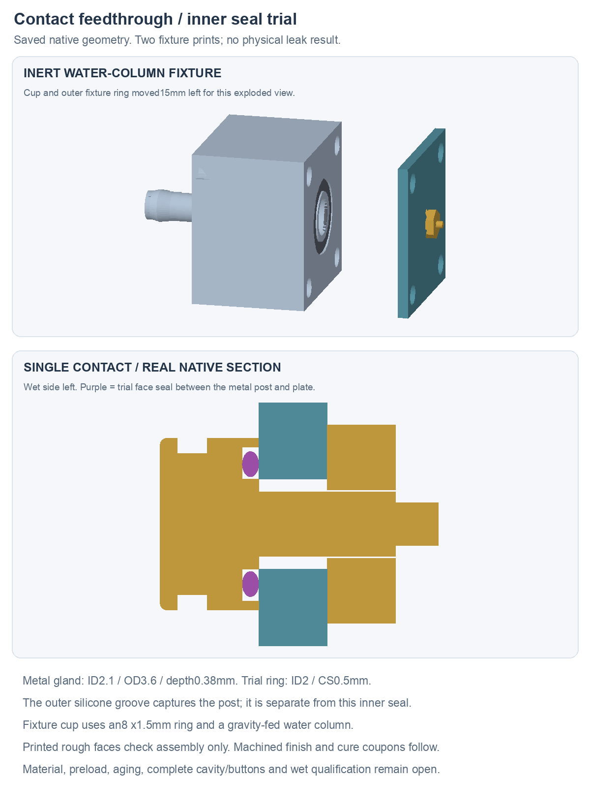

# Single-contact inner-seal trial

Two printable fixture pieces test the actual revised contact-post/inner-seal
geometry before a complete molding assembly. This is an **inert hydrostatic
screen**. There is no print, assembly, leak or cure result yet.

- `ContactSealTrial.FCStd`: editable assembly with the two fixtures, actual
  post/nut and installed seal-space references.
- `ContactSealCup.stl`, `ContactSealPlate.stl`: closed meshes already oriented
  on the bed. Files ending `-view.stl` are render caches.
- `ContactPost.step`: the revised metal-post reference in coupon coordinates;
  see `CONTACT-POST-INERT-RFQ.md` for machining callouts. The smooth thread-root
  cylinder is not a finished M2 thread.
- `review.json`: native/source/export hashes, STEP readbacks and nominal checks.

The source dock retains its four contacts on6mm pitch and unchanged face/stop
coordinates. Each post now has an ID2.1/OD3.6/depth0.38mm annular face gland
against the flat rigid plastic. Its outer silicone groove captures the head;
the inner ring is a separate proposed cavity barrier. The elliptical ring in
CAD preserves free-ring volume but does not predict strain, sealing force or
contact pressure. See `../contact-seal-spec.json` for requested finish,
incoming inspection budgets and compatibility limits.

## Trial hardware

| Part | Quantity / purpose |
| --- | --- |
| Revised machined contact post | 1; unplated316L for this inert mechanical/leak trial |
| M2×0.4 nut,4AF×1.6mm | 1; match the actual nut/driver before assembly |
| [HANSA-FLEX OR2-0.5](https://shop.hansa-flex.nl/en_GB/sealing-equipment/static-seals/o-rings/nbr-o-rings/or-2-0-5/p/OR2-0-5) | 1 inner trial ring,2mm ID/0.5mm CS,NBR70; order spares for inspection/coupons |
| [HANSA-FLEX OR8-1.5](https://shop.hansa-flex.de/en_GB/sealing-equipment/static-seals/o-rings/nbr-o-rings/or-8-1-5/p/OR8-1-5) | 1 outer fixture ring;8mm ID/1.5mm CS,NBR70 |
| M3×30 bolts / M3 nuts / M3 washers | 4/4/8 to close the fixture |
| Silicone tube4mm ID×6mm OD | About1.2m; water column on the integral printed nipple |
| Clean water, water-soluble dye, white witness paper, ruler | Observe leakage and record the head above the plate |

No parts have been ordered. The tiny inner ring's dimensional ranges in the
spec are proposed incoming acceptance limits, not a supplier agreement. Its
exact compound/cure system and casting compatibility need confirmation.

## Build and inspect

1. Slice the two fixture STLs and inspect the cup's internal roof, water passage,
   hose nipple and ring gland. Print a dry-fit set first. Check the central bore
   and M3 passages with the received parts. No slicer profile is supplied.
2. A rough printed plate only checks assembly. For a representative seal trial,
   machine the24×24×1.6mm plate in the proposed product counterface material
   with the local finish/flatness required in the contact-seal spec. A clear
   unfilled-PC coupon is an EVT test candidate; no product plastic is released.
   Do not use smoothing coatings without recording them as a changed interface.
3. Inspect the actual post, gland, finish and ring at magnification. Remove
   sharp edges without rounding the specified bearing/shutoff surfaces. Fit
   the ring without cutting it on the thread; no flux or lubricant belongs on
   a casting/bond coupon. If testing soldered tails, solder/clean/cool before
   fitting the ring.
4. Fit the post from the water side, hold its face in a soft fixture and seat
   its shoulder against the plate using the M2 nut. Record actual torque,
   seating and any plate distortion. This trial does not set a product torque
   or qualify nut locking. The gland controls nominal ring space when the hard
   bearing seats; do not leave the post floating on the gasket.
5. Fit the large outer fixture ring into the cup gland, then close cup/plate
   with the four M3 bolts and washers. Tighten evenly until their rigid faces
   seat, without bowing the thin plate. The contact nut and tail stay visible
   on the dry side. Inspect clamp and hose fit before adding water.

## Hydrostatic screen

Keep the cup above the horizontal plate, nipple pointing upward. Secure the
open-ended hose vertically; use water-column height, **no compressed air**.
Place dry white witness paper near the exposed contact bore/nut without
bridging around the plate edge. Mark water level relative to the plate.

Start at50mm head, then250mm for10minutes. If the fixture itself remains dry,
try1000mm for60minutes, about9.8kPa hydrostatic pressure. These are proposed
EVT screen settings, not an IP rating or a finished cleaning/wet profile.
Record head, temperature, elapsed time, torque, ring/post/plate lot and visible
dye. Distinguish a hose/cup-perimeter leak from dye emerging at the contact
bore; a leaking fixture invalidates the run. Drain before opening and inspect
both ring seats for cuts, trapped debris, set and distortion.

Repeat representative coupons with the actual product finish/plastic,
casting system and cleaning/thermal exposure. The NBR ring is not assumed
compatible with platinum-cure silicone; test inhibition and swelling before
using it near an overmold. The unplated316L post only tests this mechanical
interface; it does not select a usable USB contact finish. Four-post alignment,
strain relief, post retention, button/root/seam seals, full closed-cavity
molding and aging still require the complete assembly trial. No electronics
or battery belong in this fixture.

Rebuild with FreeCAD Python:`tools/build_contact_seal_trial.py`, then
`tools/verify_contact_seal_trial.py`. Render using
`tools/render_contact_seal_trial.py` in the NumPy/Pillow environment.
