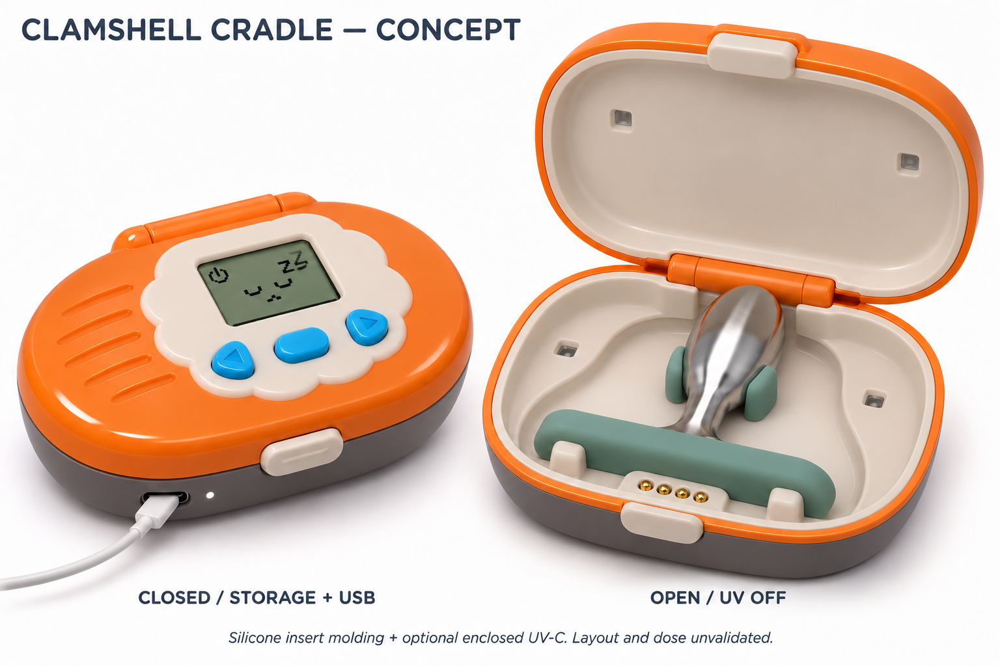
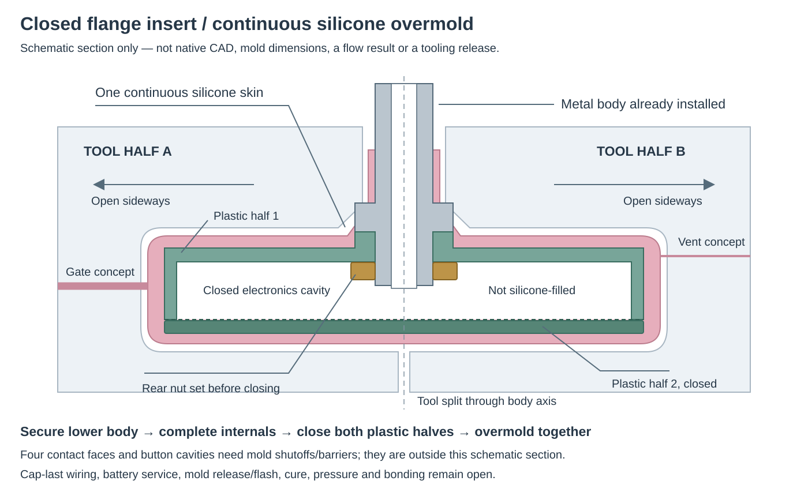
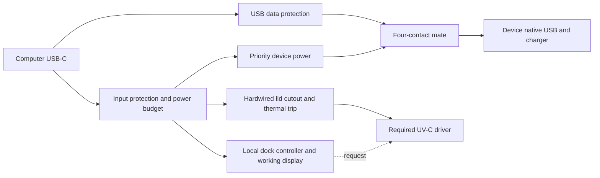

# Continuous flange overmold and clamshell cradle

Discussion concept, not routed electronics, a validated UV device or a tooling
release. The main manufacturing native still contains only the root cuff;
separate [inert skin/split-tool CAD](../../overmold-trial/README.md) now supplies
three print STLs for external fill/demold trials. A newer separate
[dock/interface prototype](../../charging-dock/README.md) adds four fixed
posts, a removable face mask and clamshell CAD. Contact bonds, button tooling
and real cavity seals remain open. The illustration is concept art, not a geometry check.

## Flange assembly and mold

The **two rigid plastic flange halves close before overmolding**. Install and
secure the lower metal body to the first half with the rear nut, complete the
internal assembly, close the second plastic half, then mold one continuous
silicone skin over the assembled flange and metal root. The plastic seam and
closure screws lie beneath that skin. There is no separately overmolded rear
service lid in this concept. The four main rigid product pieces remain body,
cap and the two plastic flange halves.

| Tool feature | Proposed function |
| --- | --- |
| Two matched mold halves | Initial candidate splits through the metal-body axis and opens sideways around the installed body; locate the closed rigid insert without squeezing the thin metal neck. |
| Supported metal-root datum and thread masks | Locate/protect the installed body; keep silicone away from nose threads, bores and cap sealing faces. |
| Four contact-face shutoffs | Hold the feedthrough inserts while leaving their conductive faces exposed. The wired contacts belong in the closed assembly before molding. |
| Parting line, gate and high-point vents | Fill around the closed insert and vent the neck/root and thin button regions. The lateral split crosses the skin; place and finish the seam for a smooth contact surface. |
| Button barriers and integral skin membranes | Prevent uncured silicone flooding the switches/inside cavity; preserve measured button travel with no separate plungers. |
| External retention features and prepared metal land | Anchor the silicone to the plastic and root; mechanical keys alone do not establish a watertight bond. Mold the tailbone/back arrow into the skin. |

Do not trap a closed tooling ring around the Ø15 neck behind the larger metal
body. A perimeter-parting tool would need a removable split neck insert or an
equivalent demonstrated release path. The lateral split above is a tooling
proposal. The separate inert tool has passed finite nominal opening-pose
checks against the insert, skin and full source metal; no physical release
result or continuous swept proof exists.

Start tooling trials with a dummy closed flange and instrumented battery/board
surrogates. A low-temperature addition-cure casting/injection process is a
prototype candidate; cure temperature, exotherm, pressure, cure inhibition and
bonding must be qualified before molding real electronics or a battery.
Production LSR processing is a separate supplier decision: it uses heated tools.
[Elkem process overview](https://www.elkem.com/products/silicones/liquid-silicone-rubber),
[printed-tool options](https://formlabs.com/white-papers/silicone-part-production-with-3d-printed-tools/)
and [Smooth-On inhibition guidance](https://www.smooth-on.com/support/faq/210/)
are process references, not finished-contact-material approvals.

Two assembly interfaces remain open. The desired cap-last operation needs a
wiring join/process that works with a closed flange: the current rotating cap
module requires its flange tails connected after threading. Completing that
module while the flange is still open is the existing compatible sequence;
cap installation after molding is not yet demonstrated. Also, the reference
33×8×20 mm pack cannot pass through the Ø12 neck. Continuous overmolding makes
battery service unresolved; do not claim rear-cover access or user replacement.
Resolve the nut lock before molding makes the joint harder to inspect.

## Pocket-toy clamshell

Use the rounded hinged Pocket Neopet visual language: a tactile latch,
contrasting scalloped cream bezel, a working status display and three blue buttons. The dock is a
protected home for the washed, dry device and a USB programming/charging adapter.
An exterior display is isolated from the chamber by an opaque inner lid.
Its initial functions are local power/lid/fault states, not inferred battery
state-of-charge or invented firmware-update progress.

The current device spans about122.6 mm axially, with an88×32 mm rigid flange
and aboutØ37.3 mm maximum metal diameter. The silicone flange target is about
90×38 mm. Start the case discussion near **155×115×65 mm closed**, then derive
the actual envelope from the finished overmold, nesting, hinge sweep and optics.
This is a rough allowance, not a fit result or a literal keychain-toy size.

An asymmetric flange saddle locates the four-contact interface and reacts pogo
force into the rigid plastic behind it. Use separate magnetic retention and
hard stops so a reversed placement cannot bridge power/data pads. A removable,
wipe-clean open nest protects the metal on a few pads; it must not bury the
device in foam. Store dry; a closed case is not a drying process.

## USB and dock electronics

The computer's USB D+/D− pair runs through protection and the four-contact mate
to the device's ESP32-C3 native USB. 5V/GND supply the protected charger/power
path. Keep dock control local and off the USB data pair initially; it does not
enumerate as a second USB peripheral. If a separate dock USB endpoint is later
required, redesign the USB topology with a suitable hub rather than paralleling
two devices onto D+/D−.

USB/charging is the default mode. Available current must be established from
the actual source and USB configuration/negotiation; UV gets only an explicitly
qualified remaining budget. Concurrent UV and flashing is not promised. Preserve
device motor inhibition on dock power. Dock wake from software-off/deep sleep
and recovery from broken firmware remain hardware/firmware work: unplugging
USB does not reset a battery-powered MCU. Internal boot/reset access is a factory
recovery route, not a user-access claim after overmolding.
[Espressif native USB reference](https://docs.espressif.com/projects/esp-idf/en/v5.5.3/esp32c3/api-guides/usb-serial-jtag-console.html).

## Required EVT UV-C hardware and validation

Investigate **UV-C for surface disinfection**; a generic UV LED or UVB label is
not a wavelength/output specification. Do not call the case a sterilizer.
CDC notes that UV effectiveness depends on organism, soil, wavelength and
intensity; shaded surfaces are a particular limitation.
[CDC UV overview](https://www.cdc.gov/infection-control/hcp/disinfection-sterilization/miscellaneous-inactivating-ingredients.html),
[shadowing/material limits](https://www.cdc.gov/MMWR/preview/mmwrhtml/su6101a1.htm).

Reserve emitter sites in lid and base, with sparse supports and a cleanable
UV-compatible interior. Reflections do not establish dose at contact patches,
under the flange, in seams or behind the charging saddle. Validate the minimum
delivered dose and microbial reduction over intended surfaces with actual
materials, soil/cleaning conditions, LED aging and temperature. The current native
assembly revision selects component geometry and develops the power/interlock
circuit separately; no validated timer duration or efficacy claim exists. Washing remains
necessary; UV does not remove soil.
[CDC cleaning guidance](https://www.cdc.gov/infection-control/hcp/environmental-control/environmental-services.html).

The concept requires an opaque, leakage-tested chamber, a lid-actuated hardware
power cut independent of firmware, separate lid/latch monitoring, thermal
shutdown and a deliberate restart after interruption. All emitters are off
when open. Test seams, hinge, ports and any vent paths for leakage; a visible
status window must not look into the chamber. UV can injure eyes/skin. Qualify
repeated exposure of the silicone, seals, adhesives, contact surrounds and case plastics.
[FDA exposure guidance](https://www.fda.gov/radiation-emitting-products/tanning/ultraviolet-uv-radiation).

Next work: print/dry-fit/cast the inert tool, design real contact/button masks
and cavity seals, then develop actual dock nest/contact alignment. Cap wiring,
battery service and the molding process remain open. The current CAD/BOM is not released.

## Illustration provenance

Made with the built-in image-generation tool using the current CAD review image
for device proportions and a [Pocket Neopet photograph](https://www.ebay.com/itm/394660376468)
for style. Exterior controls, color and optical layout are proposals. The source
photograph is not redistributed in the repository. Exact prompts:
[`image-prompt.txt`](image-prompt.txt) and [`image-edit-prompt.txt`](image-edit-prompt.txt).
`concept.json` records the reference native hash and final illustration hash.
