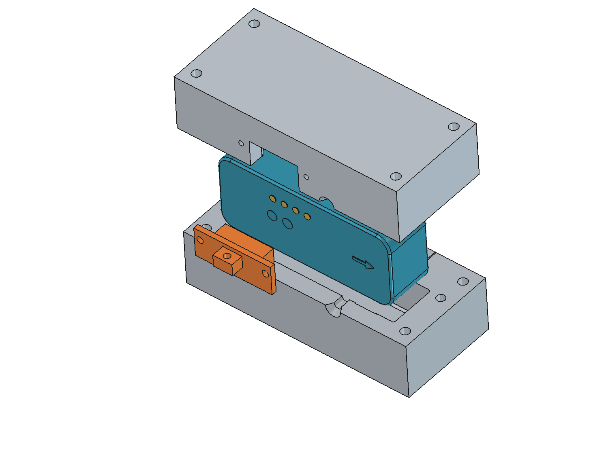

# Small rear insert mold candidate

Open [SingleFlangeMoldReview.FCStd](SingleFlangeMoldReview.FCStd) in FreeCAD.
The native contains the original closed flange references, editable cavity
and tool cuts, two mold halves, and the removable orange contact insert.
The cavity uses the saved skin exterior, including the two button crowns
and arrow. The split stays at Z=0. The insert window reaches the split so
the upper half can pass the four target heads during removal.

1. Fit the inert closed flange and root into the two halves. The tool's rear
   face stops the insert. The four face pads sit against the target faces.
   Confirm the received face heights, actual insert registration and dry
   closure before deciding how to handle tolerance and contact force.
2. Inspect the four vent outlets and the split-line fill entry. The gate
   is at X20 mm so it clears the rear insert. The modeled skin, runner and
   vents form a connected volume of 23.22 mL before process losses.
3. After cure, remove the insert fasteners and pull straight along −Y.
   Withdraw at least 8 mm to take the face pads beyond the rear tool plane.
   Then open the mold halves along −Z and +Z.

[The saved geometry check](review.json) records 37 insert positions and 42
side-opening positions, with zero rigid overlap at those positions. The
[independent FreeCAD reopen](cold-readback.json) verifies all three tool
solids and their STEP exports, and shows full nominal pad coverage on all
four contacts. With the targets installed, the [insert pocket check](clearance-pocket.json)
places the rear-entry clearance 1 mm from the skin in nominal CAD. The
exports are [lower half](MoldHalfA.step),
[upper half](MoldHalfB.step) and [rear insert](RearContactInsert.step).
Use these for an inert tooling review. Select print material and finish,
qualify the tool-side fastener engagement, confirm mask stop and neck
registration, and measure flash, fill, cavity leakage and cure before
casting over the populated device.
