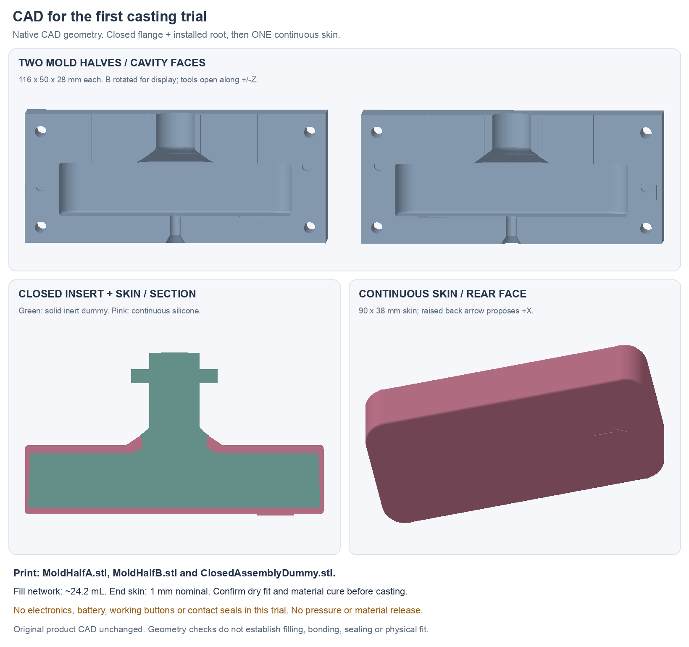

# Closed-flange overmold trial

**First unpowered casting trial, ready for slicer and dry-fit review.** The
native CAD and exports represent the outside of the already-closed flange
and installed lower metal body. Mold one continuous silicone skin around it.
No product parts or the four-piece product architecture are replaced.



The expendable **solid dummy** substitutes for the closed assembly in this
trial only. It has no electronics, battery, threads, contact inserts or working
buttons. It can establish external fill, surface finish, flash and demolding;
it cannot establish real cavity sealing, root adhesion, joint strength, thermal
exposure inside the product or a working device. Do not mold real electronics
using this tool version.

## Files and supplies

| Item | Quantity / use |
| --- | --- |
| `OvermoldTrial.FCStd` | Editable construction/native booleans, references and `TrialIntent` notes; default view shows mold A. Toggle trial parts to inspect the rest. |
| `MoldHalfA.stl`, `MoldHalfB.stl` | Print one each, 116 × 50 × 28 mm per half. Exported with the flat outside on the bed and cavity upward. |
| `ClosedAssemblyDummy.stl` | Print one per expendable casting, about 88 × 32 × 46.5 mm. Closed rear face on bed; support the two projecting locator-bar ends. |
| Matching `.step` files | Assembly coordinates for all three trial pieces plus `TrialContinuousSkin.step`. The skin is a casting reference, not a rigid print. |
| M4 × 65 through bolts / M4 nuts | Four of each, trial mold clamps only. |
| M4 flat washers | Eight, one beneath each bolt head and nut; verify actual stack and thread engagement. |
| Ø4 × 10 mm removable straight dowels | Two; nominal Ø4.2 pockets, 11 mm total depth. Tool halves slide along them when opening. |
| Tool/dummy material, silicone and preparation materials | Select a compatible combination and perform a small cure/release coupon first. No formulation, coating or finished-contact material is selected. |

Hardware above is a trial-tool list, not an update to the human-owned product
BOM. No parts have been ordered. Print STLs are closed meshes; no slicer project
or physical print exists yet. `*-view.stl` files are regenerable render caches.

## Dry assembly

1. Inspect and finish the cavity faces without changing their nominal dimensions.
   The vents are only 0.6 mm wide × 0.3 mm total deep, split 0.15 mm per half.
   Select a layer height that preserves that depth and verify each channel is
   open after printing/finishing. Finishing/coatings can close the vents or
   change the neck fit.
2. Fit the two dowels without force. Check the halves meet at Z=0 without rocking
   and the four Ø4.5 clamp bores align. The asymmetric dowel positions distinguish
   the correct assembly. The bolts clamp the tool; the dowels align it.
3. Place the inert dummy in A. Its temporary locator bar sits on the tool's
   upper end at Y13. Close B sideways around the installed root. The root contour
   and external locator establish the nominal position. The bar is a dummy-only
   fixture feature, not a new metal-product feature.
4. Fit the four bolts, washers and nuts; bring the faces together lightly and
   evenly. There is no qualified tightening torque, clamp force or pressure
   rating. Confirm the locator is seated and the tool closes without forcing
   or compressing the root. Resolve any print/finish mismatch before casting.

The neck shutoff has **zero nominal clearance**, rather than an invented
printer compensation. Actual fit and flash require measurement. The minimum
nominal silicone beyond the 88 mm flange ends is **1 mm**; inspect those ends
closely for incomplete fill or damage. The 90 × 38 mm outside is the existing
packaging target, not a comfort result.

## First cast and inspection

1. Qualify cure/release on coupons made with the exact tool, dummy, coating,
   release and silicone combination. Follow that silicone manufacturer's mixing,
   handling and cure directions. Printed-resin cure inhibition is material and
   preparation dependent; these references are process guidance, not a material
   selection: [Formlabs printed silicone tooling](https://formlabs.com/white-papers/silicone-part-production-with-3d-printed-tools/)
   and [Smooth-On inhibition guidance](https://www.smooth-on.com/support/faq/210/).
2. Hold the assembly with **+Y upward**: the neck and four vent outlets at the
   top, fill entry at the bottom. Feed through the Ø4 runner using a compatible
   hand-fill setup; the funnel is not a specified syringe/nozzle coupling.
   Stop if filling meets resistance or the tool separates. No pressurized or
   heated production process is qualified.
3. Nominal connected skin/runner/vent volume is **24.18 mL**, of which the skin
   is **23.98 mL**. Allow separate mixing/transfer/purge losses. This is volume,
   not mass, a mixing ratio or a flow prediction. Record delivered volume,
   fill time, vent emergence, leakage and cure behavior.
4. After the material-specific cure, remove the bolts. Open A along −Z and B
   along +Z, sliding straight off the dowels; retrieve the loose dowels after
   separation. The
   split passes through the metal-body axis; no closed tooling ring is trapped
   behind the larger body. Do not pull the part axially through a closed tool.
5. Photograph before trimming. Inspect all four vent ends, flange ends, root,
   arrow and the full parting seam. Record voids, tack/inhibition, tears, flash
   and demolding damage. On a sacrificial casting, section both narrow ends and
   the root to measure actual skin coverage. Keep the material/process record
   with the specimen; no physical result is recorded yet.

The raised back arrow proposes **+X** as the flange manufacturing reference.
The sensor-to-flange transform remains to implement. The arrow adds 0.35 mm at
the rear face; the flat skin spans Y−26.5..−6 and its cuff ends at Y−3.

## Before a functional assembly

Replace the solid dummy with a demonstrated, sealed **two-half** assembly only
after designing the four contact feedthrough/shutoff inserts, permanent button
barriers/membranes and real cavity seals. Develop bond preparation/retention
features and repeat on actual materials. Establish cure/exotherm/pressure limits
using instrumented internal surrogates before any battery or powered electronics.
Qualify the rear nut lock before burying it. Battery service and post-mold
recovery access remain unresolved. Use the current cap sequence: thread its
prewired module with flange tails free, join them while the flange is open,
then close and mold. Cap-after-molding is not demonstrated.

## Rebuild and evidence

Run from the repository with FreeCAD's Python; the scripts currently use the
installed macOS FreeCAD library path:

```sh
/Applications/FreeCAD.app/Contents/Resources/bin/python tools/build_overmold_trial.py hardware/cad/manufacturing-layout /private/tmp/compass-overmold-trial
/Applications/FreeCAD.app/Contents/Resources/bin/python tools/verify_overmold_trial.py /private/tmp/compass-overmold-trial
python tools/render_overmold_trial.py /private/tmp/compass-overmold-trial /private/tmp/overmold-trial.png
```

The renderer uses the same NumPy/Pillow dependencies as the existing CAD
renderer. `review.json` binds the native, source, builder, verifier and exports.
Four valid single solids, STEP readbacks and closed print meshes passed.
The skin, gate and four vents form one connected network. Both tools clear the
dummy, continuous skin and full source metal body/cap at **22 total sampled
translations**. These are finite rigid checks, not a continuous swept proof,
flow simulation, print fit, pressure rating or physical casting result. The
original product native is unchanged.
