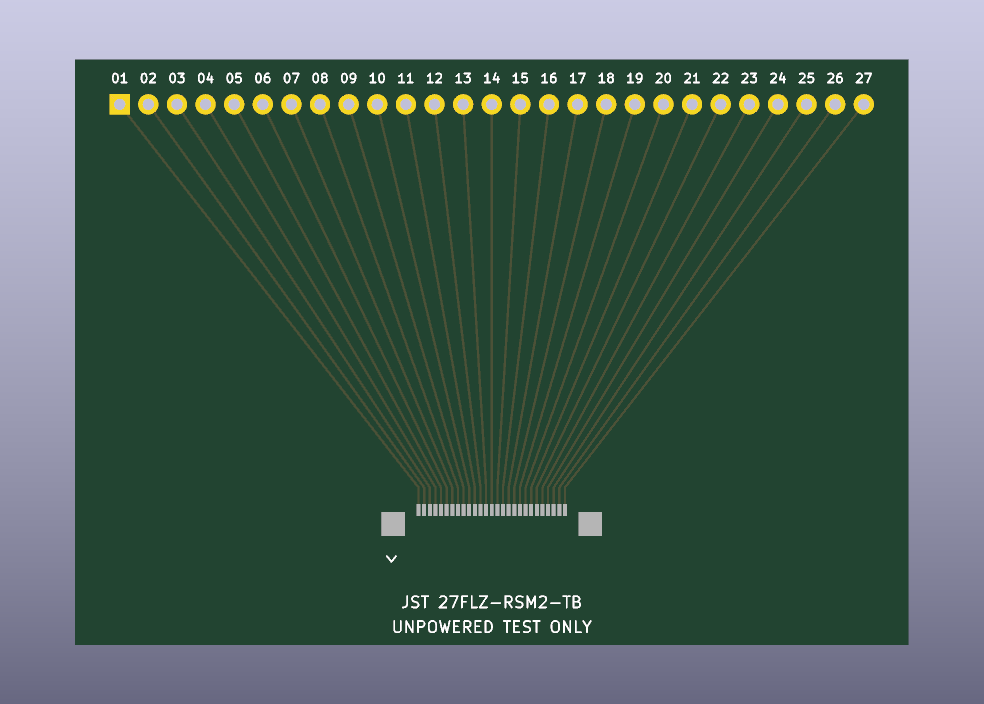

# JST 27-way continuity breakout

This passive bench board brings each JST **27FLZ-RSM2-TB** contact out to its
own numbered 1.8 mm plated test pad. The 27 holes are 1.0 mm at 2.54 mm pitch.
Leave them open for probes or use a 2.54 mm through-hole header. The two
socket hold-down pads are floating. The breakout uses the routed lid's exact
J302 solder lands and bottom-contact orientation.

Request three bare boards using [Gerbers and plated drill](JST27-continuity-fab.zip),
74 × 52 × 1.0 mm, two-layer FR-4, 35 µm nominal copper, ENIG, solder mask both
sides and top silkscreen. Confirm the 0.15 mm spacing between connector pads,
mask registration and 1.0 mm finished plated holes with the fab. The ZIP
includes front paste for stencil work. For the first bench set, populate one
socket on each of two boards and keep the third bare as a spare.

Use a separate 27-way passive test tail with its lane-1 edge independently
marked under magnification. The bench cable candidate is **Molex 0150200966**,
27 contacts at 0.50 mm pitch, 51 mm, opposite-side contacts. Measure its two
mating ends before use. The Molex family thickness tolerance is wider than
the JST connector's. Verify received width, insertion, overlap and end
thickness against the JST limits. Use the test cable to check socket
numbering and wiring only. Use the actual Newhaven flex to measure loaded
height in the separate dock fixture.
[Molex cable](https://www.molex.com/en-us/products/part-detail/150200966) ·
[Molex family dimensions](https://www.molex.com/content/dam/molex/molex-dot-com/products/automated/en-us/productspecificationpdf/150/15020/PS-15020-001-001.pdf?inline=) ·
[JST limits](https://www.jst.com/wp-content/uploads/2025/06/eFLZ.pdf)

1. Inspect solder joints and check the unpowered boards for adjacent shorts.
2. Mate the passive cable to both breakouts. With the opposite-side cable,
   arrange the boards to face opposite directions as needed to seat the
   contacts without a twist. Mark which end and side each board sees.
3. Trace each end's marked lane to the nearest socket pad under magnification.
   Compare the predicted orientation with the measured map across all 27
   pairs. Record the two possible end-to-end numbering orders from the actual
   orientation. Use direct pad-to-exposed-tail probing if one end's orientation
   is ambiguous. Check isolation between all neighbors and between pins 13 and
   23, which share a supply net on the lid PCB.
4. With the received numbering established, check the actual LCD and the lid
   PCB using the [received-fit procedure](../../../../cad/evt1-assembly/vendor/lcd-socket-replacement/README.md).

The [native board](JST27-continuity.kicad_pcb) and project open in KiCad.
[KiCad 10.0.8 DRC](drc.json) reports zero violations, unconnected items and
ignored checks. [IPC-D-356](JST27-continuity.d356) and the
[source and fabrication audit](review.json) verify 27 separate two-endpoint
nets, the exact 29 J302 lands and 27 plated drill hits. Physical fit and
continuity still require received sockets and cables.
