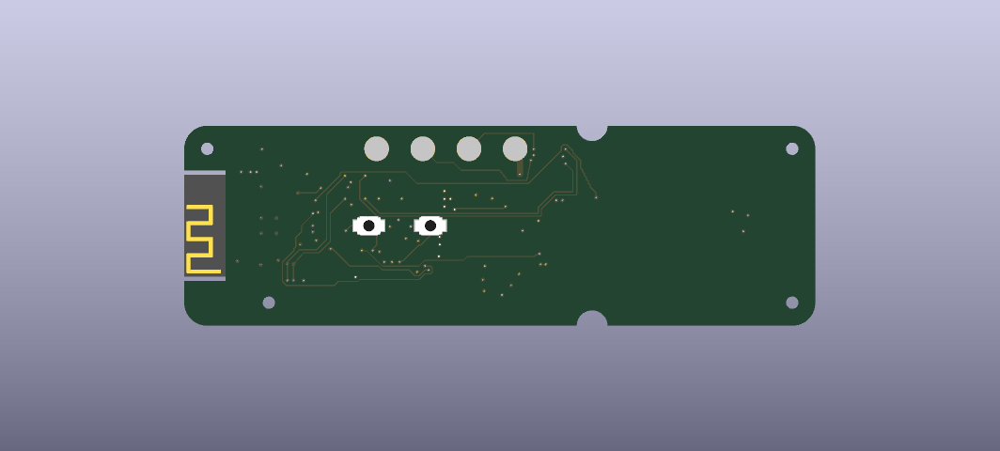
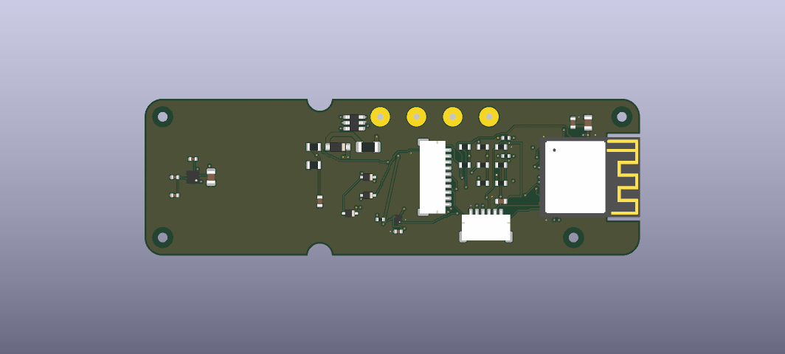

# Single flange EVT1 PCB assembly quote

Request three boards total. SMT-populate two and keep one unpopulated for
receiving measurements and inert flange fit. For a turnkey quote, send the
[assembly quote ZIP](single-flange-evt1-assembly-quote.zip). It contains the
same drill and Gerber package as the standalone
[fabrication ZIP](single-flange-evt1-fabrication-quote.zip). If using separate
shops, quote fabrication of all three from the fabrication ZIP and supply two
of the received boards to the assembly shop for SMT. This is the routed single
flange PCB used with the retained body PCB.

The board is 1.00 mm finished thickness with four copper layers and ENIG.
Quote the explicit copper/dielectric stack in `fabrication-request.json`.
Preserve In1 as the ground reference, the open antenna notch and all-layer
copper keepout. Review the requested stack, controlled impedance capability,
0.15 mm trace/clearance, 0.20 mm vias, 1.020 mm plated target holes in the drill
file and 1.60 mm unplated mounting holes before accepting a quote.

For **CT1–CT4**, the Ø1.020 mm Excellon callout records the nominal artwork.
Mill-Max lists a Ø0.030 ±0.002 in solder tail and recommends that the minimum
finished hole be 0.004 in larger than the tail. At the generic maximum tail,
that suggests a **Ø0.9144 mm minimum finished hole after plating**. The 1.020 mm
artwork leaves 0.1056 mm nominal diameter margin above that screen. The four
Ø3.20 mm lands and their centers are retained, giving 1.09 mm nominal radial
annulus before fabrication tolerances. [Mill-Max 1946 data sheet, pp. 1–2](https://static6.arrow.com/aropdfconversion/90d71f3ebe495227f21cda68abc0144cdb9cadae/1946-0-00-15-00-00-03-0.pdf)

Before releasing even the bare boards to fabrication, return the proposed
CT1–CT4 tool diameter, plating compensation, guaranteed finished-hole minimum
and maximum, and remaining annular ring. Compare that minimum with the
manufacturer's worst-case tail screen or a confirmed tighter tail limit for the
ordered lot. Flag any required change for review before CAM. On receipt,
verify the finished holes on the bare board and dry-seat the exact targets
on their shoulders before soldering.

Use `single-flange-smt-parts.csv` and `single-flange-smt-positions.csv` together
for the 35 SMT placements. Two switches populate the front. Thirty-three
components populate the back. The KiCad position files use mm and the same
absolute origin as the Gerbers and drills. Preserve the exported side and
rotation. Reconcile orientation to the native Fab drawings and component
markings before programming placement. D1's cathode stripe goes at the
native cathode bar and pad 2. U6 and U81 require package orientation and
stencil review. Quote C83 as TDK **C2012X5R1E226M125AC**, 22 µF, X5R, 25 V.
The KiCad value still carries a 10 V design label. Use the exact MPN for
procurement. Check for at least 10 µF effective at 3.3 V over the intended
temperature and aging conditions. TDK's typical bias plot is a screening
reference for this check. [TDK part specification](https://product.tdk.com/en/search/capacitor/ceramic/mlcc/info?part_no=C2012X5R1E226M125AC) · [TDK bias plot](https://product.tdk.com/en/system/files/dam/doc/product/capacitor/ceramic/mlcc/charasheet/c2012x5r1e226m125ac_20190710.pdf)

Purchase Mill-Max **1946-0-00-15-00-00-03-0** fixed targets separately.
Allow eight for the two populated boards, four more if the inert board will
carry targets, and two loose spares for the first article. That is ten for
the two populated boards plus spares, or fourteen when also fitting the inert
board. [DigiKey Canada ED1360-ND](https://www.digikey.ca/en/products/detail/mill-max-manufacturing-corp/1946-0-00-15-00-00-03-0/5176096)

See `single-flange-manual-targets.csv` for CT1–CT4, their exact nets and
installed order. Leave the plated contact holes empty through SMT assembly.
After the receiving checks, fixture and bench solder the targets with their
shoulders seated against the front lands and a square face plane. Inspect shoulder seating,
stand-off, solder fill and fit to the dry-side reaction posts before loading
the board. The intended contact load travels from the shoulder through the
laminate to the rigid posts. Verify that path on inert parts. MH1–MH4 are
unplated mounting holes. Order mating housings and cable parts separately.

The manifest binds the saved PCB, project, component selection, native pad
and schematic audits and every delivered file. The export rechecks all 163
electrical pad instances against fresh IPC-D-356, all 155 logical terminals
against the schematic netlist, and all 43 native positions against the PCB.
KiCad 10.0.8 DRC and full-context ERC run at export. Supplier acceptance,
USB performance, fit, contact sealing and powered commissioning remain open.
